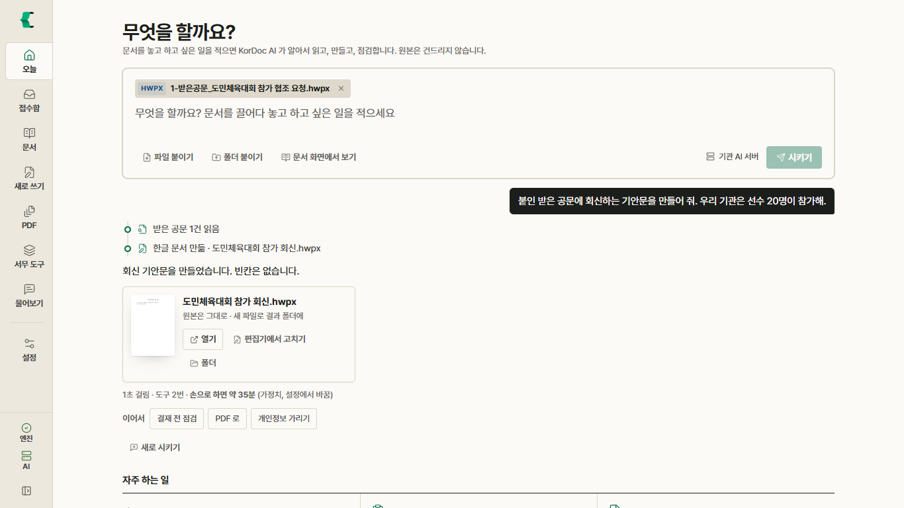
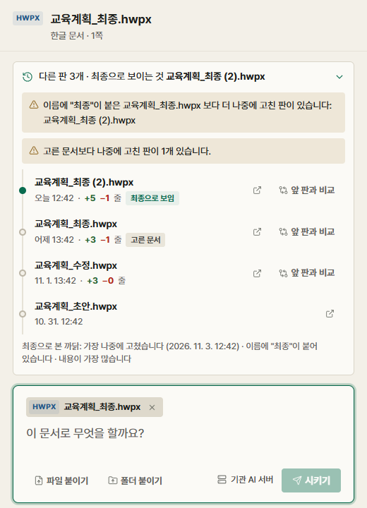

# KorDoc AI

**한글 문서를 AI 에게 맡기는 공공 문서 도구.** 문서가 있는 자리에서 말 한마디로 읽고, 만들고, 점검합니다.

- 받은 공문을 놓고 "회신 기안문 만들어 줘" 하면 기관 서식의 한글 파일(HWPX)이 나옵니다.
- 탐색기에서 문서를 우클릭해 "KorDoc AI 에게 맡기기…"를 누르면 그 자리에서 일을 시킵니다.
- "최종_진짜최종_수정 (2)" 사이에서 진짜 최종본을 찾아 줍니다(AI 없이).
- 문서 엔진·한글 편집기·AI 가 이 PC 안에서 돌아 인터넷이 막힌 업무망에서도 씁니다. 원본은 고치지 않고 결과는 늘 새 파일입니다.

> 2026 공공 AI 대전환 챌린지 세션1(자유주제) 출품작 · 서울특별시 광진구 · MIT 라이선스

| 받는 곳 | |
| --- | --- |
| 설치 파일(Windows·macOS) | [GitHub 최신 릴리스](https://github.com/chrisryugj/kordoc-ai/releases/latest) · 공공 GitLab 프로젝트의 릴리스 |
| 소스 | GitHub [chrisryugj/kordoc-ai](https://github.com/chrisryugj/kordoc-ai) · 공공 GitLab `chrisryugj/kordoc-ai` |
| 문서 엔진 | [kordoc](https://github.com/chrisryugj/kordoc) (같은 개발자, MIT) |



---

## 처음 쓰는 분: 5분 따라 하기

컴퓨터를 잘 몰라도 아래 순서대로 누르면 됩니다. 화면에 보이는 글자 그대로 적었습니다.

1. **설치**: 받는 곳에서 `KorDoc AI_2.2.0_x64-setup.exe` 를 받아 두 번 누릅니다. 관리자 권한은 필요 없습니다.
   "Windows의 PC 보호" 창이 뜨면 **추가 정보 → 실행**을 누릅니다(코드 서명 전이라 한 번만 묻습니다).
2. **첫 실행**: "처음 오셨네요" 창에서 기관명을 적고 **다음**. AI 는 **AI 없이 시작**을 골라도 됩니다(나중에 켭니다). **저장하고 시작**.
3. **예제로 해 보기**: 홈 아래쪽 "예제로 해 보기"에서 **해 보기**를 누릅니다. 예제는 모두 가상의 가온시 문서입니다.

   | 예제 | 누르면 | AI |
   | --- | --- | --- |
   | ① 받은 공문에 회신하기 | 회신 초안 → 한글 편집기 → PDF·HWP 저장 | 필요 |
   | ② 부서 제출 양식 취합하기 | 다섯 부서 수요조사서 → 엑셀 한 장, 안 낸 부서 | 없어도 됨 |
   | ③ 공개 전 개인정보 가리기 | 주민번호·연락처·계좌를 서식 그대로 가림, 남은 것 다시 검사 | 없어도 됨 |
   | ④ 긴 보고서 요약·질문하기 | 한 장 요약, 근거 문장 번호가 달린 답 | 필요 |
   | ⑤ 진짜 최종본 찾기 | 초안·수정·최종·최종 (2) 가운데 가장 나중에 고친 판, 앞 판과 비교 | 없어도 됨 |

4. **AI 켜기**: 홈 맨 위 "무엇을 할까요?" 아래에 AI 켜기 패널이 있습니다. 셋 가운데 하나를 누릅니다.
   - **이 PC 의 AI 쓰기**: Ollama 등이 켜져 있으면 바로 켜집니다.
   - **내장 AI 받기 (Gemma 3 4B)**: 2.3GB 를 한 번 받으면 인터넷 없이 씁니다(메모리 8GB 이상).
   - **인터넷 AI 키 넣기**: Gemini·Claude 키. 보내기 전에 개인정보를 가립니다.
5. **말로 시키기**: 홈 입력창 위에 문서를 끌어다 놓고 하고 싶은 일을 적은 뒤 **시키기**. 진행 단계와 만든 파일이 그 자리에 보이고, "이어서"의 **결재 전 점검·PDF 로·개인정보 가리기**를 누르면 이어서 합니다.
6. **우클릭**: 탐색기에서 한글·PDF·워드·엑셀 파일을 우클릭 → **KorDoc AI** → **KorDoc AI 에게 맡기기…** 또는 **최종본 찾기**. 작은 문서 카드 창이 뜹니다.

만든 파일은 `문서\KorDoc AI 결과` 폴더에 새 파일로 저장됩니다(설정 › 저장과 연결에서 바꿈). 원본은 바뀌지 않습니다.



## 할 수 있는 일

| 하던 일 | KorDoc AI 에서 | AI |
| --- | --- | --- |
| 받은 공문을 읽고 회신 공문을 처음부터 작성 | 받은 공문을 놓고 "회신 써 줘": 기관 서식 HWPX, 모르는 값은 빈칸으로 남겨 표시 | 필요 |
| 부서 제출 양식을 하나씩 열어 엑셀에 옮겨 적기 | 폴더째 놓으면 엑셀 한 장, 미제출 부서와 독촉 글까지 | 없어도 됨 |
| 결재 올리기 전 표기법·날짜와 요일·표 합계를 눈으로 확인 | 결재 전 점검, 고칠 값이 정해진 것은 서식 그대로 고친 사본 | 없어도 됨 |
| 정보공개 전 개인정보를 손으로 가리기 | 서식 그대로 가리고 남은 개인정보를 다시 검사 | 없어도 됨 |
| "최종", "진짜최종", "(2)" 중에 무엇이 최종인지 하나씩 열어 보기 | 최종본 찾기: 판 계보, 최종으로 보는 까닭, 앞 판과 바꾼 곳 | 없어도 됨 |
| 명단을 보며 같은 문서를 사람 수만큼 복사·수정 | 명부(엑셀) 한 줄이 문서 한 장 | 없어도 됨 |
| 규정 개정 때 신구조문대비표를 다시 그리기 | 옛 문서와 새 문서로 한글 2단 표 | 없어도 됨 |
| 스캔본·PDF 를 한글로 다시 타이핑 | 이 PC 안 OCR 로 읽어 고칠 수 있는 HWPX | 없어도 됨 |
| 본문과 붙임을 PDF 로 바꿔 합치고 용량 줄이기 | 합본 PDF(쪽 번호·워터마크), 첨부 한도에 맞춰 그림만 줄이기 | 없어도 됨 |
| 한글 문서를 고치려고 한컴 오피스 켜기 | 앱에 든 한글 편집기, 편집기 안 AI 대화로 문단·표·각주 고침 | 대화만 필요 |

일을 마치면 "손으로 하면 약 N분"을 함께 보여 줍니다. 기준 시간은 가정치이며, 홈의 "이번 달 처리 문서" 줄을 누르면 열리는 효과 화면에서 기관 실정에 맞게 바꿉니다.

## AI 연결과 모델 바꾸기

특정 모델에 묶이지 않습니다. 설정 › AI 연결에서 고르면 모든 기능이 그 모델로 돕니다.

| 갈래 | 예 | 문서가 나가는 곳 |
| --- | --- | --- |
| 이 PC 안 내장 AI | Gemma 3 4B(기본 추천)·Gemma 4 E4B·Qwen3 4B, 가진 GGUF 파일 | 이 PC 안 |
| 이 PC 의 로컬 모델 서버 | Ollama·LM Studio·llama.cpp 서버·vLLM (127.0.0.1 을 찾아 줌) | 이 PC 안 |
| 기관 AI 서버 | OpenAI 호환 주소: 행정안전부 AI 공통기반 지원 모델(Gemma·GPT-OSS·EXAONE·HyperCLOVA X·Solar) 등 | 기관 안 |
| 인터넷 AI | Gemini·Claude API 키 | 밖(개인정보 가린 뒤) |
| 구독 계정 | PC 에 로그인해 둔 Claude Code·Codex | 밖(기본 꺼짐) |

**두 모델 실측(2026-11-03)**: 같은 작업("붙인 받은 공문에 회신하는 기안문을 만들어 줘")을 Gemma 4 E4B(Ollama, 이 PC 안)와 Claude Code(구독)로 돌려 둘 다 받은 공문 읽기 → 기안문 규칙 확인 → HWPX 만들기까지 끝냈습니다(각각 24초·21초). 재현: `node scripts/contest-gate.mjs --only engine --models local:gemma4:e4b,claude-code`.

## 고급 사용자

<details>
<summary><b>PC 의 AI 에이전트에 연결 (MCP)</b></summary>

설정 › 저장과 연결 › "다른 AI 프로그램과 연결 (MCP)"의 **연결 설정**에서 Claude Code·Codex·Claude·Cursor·VS Code·Windsurf·Gemini CLI·Zed 를 고르면 한 번에 등록됩니다.
앱에 든 Node 와 엔진(`dist/bundle.mjs --mcp`)으로 등록해 npx·인터넷이 필요 없고, 폴더를 고르면 그 폴더 밖 파일은 막습니다.
도구는 앱의 말로 시키기와 같은 21개입니다: 문서 읽기·찾기·받은 공문 읽기·최종본 찾기·공문 작성 규칙·우리 기관 서식·공문 작성·한글로 바꾸기·서식 빈칸 읽기와 채우기·명부로 여러 장·제출물 수합·신구대조표·표 뽑기·결재 전 점검·표기 고치기·법령 인용 확인·개인정보 가리기·PDF 만들기·합치기·줄이기.
결과는 늘 새 파일이고 원본은 고치지 않습니다.
</details>

<details>
<summary><b>폐쇄망·보안</b></summary>

- 기본 설정과 폐쇄망 모드에서 밖으로 나가는 통신이 없습니다. 직접 켠 기능(인터넷 AI·법령 확인·모델 받기)만 나가고, 나간 요청은 설정 › 보안에 남습니다.
- 폐쇄망 모드를 켜면 인터넷 주소로 가는 요청을 보내기 전에 막습니다.
- 사용 통계 전송·계정·로그인이 없습니다. 설정·기록은 이 PC 앱 데이터 폴더에만 있습니다.
- 설치본에 Node.js·문서 엔진·OCR 모델·한글 편집기·WebView2·VC++ 런타임이 들어 있어 인터넷 없이 설치하고 씁니다.
- 공유 폴더 네트워크 경로(`\\서버\공유`)는 열지 않습니다. 드라이브 문자(`Z:`)로 연결해 고릅니다.
</details>

<details>
<summary><b>기관 배포</b></summary>

정보통신 담당자가 `policy.json` 하나로 기관 AI 서버 주소·기관 정보·폐쇄망 모드를 여러 PC 에 미리 넣고 일부를 잠급니다. 우클릭 메뉴 일괄 설치는 `kordoc-ai.exe --shell-menu install`. 자세히: [기관 배포 설정](docs/deploy-policy.md).
</details>

<details>
<summary><b>개발·빌드·검사</b></summary>

```bash
pnpm install
node scripts/fetch-node.mjs          # 동봉할 Node 런타임 (SHA-256 검증)
node scripts/build-sidecar.mjs       # 문서 엔진: tsc → 번들 → 네이티브 스테이징 → OCR 모델
node scripts/build-rhwp-studio.mjs   # 내장 한글 편집기 (rhwp 0.8.7)
pnpm tauri dev                       # 개발 실행
pnpm tauri build                     # 설치 파일
node scripts/contest-gate.mjs        # 출품 관문: 타입·시험·빌드·설치본 스모크·도구 전수와 원본 불변·MCP·비밀값·OSV·문서보안·서류 규격
```

구조:

```
React 19 화면 ── Tauri 2 (Rust) ── JSON-RPC(stdin/stdout) ── Node 24 문서 엔진(동봉)
                     │                                          ├─ kordoc (파싱·생성·변환·렌더·마스킹·OCR·공문서 검사)
                     │                                          ├─ 작업 에이전트 도구 21개 (앱의 말로 시키기 = MCP 서버)
                     │                                          ├─ AI 공급자 (내장 llama.cpp·OpenAI 호환·Gemini·Claude·구독 CLI)
                     │                                          └─ 한글 편집기 서버 (127.0.0.1, rhwp-studio)
                     └─ 우클릭 메뉴·문서 카드 창·트레이·kordoc:// 주소
```

세부 규칙(RPC 계약·허용 목록·번들 함정)은 [CLAUDE.md](CLAUDE.md).
</details>

## 예제(모의데이터)

`node-sidecar/samples/` 의 문서는 모두 가상의 가온도·가온시와 가짜 개인정보로 만든 합성 문서입니다. 앱이 처음 켜질 때 앱 데이터 폴더로 복사해 홈 "예제로 해 보기"와 말로 시키기 예제 단추가 씁니다.

| 파일 | 쓰임 |
| --- | --- |
| `1-받은공문_도민체육대회 참가 협조 요청.hwpx`·`.pdf` | 회신 쓰기, 받은 공문 읽기 |
| `취합/교육수요조사서_*.hwpx` (5개 부서) | 제출물 수합 |
| `3-민원서류_정보공개 청구서.hwpx` | 개인정보 가리기 |
| `4-보고서_디지털 행정 혁신 추진계획.hwpx` | 요약·질문, 결재 전 점검 |
| `5-버전/교육계획_*.hwpx` + 남의 문서 1개 | 진짜 최종본 찾기 (복사할 때 고친 시각을 다시 매김) |

## 알려진 제약

- 설치 파일은 코드 서명 전입니다. 처음 열 때 Windows·macOS 가 한 번 묻습니다(위 1번).
- PDF 내보내기는 PC 의 Edge 나 Chrome 을 씁니다. 없으면 문서 엔진의 렌더로 만들어 칸 안 줄바꿈이 다를 수 있습니다.
- 내장 AI 모델 파일은 설치 파일에 없습니다. 처음 한 번 받거나 USB 로 가져옵니다(설정 › AI 연결).
- 말로 시키기는 AI 가 있어야 합니다. 작은 모델일수록 도구를 잘못 부를 수 있어, 앱이 인자를 검사해 되돌려 고치게 합니다.
- 최종본 찾기는 같은 폴더와 위·아래 폴더만 보고, 고친 차례를 파일 수정 시각으로 정합니다. 메일로 받거나 복사해 시각이 바뀐 파일은 차례가 틀릴 수 있습니다.
- HWP 3.x 를 한글(HWPX)로 바꾸면 서식이 아니라 글·표만 옮깁니다.
- macOS 의 Finder 빠른 동작은 자주 쓰는 동작만 들어 있습니다.
- 재배포가 제한되는 구성요소는 설치본에 없습니다. 내장 AI 의 Gemma 모델은 사용자가 받으며 Gemma 이용 약관을 따릅니다. VC++ 런타임은 Microsoft 재배포 조건으로 들어 있습니다.

## 근거

| 지표 | 값 | 출처 |
| --- | --- | --- |
| 문서 엔진 PDF 공개 벤치 | 종합 0.964 (opendataloader-bench 200문서, 공개 리더보드 12개 파서보다 높음) | [kordoc 벤치마크](https://github.com/chrisryugj/kordoc/blob/main/docs/benchmarks.md) |
| 한국 공문서 표 구조 | 원본 HWPX 2,424문서의 표 10,342개 전부 구조 일치 | 같은 곳 |
| HWP → HWPX 변환 | 공공 HWP 67개: 한글에서 모두 열림, 한글 2024 저장본 대비 서식 일치 0.997 | 2026-11-03 실측(한글 COM 저장본을 정답으로) |
| kordoc npm 내려받기 | 최근 한 달 173,778회 · 최근 1년 465,244회 (자동 설치 포함, 사용자 수 아님) | api.npmjs.org, 2026-11-03 조회 |
| kordoc GitHub | 별 2,896 · 포크 516 | GitHub, 2026-11-03 조회 |

## 참고한 오픈소스와 라이선스

[MIT](LICENSE). 문서 엔진 [kordoc](https://github.com/chrisryugj/kordoc)(MIT, 같은 개발자), 한글 편집기 [rhwp](https://github.com/edwardkim/rhwp)(MIT), 화면 틀 Tauri(MIT·Apache-2.0), 내장 AI 실행 llama.cpp·node-llama-cpp(MIT), OCR PaddleOCR PP-OCRv5 모델(Apache-2.0)과 ONNX Runtime(MIT). 요약 고지는 [NOTICE](NOTICE), 패키지별 라이선스 전문은 [THIRD_PARTY_NOTICES.txt](THIRD_PARTY_NOTICES.txt). 앱에서는 설정 › 화면과 정보 › 오픈소스 고지에서 엽니다.
