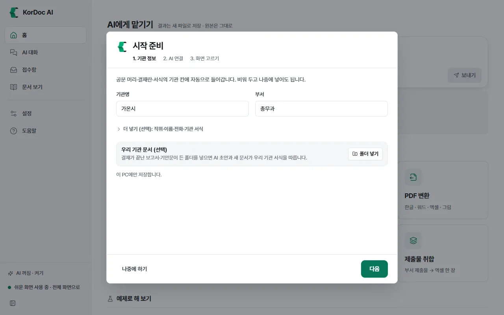
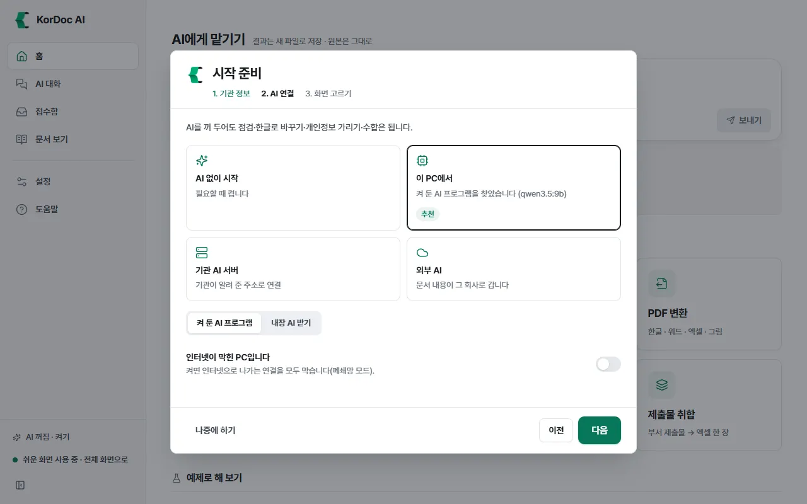
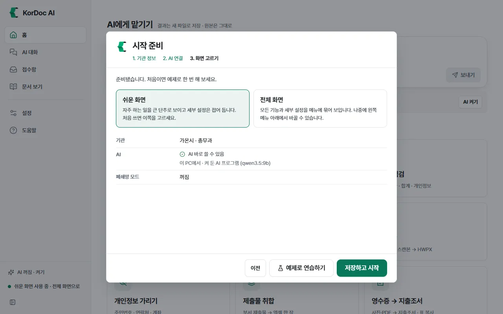
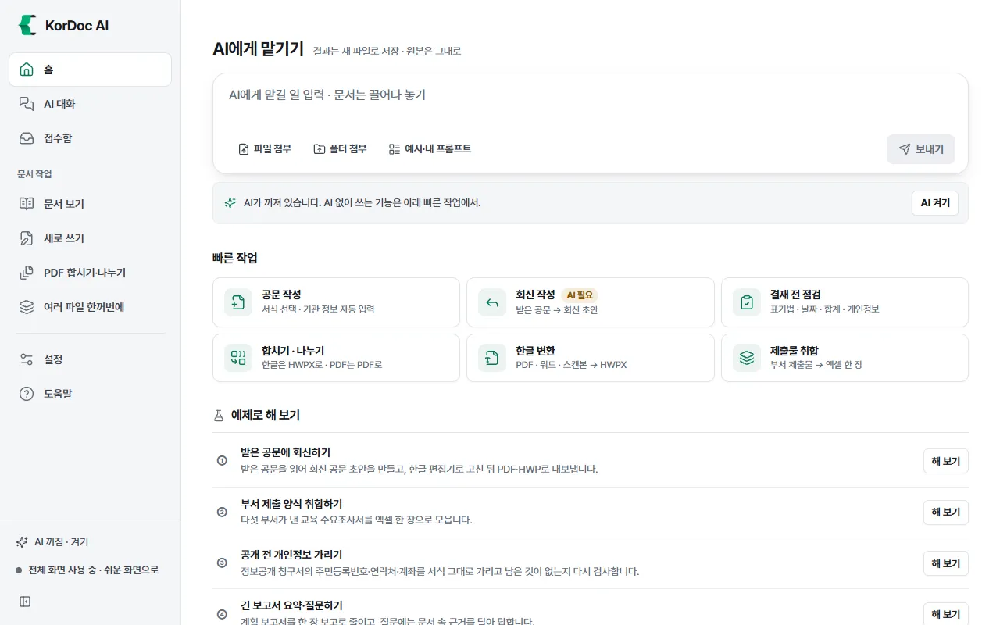
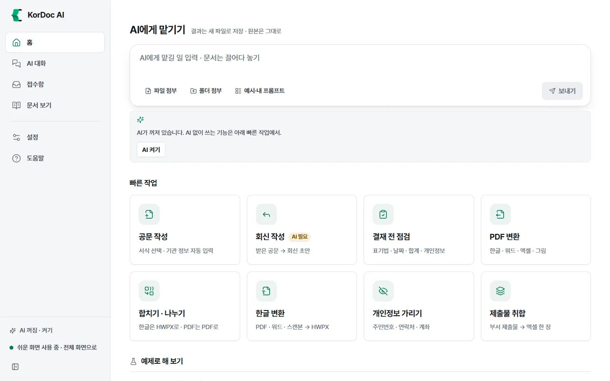

# 처음 시작하기

KorDoc AI를 설치하고 처음 켤 때 나오는 시작 준비 창을 마친 뒤 화면 생김새를 익히는 장입니다. 처음 쓰는 분은 이 장부터 차례로 읽으세요.

## 이럴 때 읽습니다

- 앱을 처음 설치할 때
- 왼쪽 메뉴에 무엇이 있는지, 만든 파일이 어디에 저장되는지 알고 싶을 때
- 메뉴가 너무 적거나 너무 많아 보일 때(쉬운 화면과 전체 화면)

## 설치하기

필요한 것

| 항목 | 내용 |
| --- | --- |
| 운영체제 | Windows 10·11(64비트), macOS 14 이상(Apple 실리콘) |
| 메모리 | 8GB 이상 권장 |
| 저장 공간 | 1GB. 내장 AI를 쓰면 모델 파일만큼 더 필요합니다 |
| 따로 깔 프로그램 | 없습니다. 한컴오피스가 없어도 됩니다 |

설치 파일 안에 문서 엔진, 글자 읽기(OCR) 모델, 한글 편집기가 모두 들어 있습니다. 그래서 인터넷이 막힌 PC에서도 설치하고 쓸 수 있습니다. PDF로 저장할 때는 PC에 있는 Edge나 Chrome을 씁니다. Windows에는 Edge가 기본으로 있습니다.

따라 하기 (Windows)

1. 받는 곳(공공 GitLab 또는 GitHub 릴리스)에서 `KorDoc.AI_2.3.2_x64-setup.exe` 파일을 받습니다.
2. 받은 파일을 두 번 누릅니다. 관리자 권한은 필요 없습니다. 내 사용자 계정에만 설치됩니다.
3. "Windows의 PC 보호" 창이 뜨면 **추가 정보**를 누른 뒤 **실행**을 누릅니다. 코드 서명 전이라 처음 한 번만 묻습니다.
4. 설치가 끝나면 시작 메뉴에서 **KorDoc AI**를 엽니다.

macOS는 macOS용 설치 파일을 받아 응용 프로그램 폴더에 넣고 엽니다. 처음 열 때 macOS가 한 번 묻습니다.

## 시작 준비 창 (처음 켤 때 한 번)

처음 켜면 **시작 준비** 창이 뜹니다. 세 단계입니다. 어느 단계든 비워 두고 넘어가도 됩니다. 나중에 설정에서 바꾸면 됩니다.

### 1단계. 기관 정보

1. **기관명**과 **부서**를 적습니다. 예: 가온시, 총무과.
2. 더 넣고 싶으면 **더 넣기 (선택): 직위·이름·전화·기관 서식**을 눌러 펼칩니다. 펼친 곳에서 직위, 이름, 전화, 기관 서식을 고릅니다.
3. 결재가 끝난 우리 기관 보고서·기안문이 든 폴더가 있으면 **우리 기관 문서 (선택)** 칸의 **폴더 넣기**를 누릅니다. 그러면 AI 초안과 새 문서가 우리 기관 서식을 따릅니다. 폴더 안 문서는 앱 데이터에 사본으로 두고 원본은 건드리지 않습니다.
4. **다음**을 누릅니다.

여기 넣은 기관명·부서·담당자는 공문 머리, 결재란, 서식의 기관 칸에 저절로 들어갑니다. 이 PC에만 저장합니다. 팩스·주소·결재선·관인 그림은 [설정](10-settings.md)의 **내 기관 정보**에서 넣습니다.

### 2단계. AI 연결

AI를 꺼 두어도 점검, 한글로 바꾸기, 개인정보 가리기, 수합은 됩니다. 처음이라 잘 모르겠으면 **AI 없이 시작**을 고르세요.

| 고를 것 | 뜻 |
| --- | --- |
| **AI 없이 시작** | AI 없이 씁니다. 나중에 왼쪽 아래 **AI 꺼짐 · 켜기**로 켭니다 |
| **이 PC에서** | 내장 AI를 받거나, 이 PC에 켜 둔 AI 프로그램(Ollama 등)에 연결합니다. 문서가 PC 밖으로 나가지 않습니다 |
| **기관 AI 서버** | 기관 전산 담당자에게 AI 서버 주소를 받았을 때 고릅니다 |
| **외부 AI** | Gemini·Claude 키나 유료 구독이 있을 때 고릅니다. 문서 내용이 그 회사로 갑니다 |

- 이 PC에 켜 둔 AI 프로그램을 앱이 찾으면 **이 PC에서** 칸에 "켜 둔 AI 프로그램을 찾았습니다"와 **추천** 표시가 붙고 그쪽이 먼저 골라져 있습니다.
- 인터넷이 막힌 업무망 PC라면 **인터넷이 막힌 PC입니다** 스위치를 켭니다. 그러면 인터넷으로 나가는 연결을 모두 막습니다(폐쇄망 모드). 이때 **외부 AI**는 고를 수 없습니다.
- 구독 계정(Claude Code·Codex·Gemini CLI)은 이 창에서 고르지 않습니다. 설정 › AI 연결 › 외부 AI에서 연결합니다. 자세한 것은 [AI 연결](09-ai.md) 장에 있습니다.

**다음**을 누릅니다.

### 3단계. 화면 고르기

1. **쉬운 화면**과 **전체 화면** 가운데 하나를 고릅니다. 처음 쓰면 **쉬운 화면**을 고르세요.
2. 아래 요약에서 기관, AI, 폐쇄망 모드를 확인합니다.
3. Windows라면 **탐색기 우클릭 메뉴 넣기** 스위치가 보입니다. 켜 두면 탐색기에서 파일을 우클릭해 바로 일을 시킬 수 있습니다. 끄고 싶으면 설정에서 뺍니다.
4. **저장하고 시작**을 누릅니다. 예제로 먼저 연습하고 싶으면 **예제로 연습하기**를 누릅니다.

알아 둘 것

- 1단계와 2단계에서 **나중에 하기**를 누르면 넣은 것만 저장하고 닫습니다. 3단계에는 이 단추가 없습니다.
- AI를 골랐는데 아직 준비가 안 됐으면(내장 AI를 아직 받지 않았거나 서버 주소가 비었으면) 저장한 뒤 설정의 AI 연결 화면으로 갑니다.
- 저장에 실패하면 "넣은 내용을 저장하지 못했습니다" 안내가 나옵니다. **저장하지 않고 닫기**를 누른 뒤 설정 › 내 기관 정보에서 다시 넣어 저장하세요.

## 화면 구성

화면은 왼쪽 메뉴와 오른쪽 작업 칸으로 나뉩니다.

왼쪽 메뉴

| 메뉴 | 하는 일 | 설명 장 |
| --- | --- | --- |
| 홈 | 할 일 고르기, 급한 공문, 최근 문서 | [홈과 빠른 작업](01-home.md) |
| AI 대화 | 글로 일 맡기기, 지난 대화 | [AI 대화](02-chat.md) |
| 접수함 | 받은 공문 기한·요청 | [접수함](05-inbox.md) |
| 문서 보기 | 연 문서를 읽고 점검하고 고칩니다 | [문서 보기](03-viewer.md) |
| 새로 쓰기 | 서식·초안·한글로 바꾸기 | [새로 쓰기](04-create.md) |
| PDF 합치기·나누기 | 쪽을 보며 합치고 나누고 순서를 바꿉니다 | [PDF 합치기·나누기](06-pdf.md) |
| 여러 파일 한꺼번에 | 제출물 모으기·합본·신구대조표·한꺼번에 바꾸기 | [여러 파일 한꺼번에](07-batch.md) |
| 설정 | AI 연결, 내 기관 정보 | [설정](10-settings.md) |
| 도움말 | 이 설명서 | |

왼쪽 아래

- **AI 상태 줄**: 지금 AI를 어디서 돌리는지 보입니다. "AI 꺼짐 · 켜기", "이 PC에서 · 내장 AI", "이 PC에서 · AI 프로그램", "기관 AI 서버", "외부 AI" 가운데 하나입니다. 구독 계정과 API 키는 모두 "외부 AI"로 보입니다. 누르면 설정의 AI 연결로 갑니다.
- **문서 엔진 상태 줄**: 엔진이 켜지는 중이면 "문서 엔진 켜는 중", 멈췄으면 "문서 엔진 멈춤: 눌러서 다시 켜기"가 보입니다. 잘 돌 때는 보이지 않습니다.
- **폐쇄망 모드 켜짐**: 폐쇄망 모드를 켰을 때만 보입니다.
- **화면 방식 단추**: "쉬운 화면 사용 중 · 전체 화면으로" 또는 "전체 화면 사용 중 · 쉬운 화면으로". 누를 때마다 바뀝니다.
- **메뉴 접기/펼치기 단추**: 메뉴를 아이콘과 짧은 이름만 남기고 접습니다. 창 폭이 좁으면 처음부터 접혀 있습니다.

## 쉬운 화면과 전체 화면

| | 쉬운 화면 | 전체 화면 |
| --- | --- | --- |
| 왼쪽 메뉴 | 홈, AI 대화, 접수함, 문서 보기, 설정, 도움말 | "문서 작업" 묶음이 생기고 그 안에 문서 보기와 새로 쓰기, PDF 합치기·나누기, 여러 파일 한꺼번에가 놓입니다 |
| 홈 빠른 작업 | 큰 카드 9개 | 카드 6개 + **모든 기능 보기** |
| 세부 설정 | 접어 둡니다 | 모두 보입니다 |

- 쉬운 화면에서도 빠진 기능은 없습니다. 홈 카드나 다른 화면에서 들어가면 그 화면이 메뉴 아래 **지금 보는 화면** 자리에 잠깐 보입니다.
- 바꾸는 곳은 두 군데입니다. 왼쪽 아래 화면 방식 단추와 설정 › 화면과 정보 › **화면 방식**입니다.
- 설정 목차의 번호도 화면 방식에 따라 다릅니다. 쉬운 화면은 보이는 구획만 가~라로, 전체 화면은 가~아로 매깁니다. 그래서 이 설명서는 번호가 바뀌는 구획을 이름으로만 적습니다. 자세한 것은 [설정](10-settings.md) 장에 있습니다.
- 이 설명서에서 "전체 화면에서만"이라고 적은 항목은 쉬운 화면에서 숨어 있습니다.

## 원본은 그대로, 결과는 새 파일

KorDoc AI는 연 문서를 고쳐 덮어쓰지 않습니다. 변환, 가리기, 합치기, 점검 뒤 고치기 같은 일은 모두 새 파일을 만듭니다.

- 같은 이름의 파일이 있으면 덮어쓰지 않고 이름 뒤에 " (2)", " (3)"을 붙입니다.
- 결과 파일 이름에는 하는 일이 붙습니다. 예: `보고서_가림.hwpx`, `보고서_용량줄임.pdf`, `보고서_표.xlsx`.
- 예외는 두 가지입니다. 한글 편집기에서 직접 **저장**을 누를 때, 그리고 [여러 파일 한꺼번에](07-batch.md)의 **폴더 지켜보기**가 같은 원본의 변환 결과를 새로 바꿀 때입니다. 한글 편집기에서 처음 덮어쓸 때는 원래 파일을 `.bak` 파일로 남깁니다.

## 결과 폴더

만든 파일은 기본으로 `문서\KorDoc AI 결과` 폴더에 저장합니다.

- 바꾸려면 설정 › 바. 저장과 연결 › **저장 위치**에서 **바꾸기**를 누릅니다. 이 구획은 전체 화면에서만 보입니다.
- **원본 옆으로**를 누르면 원본과 같은 폴더에 새 파일로 저장합니다.
- 결과 카드나 저장 안내에 있는 **폴더에서 보기**를 누르면 그 파일이 든 폴더가 열립니다.
- 원본이 없는 문서(새로 쓴 공문, 접수대장 같은 것)는 저장 위치가 비었을 때 문서 폴더에 저장합니다.

## 알아 둘 것

- 예제 문서는 모두 가상의 기관(가온도·가온시)과 가짜 개인정보로 만든 합성 문서입니다. 홈의 **예제로 해 보기**에서 바로 써 보세요.
- 기관 정보, 설정, 대화 기록은 이 PC에만 저장합니다. 사용 기록·통계를 어디에도 보내지 않습니다.
- 정보통신 담당자가 기관 배포 설정을 깔아 두었으면 일부 칸 옆에 자물쇠 그림과 "기관에서 정함" 표시가 붙고 바꿀 수 없습니다.
