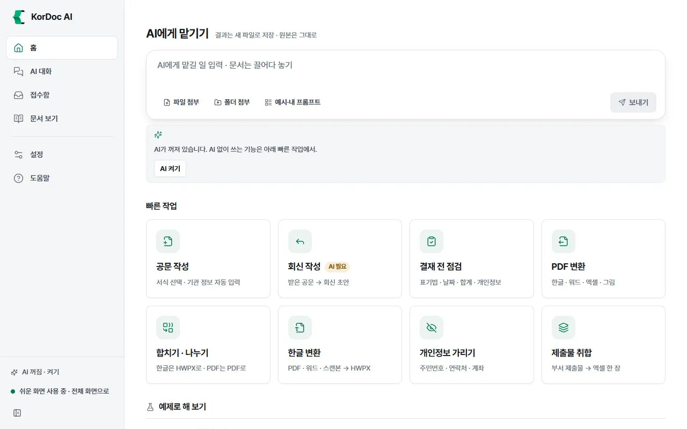
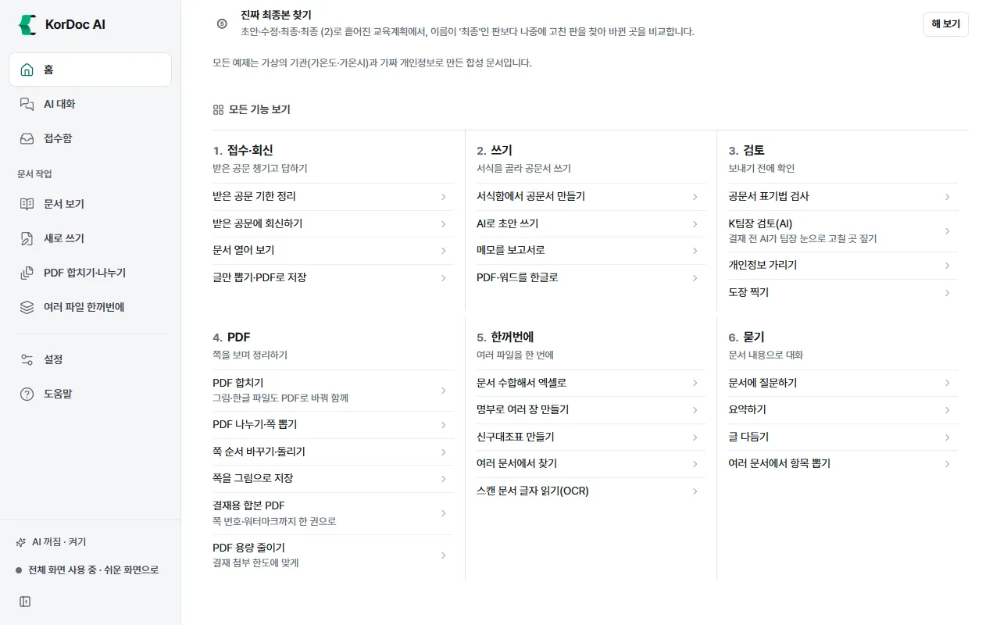

# 홈과 빠른 작업

앱을 켜면 처음 보이는 화면입니다. 위에서 아래로 급한 공문, 저장하지 않은 문서, AI에게 맡기기 입력창, 빠른 작업 카드, 최근 문서(또는 예제)가 차례로 놓입니다.

## 이럴 때 씁니다

- 오늘 할 일을 바로 시작할 때
- 기한이 다가온 공문을 확인할 때
- 어제 보던 문서를 다시 열 때
- 처음 써 보는 기능을 예제로 연습할 때

## 홈의 칸들

### 기한이 다가온 공문

접수함에 넣은 공문 가운데 기한이 지났거나 7일 안에 끝나는 것이 있으면 맨 위에 최대 3건까지 보입니다. 그런 공문이 없으면 이 칸은 나오지 않습니다.

- 줄마다 "3일 지남", "오늘", "D-5" 같은 표시와 제목, "보낸 곳 · 날짜까지"가 보입니다.
- 줄을 누르면 그 공문이 문서 보기에서 열립니다.
- **접수함 전체 보기**를 누르면 접수함으로 갑니다. 자세한 것은 [접수함](05-inbox.md) 장에 있습니다.

### 저장하지 않고 꺼진 문서

한글 편집기에서 고치다가 저장하지 않은 채 앱이 꺼졌으면, 고친 내용이 이 칸에 남습니다. 앱은 고치는 동안 30초마다(입력이 2초 멈췄을 때) 복구 사본을 만들어 둡니다.

1. **되살리기**를 누르면 고친 내용으로 한글 편집기가 열립니다.
2. 필요 없으면 **버리기**를 누릅니다.

원래 파일이 없어졌으면 "원래 파일이 없어 저장할 때 새로 만듭니다"라고 알려 줍니다.

### AI에게 맡기기

입력창에 할 일을 적고 **보내기**를 누르면 AI가 그 일을 합니다. 결과는 새 파일로 저장하고 원본은 그대로 둡니다.

1. 문서를 입력창 위에 끌어다 놓거나 **파일 첨부**·**폴더 첨부**로 붙입니다.
2. 할 일을 적습니다. 예: "붙인 받은 공문에 회신하는 기안문을 만들어 줘".
3. **보내기**를 누르거나 Enter를 누릅니다. 줄을 바꾸려면 Shift+Enter를 누릅니다.
4. 화면이 [AI 대화](02-chat.md)로 넘어가 진행 단계와 만든 파일이 보입니다.

- 파일을 붙이면 **문서 화면에서 보기** 단추가 생깁니다. 누르면 AI 없이 그 문서를 문서 보기에서 엽니다.
- 지난 대화가 있으면 입력창 아래에 **최근 대화 이어 하기: (대화 이름)**이 보입니다.
- AI가 꺼져 있으면 입력창 아래에 "AI가 꺼져 있습니다. AI 없이 쓰는 기능은 아래 빠른 작업에서."와 **AI 켜기** 단추가 보입니다. **AI 켜기**를 누르면 그 자리에 고르는 칸이 펼쳐집니다(아래 "AI 켜기 칸" 참고).

### 이번 달 처리 문서 (전체 화면에서만)

이번 달에 앱으로 처리한 문서가 있으면 "이번 달 처리 문서 N건 · 아낀 시간 약 N시간"이 보입니다. 누르면 효과 화면이 열립니다. 효과 화면은 [설정](10-settings.md) 장에서 설명합니다.

### 빠른 작업

AI 없이 자주 하는 일을 카드로 모았습니다. 쉬운 화면에는 9개(세 줄 세 칸), 전체 화면에는 6개가 있습니다(PDF 변환, 개인정보 가리기, 영수증 → 지출조서 카드는 쉬운 화면에만 있습니다. 전체 화면에서는 모든 기능 보기의 "한꺼번에"에 있습니다).

| 카드 | 누르면 | AI |
| --- | --- | --- |
| **공문 작성** | 새로 쓰기의 서식함이 열립니다. 서식을 고르면 기관명·부서·담당자 칸을 채워 한글 편집기로 엽니다 | 필요 없음 |
| **회신 작성** | 받은 공문 파일 하나를 고르면 AI가 회신 기안문 초안을 한글 파일로 만듭니다 | 필요 |
| **결재 전 점검** | 쓴 문서를 하나 고르면 표기법, 날짜와 요일, 표 합계, 개인정보를 점검해 고칠 곳을 보여 줍니다 | 필요 없음 |
| **PDF 변환** (쉬운 화면) | 고른 파일을 인쇄 모양 그대로 PDF로 저장합니다 | 필요 없음 |
| **합치기 · 나누기** | 파일을 두 개 이상 고르면 하나로 합치고, 하나만 고르면 나눕니다 | 필요 없음 |
| **한글 변환** | PDF·워드·엑셀·스캔본을 고쳐 쓸 수 있는 한글 문서(HWPX)로 바꿉니다 | 필요 없음 |
| **개인정보 가리기** (쉬운 화면) | 문서 하나를 고르면 주민등록번호·전화번호·계좌번호 등을 가린 사본을 만듭니다 | 필요 없음 |
| **제출물 취합** | 부서들이 낸 파일이나 폴더를 엑셀 한 장으로 모으고, 안 낸 부서와 독촉 글까지 만듭니다 | 필요 없음 |
| **영수증 → 지출조서** (쉬운 화면) | 영수증 사진·PDF를 고르면 이 PC에서 글자를 읽어 지출일자·거래처·사업자등록번호·금액을 뽑습니다. 고친 뒤 표 복사와 지출조서 한글 파일 저장을 합니다(여러 파일 한꺼번에의 "영수증으로 지출조서") | 필요 없음 |

- AI가 꺼져 있으면 **회신 작성** 카드에 "AI 필요" 표시가 붙습니다. 그래도 누를 수 있고, 누르면 이유와 AI 켜는 길을 알려 줍니다.
- 카드에 마우스를 올리면 무엇을 하는지 한 줄 설명이 뜹니다.

### 최근 문서 / 예제로 해 보기

- 연 문서가 있으면 **최근 문서**에 최근 4개가 보입니다. 누르면 다시 엽니다. **최근 목록 지우기**를 누르면 목록만 지워집니다(파일은 그대로).
- 처음이라 연 문서가 없으면 **예제로 해 보기**가 보입니다. **해 보기**를 누르면 예제 파일로 그 일을 바로 시작합니다.

| 예제 | 하는 일 | AI |
| --- | --- | --- |
| ① 받은 공문에 회신하기 | 회신 공문 초안을 만들고 한글 편집기로 고친 뒤 PDF·HWP로 내보냅니다 | 필요 |
| ② 부서 제출 양식 취합하기 | 다섯 부서가 낸 교육 수요조사서를 엑셀 한 장으로 모읍니다 | 필요 없음 |
| ③ 공개 전 개인정보 가리기 | 정보공개 청구서의 개인정보를 서식 그대로 가리고 다시 검사합니다 | 필요 없음 |
| ④ 긴 보고서 요약·질문하기 | 계획 보고서를 요약하고 근거를 달아 답합니다 | 필요 |
| ⑤ 진짜 최종본 찾기 | 초안·수정·최종·최종 (2) 가운데 가장 나중에 고친 판을 찾아 비교합니다 | 필요 없음 |

예제 파일은 앱 데이터 폴더에 사본으로 들어 있어 마음대로 써도 됩니다.

## 모든 기능 보기 (전체 화면에서만)

전체 화면의 홈 맨 아래에는 **모든 기능 보기**가 있습니다. 하려는 일에 따라 여섯 갈래로 나눠 기능을 모두 늘어놓았습니다. 제목을 누르면 접히거나 펼쳐집니다.

| 갈래 | 들어 있는 것 |
| --- | --- |
| 1. 접수·회신 | 받은 공문 기한 정리, 받은 공문에 회신하기, 문서 열어 보기, 글만 뽑기·PDF로 저장 |
| 2. 쓰기 | 서식함에서 공문서 만들기, AI로 초안 쓰기, 메모를 보고서로, PDF·워드를 한글로 |
| 3. 검토 | 공문서 표기법 검사, K팀장 검토(AI), 개인정보 가리기, 도장 찍기 |
| 4. PDF | PDF 합치기, PDF 나누기·쪽 뽑기, 쪽 순서 바꾸기·돌리기, 쪽을 그림으로 저장, 결재용 합본 PDF, PDF 용량 줄이기 |
| 5. 한꺼번에 | 문서 수합해서 엑셀로, 명부로 여러 장 만들기, 신구대조표 만들기, 여러 문서에서 찾기, 스캔 문서 글자 읽기(OCR) |
| 6. 묻기 | 문서에 질문하기, 요약하기, 글 다듬기, 여러 문서에서 항목 뽑기 |

## AI 켜기 칸

홈 입력창 아래 **AI 켜기**를 누르면 세 가지 길이 보입니다.

- **이 PC에서**: 이 PC에 켜 둔 AI 프로그램(Ollama 등)이 있으면 **켜 둔 AI 프로그램 쓰기**로 바로 씁니다. 없으면 **내장 AI 받기**로 모델을 한 번 받습니다. 받는 동안 "받는 중 N%"가 보입니다. 이미 받아 두었으면 **내장 AI 켜기**가 보입니다.
- **기관 AI 서버**: **주소 넣기**를 누르면 설정의 AI 연결로 가서 주소와 모델 이름을 넣습니다.
- **외부 AI**: **고르기**를 누르면 설정의 AI 연결로 가서 회사와 연결 방식을 고릅니다. 폐쇄망 모드에서는 이 칸이 없습니다.

자세한 것은 [AI 연결](09-ai.md) 장에 있습니다.

## 그 밖에 홈에서 되는 것

- 창 어디에든 파일을 끌어다 놓으면 홈의 AI에게 맡기기 입력창에 붙습니다.
- 입력칸 밖에서 Ctrl+V로 그림이나 10자 넘는 글을 붙여 넣으면 파일로 저장해 문서 보기에서 엽니다.
- Ctrl+O(맥은 ⌘O)를 누르면 파일을 골라 문서 보기에서 엽니다.

## 알아 둘 것

- 빠른 작업 카드는 회신 작성을 빼면 AI 없이 씁니다.
- 빠른 작업이 만든 파일도 모두 새 파일입니다. 원본은 그대로 남습니다.
