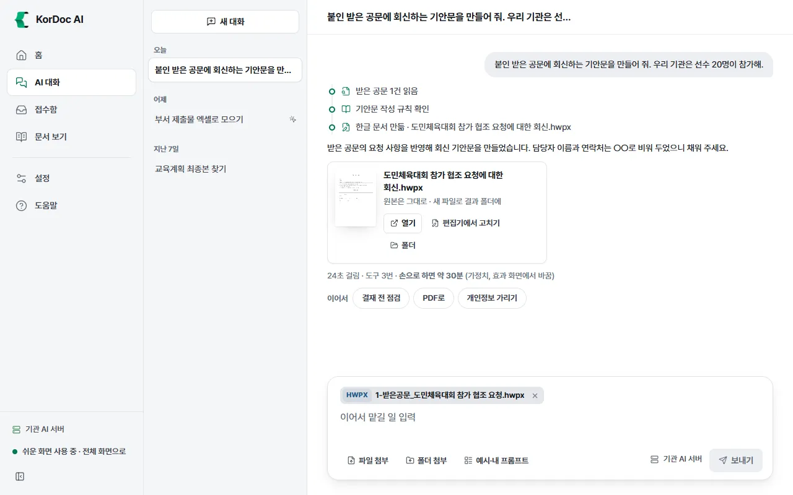
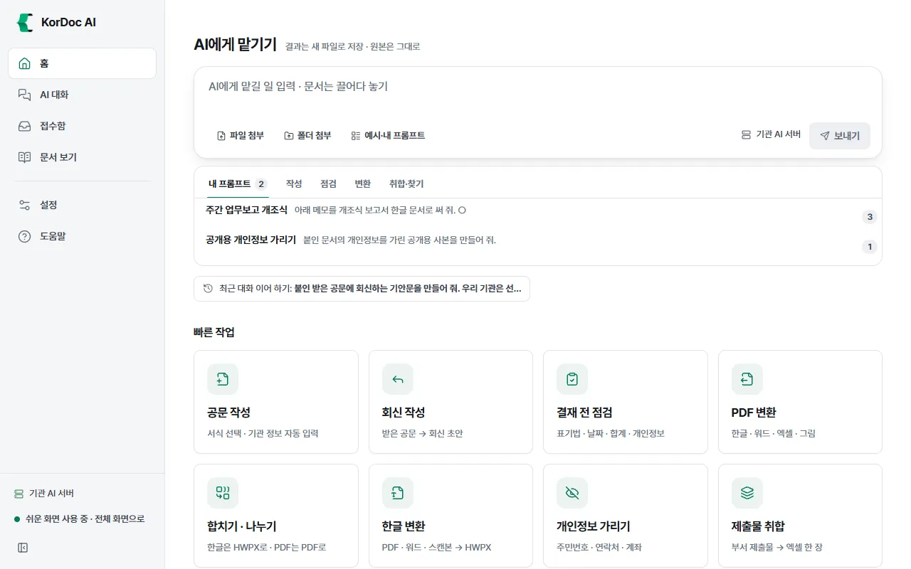
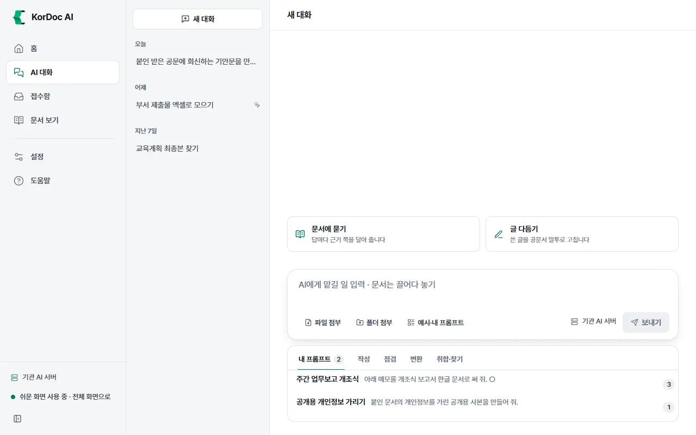
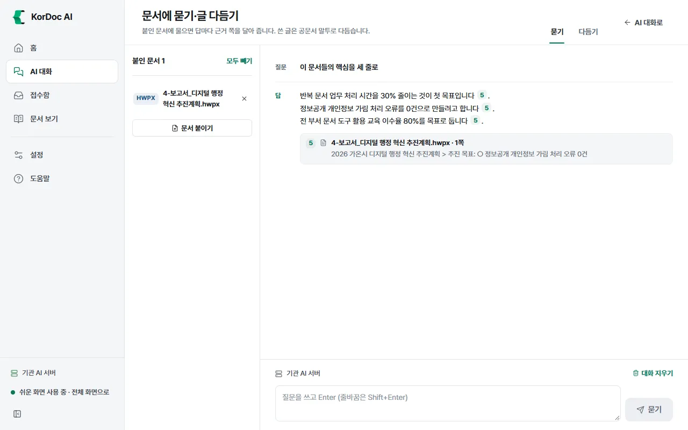

# AI 대화

하고 싶은 일을 글로 적어 AI에게 맡기는 화면입니다. AI가 문서를 읽고 새 문서를 만들고 점검하며 결과 파일은 카드로 보여 줍니다. 대화는 저장되어 앱을 다시 켜도 이어서 시킬 수 있습니다.

## 이럴 때 씁니다

- "받은 공문에 회신하는 기안문 만들어 줘"처럼 여러 단계 일을 한 번에 맡길 때
- 메뉴에서 기능을 찾기 어려울 때
- 문서 여러 개에 질문하고 근거 쪽까지 받고 싶을 때(문서에 묻기)
- 쓴 글을 공문서 말투로 고칠 때(글 다듬기)

AI 대화를 쓰려면 AI가 있어야 합니다. AI가 꺼져 있으면 입력창 아래에 "AI가 꺼져 있습니다."와 **AI 켜기** 단추가 보입니다. 켜는 법은 [AI 연결](09-ai.md) 장에 있습니다.

## 화면 생김새

- 왼쪽: 대화 목록. 맨 위에 **새 대화** 단추가 있고, 대화가 "오늘", "어제", "지난 7일", "지난 30일", "그 전"으로 묶여 있습니다. 대화가 하나도 없으면 목록 칸은 보이지 않습니다.
- 오른쪽: 대화 내용과 입력창.
- 탐색기 우클릭으로 시킨 대화에는 작은 마우스 표시가 붙습니다("탐색기 우클릭에서 시킨 대화").

## 일 맡기기

1. 왼쪽 메뉴에서 **AI 대화**를 누르거나, 홈의 AI에게 맡기기 입력창에 적습니다.
2. 필요한 문서를 붙입니다. 붙이는 법은 세 가지입니다.
   - 문서를 입력창 위에 끌어다 놓기
   - **파일 첨부**: 한글·PDF·워드·엑셀·그림 파일을 고릅니다. 여러 개를 골라도 됩니다
   - **폴더 첨부**: 폴더 안 문서를 모두 넘깁니다. 제출물 취합처럼 파일이 많을 때 씁니다
3. 붙인 파일은 입력창 위에 이름표로 보입니다. 빼려면 이름표의 ×를 누릅니다.
4. 할 일을 적고 **보내기**를 누릅니다. Enter로도 보냅니다. 줄바꿈은 Shift+Enter입니다.
5. AI가 일하는 동안 진행 단계가 한 줄씩 늘어납니다. 예: "받은 공문 1건 읽음", "기안문 작성 규칙 확인", "한글 문서 만듦 · 파일 이름". 하지 못한 단계는 "못 함:"으로 시작합니다.
6. 멈추려면 **멈추기**를 누릅니다.

알아 둘 것

- 한 번에 한 가지 일만 합니다. 다른 대화에서 일하는 중이면 "다른 대화에서 일하는 중입니다. 끝나면 보낼 수 있습니다."가 보입니다. 글은 미리 적어 둘 수 있습니다.
- AI는 원본을 고치지 않습니다. 만든 결과는 모두 새 파일입니다.
- 날짜·금액·이름처럼 문서에 없는 값은 지어내지 않고 "○○"로 비워 둡니다. 비운 칸은 AI가 답에서 알려 줍니다.
- 입력창 오른쪽 아래에 AI를 어디서 돌리는지 보입니다. 예: "이 PC에서 · 내장 AI", "이 PC에서 · 켜 둔 AI 프로그램", "기관 AI 서버", "외부 AI · 구독 계정 (Claude Code)". 외부 AI라면 "개인정보는 가려서 보냅니다" 또는 "문서 원문이 나갑니다"가 함께 보입니다.

## 결과 카드

AI가 파일을 만들면 대화 안에 결과 카드가 생깁니다.

- 첫 쪽 미리보기(한글·PDF), 파일 이름, "원본은 그대로 · 새 파일로 (폴더 이름) 폴더에"
- **열기**: PC의 기본 프로그램으로 엽니다
- **편집기에서 고치기**: 한글 파일이면 앱의 한글 편집기로 엽니다
- **폴더**: 파일이 든 폴더를 엽니다

카드 아래에는 "N초 걸림 · 도구 N번 · 손으로 하면 약 N분 (가정치, 효과 화면에서 바꿈)"이 보입니다. 손으로 하는 시간은 가정치입니다. 효과 화면에서 기관 실정에 맞게 바꿀 수 있습니다.

## 이어서 칩

마지막 요청이 끝나면 결과 아래에 **이어서** 칩이 생깁니다. 누르면 바로 보냅니다.

| 만든 파일 | 칩 |
| --- | --- |
| 한글 파일(HWP·HWPX) | **결재 전 점검**, **PDF로**, **개인정보 가리기** |
| PDF | **용량 줄이기** |

## 예시와 내 프롬프트

자주 맡기는 일을 골라 입력창에 채워 넣는 곳입니다.

1. 입력창 아래 줄의 **예시·내 프롬프트**를 누르면 입력창 밑에 목록이 펼쳐집니다. 새 대화의 빈 화면에서는 처음부터 펼쳐져 있습니다.
2. 탭을 고릅니다: **내 프롬프트**, **작성**, **점검**, **변환**, **취합·찾기**.
3. 항목을 누르면 그 문장이 입력창에 들어갑니다. 문장에 "○"가 있으면 첫 ○가 골라져 있으니 바로 덮어 쓰면 됩니다.
4. 클립 표시와 숫자가 붙은 예시는 파일을 그만큼 붙여야 합니다. 예시를 골라도 파일은 저절로 붙지 않습니다.

| 탭 | 예시 |
| --- | --- |
| 작성 | 회신 기안문, 메모로 보고서, 서식 빈칸 채우기, 명부로 여러 장 |
| 점검 | 결재 전 점검, 법령 인용 확인, 신구대조표, 최종본 찾기 |
| 변환 | PDF로 저장, 한글 문서로, 결재 합본 PDF, PDF 용량 줄이기, 개인정보 가리기 |
| 취합·찾기 | 제출물 취합, 표를 엑셀로, 문서 찾기, 핵심 요약 |

내 프롬프트 저장·관리

1. 입력창에 문장을 적습니다.
2. 입력창 오른쪽 아래의 책갈피 단추("이 문장을 내 프롬프트에 저장")를 누릅니다. "내 프롬프트에 저장했습니다"가 뜹니다. 같은 문장을 또 저장하면 "이미 저장한 문장입니다"가 뜹니다.
3. **내 프롬프트** 탭에 모입니다. 많이 쓴 것이 위로 올라가고, 오른쪽 숫자는 쓴 횟수입니다.
4. 이름 바꾸기: 연필 단추를 누르고 새 이름을 적은 뒤 Enter(또는 체크 단추)를 누릅니다. 그만두려면 Esc를 누릅니다.
5. 지우기: 휴지통 단추를 누르면 그 자리에 "이 프롬프트를 지울까요?"가 뜹니다. **지우기**를 누르면 지우고 **취소**나 Esc를 누르면 그대로 둡니다.

예시 목록이 닫혀 있으면 새 대화의 빈 화면 입력창 아래에 예제 칩(예: "받은 공문에 회신 쓰기", "부서 제출물 모으기", "진짜 최종본 찾기")이 보입니다. AI가 켜져 있을 때만 보입니다. 칩은 예제 파일까지 붙여 줍니다. 새 대화는 예시 목록이 펼쳐진 채 열리므로, 칩을 보려면 **예시·내 프롬프트**를 한 번 눌러 목록을 닫습니다.

## 대화 목록 다루기

- **새 대화**: 빈 대화를 엽니다. 아직 아무것도 보내지 않은 대화는 목록에 남지 않습니다.
- 대화 이어 하기: 목록에서 대화를 누르고 입력창에 이어서 적습니다(입력창 안내가 "이어서 맡길 일 입력"으로 바뀝니다). 앞에서 만든 파일도 AI가 기억합니다.
- 이름 바꾸기: 대화에 마우스를 올리면 연필 단추가 보입니다. 누르고 새 이름을 적은 뒤 Enter를 누릅니다. Esc를 누르면 그만둡니다.
- 지우기: 휴지통 단추를 누르면 "이 대화를 지울까요?"가 뜹니다. 체크 단추로 지우고 × 단추로 그만둡니다. 일하는 중인 대화를 지우면 그 일도 멈춥니다.
- 대화 이름은 처음 보낸 문장 앞부분으로 저절로 정해집니다.
- 대화는 이 PC에만 저장합니다. 최근 60개까지 남깁니다.
- 일하는 도중에 앱이 꺼졌으면 그 요청에 "앱이 꺼져서 멈췄습니다."가 남습니다.

## 문서에 묻기·글 다듬기

새 대화의 빈 화면에 두 칸이 있습니다.

- **문서에 묻기**: 답마다 근거 쪽을 달아 줍니다
- **글 다듬기**: 쓴 글을 공문서 말투로 고칩니다

누르면 **문서에 묻기·글 다듬기** 화면이 열립니다. 위쪽 **묻기**·**다듬기** 탭으로 오가고 **AI 대화로**를 누르면 돌아갑니다. 왼쪽 메뉴에서는 AI 대화 자리에 불이 켜집니다.

### 묻기

1. 왼쪽 **문서 붙이기**를 누르거나 문서를 끌어다 놓습니다. 여러 문서에 함께 물어도 됩니다. 문서 보기에서 연 문서가 있으면 **연 문서 N개 가져오기**로 한 번에 붙입니다.
2. 아래 입력칸에 질문을 쓰고 Enter를 누르거나 **묻기**를 누릅니다. 처음에는 "이 문서들의 핵심을 세 줄로" 같은 추천 질문을 눌러도 됩니다.
3. 답의 문장 끝에 붙은 번호를 누르면 근거가 있는 쪽을 문서 보기에서 엽니다. 답 아래 근거 목록에는 "파일 이름 · N쪽"과 근거 문장이 보입니다.
4. 근거 번호 없이 숫자가 나온 문장이 있으면 "근거 번호 없이 숫자가 나온 문장이 있습니다. 원문에서 확인하세요."가 뜹니다. 근거에 없는 숫자에는 "숫자 확인 필요"가 붙습니다.
5. **대화 지우기**로 질문과 답을 지웁니다. **모두 빼기**는 붙인 문서와 대화를 함께 지웁니다.

### 다듬기

1. **다듬을 글** 칸에 보고서 문단, 민원 답변, 안내문을 붙여 넣습니다.
2. **어떻게**에서 방식을 고릅니다: 매끄럽게 다듬기, 간결하게, 공문체로, 개조식으로, 서술문으로, 쉬운 공공언어로, 쉬운 말로, 보도자료 문체로, 늘려 쓰기, 영어로, 직접 지시. **직접 지시**를 고르면 **지시** 칸에 원하는 방식을 적습니다(예: 어르신이 읽기 쉽게, 한 문장은 짧게).
3. **다듬기**를 누르면 오른쪽 **다듬은 글**에 결과가 나옵니다.
4. **복사**로 복사하거나, **새로 쓰기로 보내기**로 AI 초안 화면에 넘겨 한글 문서로 만듭니다.

## AI가 할 수 있는 일

AI 대화에서 AI는 아래 도구를 골라 씁니다. 어느 도구도 원본을 덮어쓰지 않습니다. 파일을 만들면 늘 새 파일입니다.

| 갈래 | 할 수 있는 일 | 새 파일 |
| --- | --- | --- |
| 읽기 | 파일·폴더 안 문서 목록 보기, 문서 본문 읽기(스캔본은 글자 인식), 여러 문서에서 낱말 찾기 | 없음 |
| 읽기 | 같은 문서의 여러 판에서 최종본 찾기 | 없음 |
| 읽기 | 받은 공문의 보낸 곳·문서번호·제목·요청 사항·기한 뽑아 접수함에 넣기 | 없음(접수함 목록에 추가) |
| 쓰기 | 공문서 갈래별 작성 규칙 확인, 우리 기관 문서 구성 확인 | 없음 |
| 쓰기 | 공문서를 한글 파일(HWPX)로 만들기 | `제목.hwpx` |
| 쓰기 | PDF·워드·엑셀·스캔본을 한글 파일로 바꾸기 | `이름.hwpx` |
| 쓰기 | 서식 빈칸 확인, 서식 빈칸 채우기 | `이름_채움.hwpx` |
| 쓰기 | 명부 한 줄마다 서식 한 장씩 만들기 | 새 폴더에 여러 장 |
| 쓰기 | 부서 제출물을 엑셀 한 장으로 모으고 미제출 부서·독촉 글 만들기 | `제목_수합.xlsx` |
| 쓰기 | 두 문서를 비교해 신구대조표 만들기 | `이름_신구대조표.hwpx` |
| 쓰기 | 문서 속 표를 엑셀로 뽑기 | `이름_표.xlsx` |
| 점검 | 결재 전 점검(표기법·날짜와 요일·표 합계·끝 표시·빈칸 안내 글자·개인정보) | 없음 |
| 점검 | 점검에서 고칠 값이 정해진 곳만 고친 사본 만들기 | `이름_수정.hwpx` |
| 점검 | 문서 속 법령 인용을 법제처 현행 법령과 대조(인터넷 필요) | 없음 |
| 점검 | 개인정보를 가린 사본 만들기 | `이름_가림.hwpx` 등 |
| PDF | PDF 만들기, 본문과 붙임을 PDF 한 권으로 합치기(워터마크·쪽 번호), PDF 용량 줄이기 | `이름.pdf`, `이름_합본.pdf`, `이름_용량줄임.pdf` |
| 그 밖 | 만든 파일을 PC의 기본 프로그램으로 열기(사용자가 보여 달라고 할 때만) | 없음 |

같은 도구를 다른 AI 프로그램에서도 쓸 수 있습니다. [다른 AI 도구와 연결](11-mcp.md) 장을 보세요.

## 알아 둘 것

- AI 대화를 쓰려면 AI가 있어야 합니다. AI 없이 되는 일은 빠른 작업, 문서 보기, 여러 파일 한꺼번에 화면에서 하세요.
- 외부 AI로 보낼 때 개인정보 자동 가림이 켜져 있으면 보내기 전에 가리고, 답 끝에 "(외부 AI로 보내기 전에 개인정보 N건을 가렸습니다.)"를 붙입니다.
- 쉬운 화면과 전체 화면의 차이는 없습니다.
