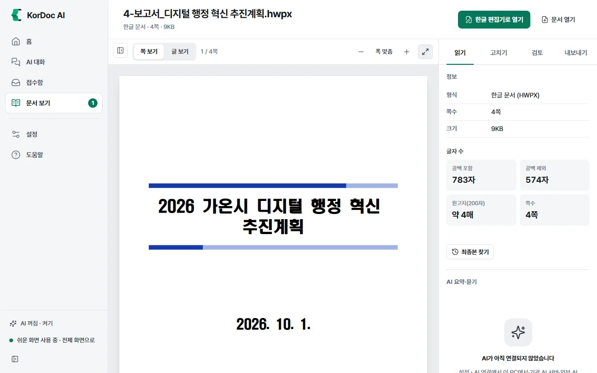
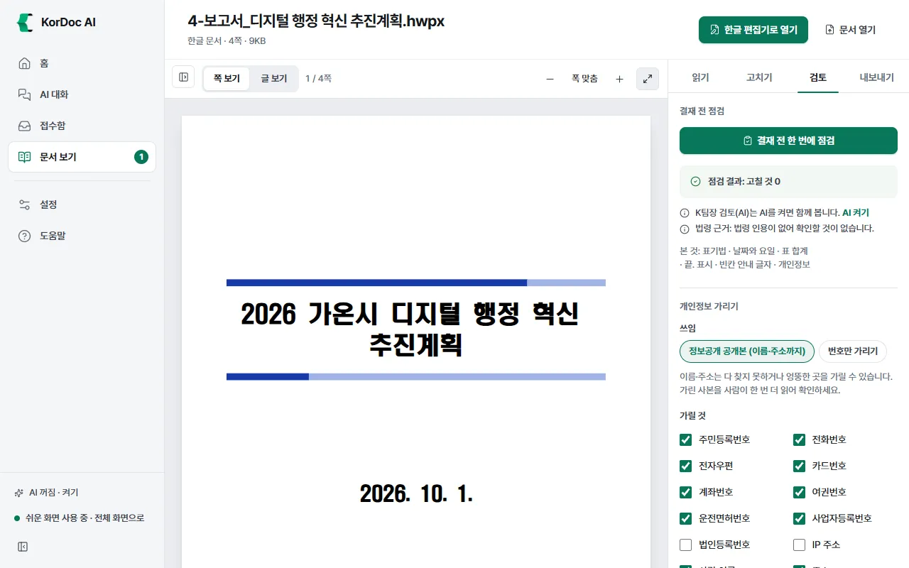
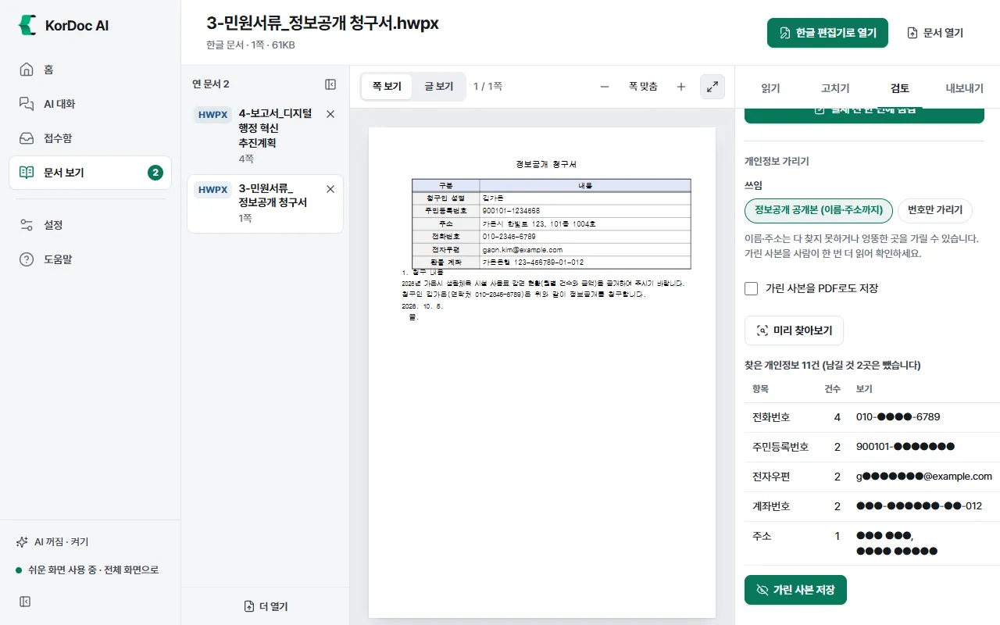
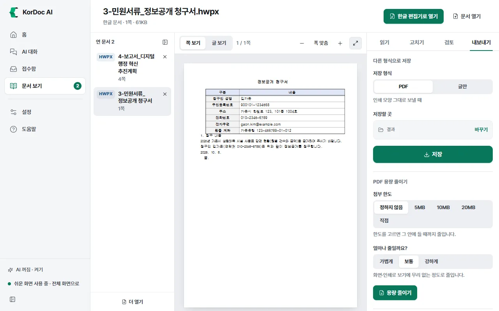

# 문서 보기

문서를 열어 읽고, 점검하고, 고치고, 다른 형식으로 내보내는 화면입니다. 가운데에 문서 미리보기, 오른쪽에 도구 칸이 있습니다. 원본 파일은 바꾸지 않습니다.

## 이럴 때 씁니다

- 한글 프로그램 없이 HWP·HWPX 문서를 볼 때
- 결재 올리기 전에 표기법·날짜·표 합계를 점검할 때
- 공개할 문서의 개인정보를 가릴 때
- 문서를 PDF나 한글(HWPX)로 바꿔 저장할 때
- 문서 속 표를 엑셀로 뽑을 때

## 문서 여는 법

열 수 있는 파일: 한글(HWP·HWPX·HML), PDF, 워드(DOCX), 엑셀(XLS·XLSX), 파워포인트(PPTX), 그림(PNG·JPG·GIF·WEBP·BMP·TIF), 글(TXT·MD·CSV).

1. 왼쪽 메뉴에서 **문서 보기**를 누릅니다. 문서를 열기 전에는 화면 제목도 "문서 보기"입니다.
2. **문서 열기**를 누르고 파일을 고릅니다. 또는 파일을 화면에 끌어다 놓습니다. 문서를 열면 화면 제목 자리에 문서 이름이 보입니다.

다른 길

- 어느 화면에서든 Ctrl+O(맥은 ⌘O)
- 홈의 최근 문서
- 탐색기에서 파일 우클릭 › KorDoc AI › **앱에서 열기**
- 입력칸 밖에서 Ctrl+V로 그림이나 글을 붙여 넣기(파일로 저장해 엽니다)

여러 문서를 열면 왼쪽에 **연 문서** 목록이 생깁니다. 눌러서 오가고, ×로 닫습니다. 닫을 때 묻지 않습니다(파일은 그대로입니다). **더 열기**로 문서를 더 엽니다. 왼쪽 메뉴의 문서 보기 옆 숫자는 연 문서 수입니다.

## 위쪽 단추

문서 이름 아래에 "한글 문서 · 4쪽 · 9KB"처럼 형식, 쪽수, 크기가 보입니다. 오른쪽 단추는 문서에 따라 달라집니다.

| 문서 | 단추 | 하는 일 |
| --- | --- | --- |
| 받은 공문으로 보이는 문서 | **이 공문에 회신 쓰기** (AI 꺼짐: **서식으로 회신 쓰기**) | AI가 회신 기안문 초안을 씁니다. AI가 꺼져 있으면 서식함의 표준 기안문으로 직접 씁니다 |
| 한글 문서 | **한글 편집기로 열기** | 글·표·서식을 직접 고칩니다. 저장하기 전에는 파일이 바뀌지 않습니다 |
| PDF | **쪽 정리·나누기** | PDF 합치기·나누기 화면으로 넘깁니다 |
| 모든 문서 | **문서 열기** | 다른 문서를 더 엽니다 |

## 미리보기

- **쪽 보기**: 인쇄 모양 그대로 봅니다. 위에 "1 / 4쪽"이 보입니다. **−**·**+**로 크기를 바꾸고 폭 맞춤 단추로 화면 폭에 맞춥니다.
- **글 보기**: 글만 뽑아 봅니다. **메신저용 복사**는 표시 없이 복사하고(표는 칸마다 탭으로 나눔), **마크다운 복사**는 #·| 표시가 붙은 글 그대로 복사합니다. 우클릭하면 **고른 글 복사**(글을 골라 놓았을 때)와 **글 전체 복사**가 나옵니다.
- 스캔한 쪽이 있으면 "스캔한 쪽이 있습니다. 글자를 고르거나 찾으려면 글자 읽기(OCR)를 돌리세요."와 **글자 읽기** 단추가 보입니다. 누르면 글자를 읽어 글 보기로 보여 줍니다. 파일은 만들지 않습니다.
- 암호가 걸린 문서는 "암호가 걸린 문서" 칸이 뜹니다. 문서를 만든 사람에게 받은 암호를 넣고 **열기**를 누릅니다. 암호는 저장하지 않습니다.

## 도구 칸

오른쪽 도구 칸에는 탭이 네 개 있습니다. 화살표 키 ←·→로도 탭을 옮깁니다. 문서 형식에 맞지 않는 도구는 이유가 흐린 글씨로 보입니다. 탭 안의 도구를 하나도 쓸 수 없으면 탭이 흐려집니다.

| 탭 | 들어 있는 것 |
| --- | --- |
| **읽기** | 정보, AI 요약·묻기, 표 뽑기 |
| **고치기** | 채우기·편집, 도장 |
| **검토** | 결재 전 점검, 개인정보 가리기 |
| **내보내기** | 다른 형식으로 저장, PDF 용량 줄이기, 인쇄 |

### 읽기 › 정보

- 형식, 쪽수, 크기, 제목, 작성자, 만든 날, 고친 날을 보여 줍니다.
- **글자 수**: 공백 포함, 공백 제외, 원고지(200자) 매수, 쪽수. 작은 문서는 저절로 세고, 큰 문서나 스캔본은 **글자 수 세기**를 눌러야 셉니다.
- **최종본 찾기**: 같은 폴더와 위·아래 폴더에서 이 문서의 다른 판(초안·수정·최종 등)을 찾아 최종으로 보이는 것을 짚습니다. 판마다 고친 시각과 앞 판보다 늘고 준 줄 수가 보입니다. **앞 판과 비교**를 누르면 신구대조표 화면에서 비교합니다. AI 없이 됩니다.
- 받은 공문으로 보이면 **접수함에 넣기**가 보입니다. 보낸 곳·요청 사항·제출 기한을 뽑아 접수함에 기한 순으로 둡니다. AI 없이 됩니다.
- 전체 화면에서는 받은 공문이 아닌 문서에도 **회신 쓰기**(AI 꺼짐: **서식으로 회신 쓰기**)가 보입니다.

### 읽기 › AI 요약·묻기 (AI 필요)

AI가 꺼져 있으면 "AI가 아직 연결되지 않았습니다"와 **AI 켜기**가 보입니다. **AI 켜기**를 누르면 설정의 AI 연결로 갑니다.

1. **요약하기**를 누르면 요약이 바로 나옵니다. **복사**로 복사합니다. 파일은 만들지 않습니다.
2. 전체 화면에서는 **어떤 요약**(핵심, 보고용, 검토용, 할 일)과 **길이**(짧게, 보통, 길게)를 고를 수 있습니다. 쉬운 화면은 핵심·보통입니다.
3. **이 문서에 묻기** 칸에 질문을 쓰고 Enter 또는 **묻기**. 답의 번호를 누르면 그 쪽으로 갑니다.
4. **AI에게 시키기**를 누르면 이 문서를 붙인 새 AI 대화가 열립니다.

### 읽기 › 표 뽑기

1. **저장 형식**을 고릅니다: 엑셀, CSV, 글(마크다운).
2. **자료가 든 표만**은 기본으로 켜져 있습니다. 결재란·글상자처럼 배치에만 쓴 표는 뺍니다.
3. 쪽이 여러 개면 **쪽 범위**를 적습니다. 비우면 전체입니다.
4. **표 뽑기**를 누릅니다. 결과는 `이름_표.xlsx`(또는 .csv, .md)로 저장합니다. 표마다 "표 1 · 2쪽 · 5행 4열"과 미리보기가 보입니다.

### 고치기 › 채우기·편집 (한글 문서만)

- **한글 편집기로 열기**: 새로 쓰기 화면의 한글 편집기로 엽니다. [새로 쓰기](04-create.md) 장을 보세요.
- **양식 칸 채우기** (HWPX만): 표의 이름 칸 옆 빈칸을 목록으로 보여 주고 값을 넣어 `이름_채움.hwpx`로 저장합니다. 엑셀 명부에서 값을 가져와도 됩니다. 자세한 것은 [새로 쓰기](04-create.md)의 "양식 채우기"에 있습니다.
- **미리보기에서 눌러 고치기** (HWPX만): 미리보기에서 문단이나 표 칸을 눌러 글자만 고칩니다. 고칠 수 있는 곳에는 밑줄이 보입니다. 문단은 Enter, 표 칸은 Ctrl+Enter로 넣습니다. 고친 것은 `이름_편집.hwpx`로 저장하고, 고친 뒤 30초가 지나면 저절로 저장합니다. Ctrl+Z 되돌리기, Ctrl+Y 다시 실행, Ctrl+S 저장, Esc 닫기.
- 전체 화면에서는 **HWPX 구조 검사**가 있습니다. 한글에서 열리지 않을 구조 문제가 있는지 봅니다. 파일은 바꾸지 않습니다.

### 고치기 › 도장 (HWPX만)

1. **도장 그림 (PNG)**에서 **고르기**를 눌러 도장 그림을 고릅니다. 설정의 내 기관 정보에 관인 그림을 넣어 두면 저절로 들어갑니다.
2. **찍을 자리 글자**를 확인합니다. 기본은 "(인)"입니다. 문서에 쓰인 글자 그대로 넣습니다.
3. **도장 찍기**를 누르면 그 글자 위에 도장을 얹은 사본 `이름_날인.hwpx`를 만듭니다.

찍을 자리를 못 찾으면 "“(인)” 글자를 찾지 못했습니다. 문서에 쓰인 글자 그대로 넣어 보세요."가 뜹니다.

### 검토 › 결재 전 점검

1. **결재 전 한 번에 점검**을 누릅니다.
2. 먼저 빠른 검사(AI 없이)가 표기법, 날짜와 요일, 표 합계, "끝." 표시, 빈칸 안내 글자, 남은 개인정보를 봅니다.
3. AI가 켜져 있으면 이어서 K팀장 검토(AI)가 논리·숫자·날짜를 봅니다. 꺼져 있으면 "K팀장 검토(AI)는 AI를 켜면 함께 봅니다."가 보입니다.
4. 법령 인용이 있으면 법제처 현행 법령과 대조합니다(인터넷과 법제처 아이디 필요, [설정](10-settings.md)의 법령 확인).
5. 결과는 "점검 결과: 고칠 것 N · 살필 것 N · 참고 N"으로 보입니다. 지적을 누르면 그 쪽으로 갑니다.
6. 고칠 값이 정해진 지적이 있으면 **고칠 수 있는 것 모두 고치기**를 누릅니다. 서식 그대로 고친 사본(`이름_수정.hwpx`)을 만들고 다시 점검합니다. **고친 사본을 문서 화면에서 보기**로 엽니다.
7. AI가 켜져 있고 한글 문서면 **편집기에서 AI로 고치기**도 있습니다. 편집기의 AI가 표기 지적을 고칩니다. 바꾼 곳은 한 번에 되돌릴 수 있습니다. 저장해야 파일에 들어갑니다.

- 전체 화면에서는 **개조식 끝맺음(함·임)도 보기**를 켤 수 있습니다(보고서·계획서일 때).
- 맨 아래 "본 것" 옆에 이번에 한 검사가 작은 이름표로 하나씩 늘어섭니다. K팀장 검토나 법령 대조를 했으면 "K팀장", "법령 근거"도 붙습니다. 하지 못한 검사가 있으면 그 아래 "못 본 것:" 줄에 까닭이 적힙니다.

### 검토 › 개인정보 가리기

1. **쓰임**을 고릅니다.
   - **정보공개 공개본 (이름·주소까지)**: 사람 이름과 주소도 가립니다. 주소는 시·군·구 이름 뒤의 도로명·지번과 동·호수까지 가립니다(예: "가온시 한빛로 123, 101동 1004호"는 "가온시"만 남김). 다 찾지 못하거나 엉뚱한 곳을 가릴 수 있으니 사람이 한 번 더 읽어 확인하세요.
   - **번호만 가리기**: 주민등록번호·전화번호 같은 번호만 가립니다.
2. 전체 화면에서는 아래 세 칸을 더 고칠 수 있습니다. 쉬운 화면에서는 이 칸들이 숨고 기본값으로 가립니다.
   - **가릴 것**: 항목을 하나씩 켜고 끕니다. 주민등록번호, 전화번호, 전자우편, 카드번호, 계좌번호, 여권번호, 운전면허번호, 사업자등록번호, 법인등록번호, IP 주소, 사람 이름, 주소.
   - **남길 것**: 가리지 않을 글을 쉼표로 나눠 적습니다. 설정의 기관 전화·팩스와 내 이름이 미리 들어 있습니다. 쉬운 화면에서도 이 값은 가리지 않습니다.
   - **가림 글자**: 가린 자리에 넣을 글자 하나입니다. 기본은 ●입니다(PDF·그림에는 없음). 쉬운 화면은 늘 ●입니다.
3. 한글 문서면 **가린 사본을 PDF로도 저장**을 켤 수 있습니다.
4. **미리 찾아보기**를 누르면 찾은 개인정보가 항목별 건수와 보기로 나옵니다. 파일은 아직 만들지 않습니다.
5. **가린 사본 저장**을 누르면 사본을 만들고 다시 검사한 뒤 문서 보기에 엽니다.

| 원본 | 결과 |
| --- | --- |
| HWP·HWPX | 서식 그대로 글자만 가린 `이름_가림.hwpx`(HWP는 .hwp) |
| PDF·그림 | 검게 칠하고 글자층을 지운 `이름_가림.pdf` |
| 그 밖 | 가린 글 파일 `이름_가림.md` |

가린 뒤 다시 검사해서 남은 곳이 있으면 "아직 다 가려지지 않았을 수 있습니다: 확인할 곳 N곳"이 뜹니다. 연 사본을 직접 확인한 뒤 내보내세요. 한글 문서에 붙여 넣은 그림(스캔한 신분증·통장 사본)은 그림 속 글자를 읽어 봅니다. 개인정보로 보이는 글자가 있으면 "문서 안 그림 N개에서 개인정보로 보이는 글자 N곳을 찾았습니다"로 알립니다. 한글 문서의 그림 속 글자는 가리지 못하니 그림을 지우거나 가린 그림으로 바꾸세요. 기관 표지나 직인처럼 걸리는 글자가 없는 그림은 알리지 않습니다. PDF는 큰 그림이 있는 쪽의 그림 속 글자까지 읽어 가리고, 가린 쪽을 다시 읽어 남은 곳을 마저 칠합니다.

### 내보내기 › 다른 형식으로 저장

1. **저장 형식**을 고릅니다.
   - **PDF**: 인쇄 모양 그대로 보낼 때
   - **한글(HWPX)**: 글과 표를 한글 문서로 다시 짭니다. 서식은 문서 모양을 보고 맞춥니다
   - **글만**: 꾸밈 없이 글자만
   - 전체 화면에는 **그 밖의 형식**으로 글(마크다운), HTML이 더 있고 쪽 범위와 **그림 파일도 함께 뽑기**를 정할 수 있습니다
2. 스캔한 쪽이 있으면 **스캔한 쪽 글자 읽기(OCR)**를 고릅니다: 필요한 쪽만, 모든 쪽, 안 함.
3. **저장할 곳**을 확인합니다. **바꾸기**로 이번만 다른 폴더에 저장합니다.
4. **저장**을 누릅니다. 저장되면 **열기**와 **폴더에서 보기**가 생깁니다.

한글 문서를 HWPX로 바꾸면서 서식을 지키려면 "서식을 그대로 두려면 한글 편집기에서 HWPX로 저장하세요." 안내대로 **한글 편집기로 열기**를 쓰세요.

### 내보내기 › PDF 용량 줄이기

쉬운 화면에는 **용량 줄이기** 단추만 있습니다. 누르면 "보통" 정도로 바로 줄입니다. 첨부 한도나 줄이는 정도를 고르려면 전체 화면으로 바꿉니다.

1. (전체 화면) **첨부 한도**를 고릅니다: 정하지 않음, 5MB, 10MB, 20MB, 직접.
2. (전체 화면) 한도를 정하지 않았으면 **얼마나 줄일까요?**에서 가볍게, 보통, 강하게를 고릅니다.
3. (전체 화면) 한도를 정했으면 **그래도 넘으면 쪽을 그림으로 바꿔서라도 줄이기**를 켤 수 있습니다. 이렇게 줄인 PDF는 글자를 복사하거나 찾을 수 없습니다.
4. **용량 줄이기**를 누릅니다. 결과는 `이름_용량줄임.pdf`이고 "6.8MB → 3.1MB (55% 줄임)"처럼 줄어든 크기를 알려 줍니다. 한글·오피스 문서는 PDF로 바꾼 뒤 줄입니다.

### 내보내기 › 인쇄

1. 전체 화면에서 프린터가 여럿이면 **프린터**를 고릅니다. 쉬운 화면에는 이 칸이 없고 기본 프린터로 보냅니다.
2. **인쇄**를 누르면 그 프린터로 한 부를 바로 보냅니다. 여러 부나 양면 인쇄는 PDF로 저장한 뒤 열어서 인쇄하세요.

## 알아 둘 것

- 이 화면의 도구는 원본을 바꾸지 않습니다. 파일을 만드는 도구는 늘 새 파일로 저장합니다(저장 위치는 [처음 시작하기](00-start.md)의 결과 폴더).
- AI가 필요한 것: AI 요약·묻기, K팀장 검토, 편집기에서 AI로 고치기, AI에게 시키기, 이 공문에 회신 쓰기. 나머지는 AI 없이 됩니다.
- 암호가 걸린 문서는 보기, 글자 수, 글 내보내기만 됩니다. 다른 도구는 암호를 푼 사본을 저장해 여세요.
- 한컴 문서보안(DRM)이 걸린 문서는 열 수 없습니다. 보낸 곳에 보안을 푼 사본을 달라고 하세요.
- 쉬운 화면에서 숨는 것: 요약 갈래·길이, 그 밖의 저장 형식과 쪽 범위, HWPX 구조 검사, 개조식 끝맺음 보기, 정보 탭의 회신 쓰기, 개인정보 가리기의 가릴 것·남길 것·가림 글자, 용량 줄이기의 첨부 한도·정도, 인쇄의 프린터. 숨은 칸은 기본값으로 처리합니다.
