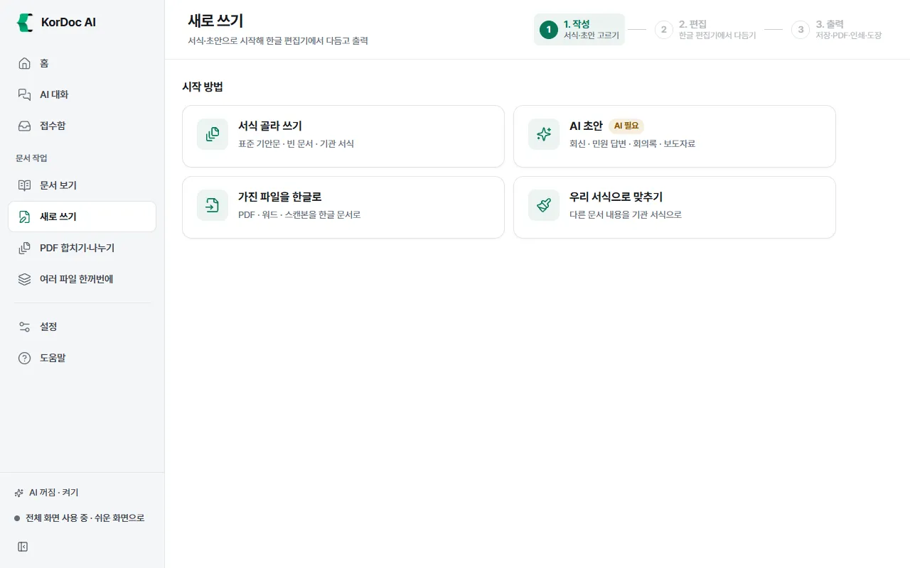
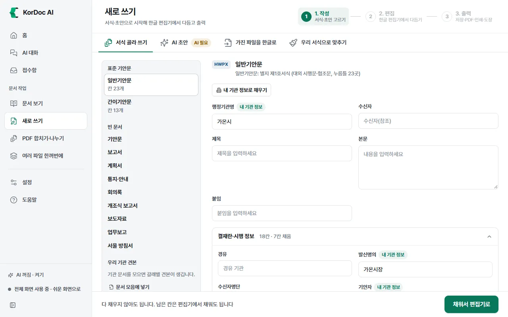
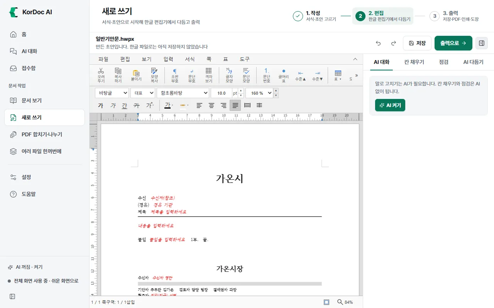
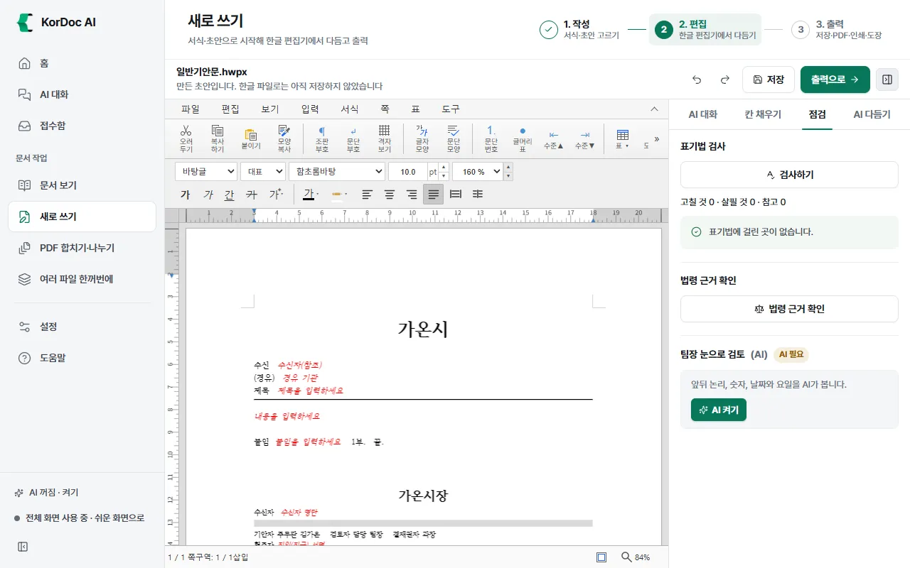
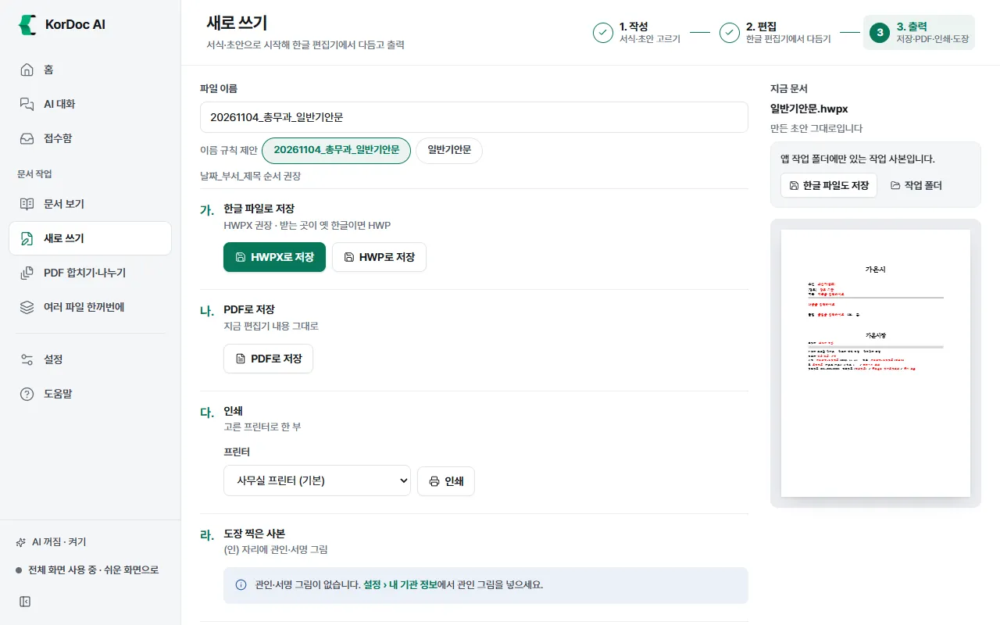

# 새로 쓰기

공문서를 새로 만들고 앱 안의 한글 편집기에서 다듬어 저장·PDF·인쇄·도장까지 하는 화면입니다. **1. 작성 → 2. 편집 → 3. 출력** 세 단계로 나뉩니다. 한컴오피스가 없어도 됩니다.

## 이럴 때 씁니다

- 표준 기안문이나 우리 기관 서식으로 공문을 쓸 때
- AI에게 회신·민원 답변·회의록·보도자료 초안을 맡길 때
- PDF·워드·스캔본을 고쳐 쓸 수 있는 한글 문서로 바꿀 때
- 다른 문서 내용을 우리 기관 서식으로 맞출 때
- 이미 있는 한글 문서를 고치고 PDF로 낼 때

새로 쓰기는 전체 화면의 왼쪽 메뉴에 있습니다. 쉬운 화면에서는 홈의 **공문 작성**·**한글 변환** 카드나 문서 보기의 **한글 편집기로 열기**로 들어갑니다.

## 1단계. 작성: 시작 방법 고르기

| 시작 방법 | 하는 일 | AI |
| --- | --- | --- |
| **서식 골라 쓰기** | 서식을 고르고 칸을 채워 편집기로 넘깁니다 | 필요 없음 |
| **AI 초안** | 지시 한 줄과 참고 문서로 AI가 초안을 쓰고 미리보기를 보며 한글 문서로 만듭니다 | 필요 |
| **가진 파일을 한글로** | 글과 표를 고쳐 쓸 수 있는 한글 문서로 다시 짭니다. 원본은 그대로 둡니다 | 필요 없음 |
| **우리 서식으로 맞추기** | 견본 문서의 여백·글꼴·항목 기호로 새 한글 문서를 만듭니다. 원본은 그대로 둡니다 | 필요 없음 |

하나를 고르면 네 칸이 위쪽 탭으로 바뀌어 다른 방법으로 바로 옮겨 갑니다. 한글 파일(HWP·HWPX)을 이 화면에 끌어다 놓으면 바로 편집기로 열리고, 다른 파일은 **가진 파일을 한글로**에 들어갑니다.

### 서식 골라 쓰기 (서식함)

왼쪽 서식 목록에는 네 묶음이 있습니다.

| 묶음 | 들어 있는 것 |
| --- | --- |
| 표준 기안문 | 일반기안문, 간이기안문 |
| 빈 문서 | 기안문, 보고서, 계획서, 통지·안내, 회의록, 개조식 보고서, 보도자료, 업무보고, 서울 방침서 |
| 우리 기관 견본 | 설정의 우리 기관 문서 모음에 넣은 문서의 갈래별 대표 견본 |
| 내 기관 서식 | 내가 등록한 HWP·HWPX 서식 |

표준 기안문으로 쓰기

1. **일반기안문**(또는 **간이기안문**)을 누릅니다.
2. 오른쪽에 칸 목록이 나옵니다. 행정기관명·발신명의·기안자처럼 내 기관 정보로 채울 수 있는 칸은 저절로 채워지고 "내 기관 정보" 표시가 붙습니다. **내 기관 정보로 채우기**를 누르면 비어 있는 칸만 다시 채웁니다.
3. 수신자, 제목, 본문, 붙임을 적습니다. 결재란·시행 정보 칸은 접혀 있습니다(전체 화면에서는 펼쳐져 있습니다).
4. AI가 켜져 있으면 **빈칸 AI로 채우기** 칸이 보입니다. 무슨 문서인지 적고 **AI로 채우기**를 누르면 비어 있는 칸에만 제안을 넣습니다. AI가 읽을 문서는 **참고 문서 붙이기**로 줍니다.
5. 다 채우지 않아도 됩니다. **채워서 편집기로**를 누르면 2단계(편집)로 넘어갑니다.

빈 문서로 시작

1. **빈 문서**에서 갈래를 고릅니다(예: 보고서).
2. 전체 화면에서는 **기관 서식**을 고를 수 있습니다. 글꼴·여백·머리글이 기관 방식대로 잡힙니다.
3. **이 서식으로 시작**을 누릅니다. 머리말·꼬리말은 내 기관 정보로 채웁니다.

내 기관 서식 등록하고 쓰기

1. **서식 등록**을 누르거나 HWP·HWPX 서식을 목록에 끌어다 놓습니다. 앱 데이터에 사본으로 넣으니 원본 파일은 그대로입니다. 한글 문서만 받습니다.
2. 등록한 서식을 누르면 서식 모양에 따라 쓰는 법이 다릅니다.
   - 누름틀 칸이 있는 서식: 칸 목록이 나옵니다. 칸을 채운 뒤 **채워서 편집기로**를 누릅니다.
   - 표의 빈칸을 채우는 서식: **칸 채우기 도우미**(HWPX만)로 양식 채우기 창을 열거나, **편집기에서 직접 쓰기**로 편집기에서 바로 씁니다.
   - 견본으로 쓰는 서식: **초안을 이 견본 글꼴로 짜기**를 누르면 AI 초안 화면에서 이 견본의 항목 기호별 글꼴·크기로 짭니다.
3. 필요 없는 서식의 휴지통 단추를 누릅니다. 그 자리에 "서식함에서 뺄까요?"가 뜨면 **빼기**를 누릅니다. 그만두려면 **취소**를 누릅니다. 서식함에 넣어 둔 사본만 지우고 처음 고른 원본 파일은 그대로 둡니다.

AI로 이 서식대로 쓰기 (AI 필요)

등록한 서식과 우리 기관 견본에는 **AI로 이 서식대로 쓰기** 칸이 있습니다. 표·상자·글꼴은 그대로 두고 내용만 새로 씁니다.

1. 무슨 문서인지 적습니다. 예: 경로당 냉방기 교체 계획 보고.
2. 필요하면 **참고 문서 붙이기**로 참고 문서를 붙입니다.
3. **이 서식대로 쓰기**를 누릅니다. 새 파일(`서식 이름_새로쓰기.hwpx`)로 만들고 모르는 숫자·이름은 ○○로 남깁니다.
4. 결과 아래에 살필 것과 서식에 넣지 못한 곳이 보입니다. **편집기에서 열기**로 이어서 고칩니다.

### AI 초안 (AI 필요)

1. **초안 갈래**를 고릅니다: 일반 초안, 회신, 민원 답변, 회의록, 한 장 보고, 보도자료, 메모 정리.
2. 참고 문서를 붙입니다. 회신은 "받은 공문", 민원 답변은 "민원 서류", 한 장 보고는 "줄일 문서"가 꼭 있어야 합니다. 문서 보기에 연 문서가 있으면 이름 칩을 눌러 바로 붙입니다.
3. AI에게 부탁할 내용을 적습니다. 메모 정리는 두서없는 메모를 그대로 붙여 넣으면 개조식 보고서로 정리합니다.
4. 전체 화면에서는 **문서 갈래**와 **분량**(짧게, 보통, 길게), **서식 옵션**(기관 서식, 결재란, 표지, 목차, 쪽 번호, 끝 표시, 견본 서식 학습, 표 서식 참고)을 정할 수 있습니다.
5. 우리 기관 문서 모음에 그 갈래 문서가 있으면 **우리 기관 서식으로** 칸을 켤 수 있습니다. 켜면 우리 기관 문서의 구성과 자주 쓰는 표현을 따릅니다.
6. **초안 쓰기**를 누르면 AI가 쓰는 글이 바로 보이고, 오른쪽 **미리보기**에 공문서 모양으로 그려집니다. 표기법 검사 결과도 함께 나옵니다.
7. 글을 직접 고치려면 **글로 직접 고치기**를 펼쳐 고칩니다. # 표시가 붙은 맨 위 줄이 제목이고, 항목은 1. 가. 처럼 번호를 붙여 한 줄씩 씁니다.
8. **한글 문서로 만들어 편집하기**를 누르면 2단계로 넘어갑니다.

- 초안을 쓴 뒤 한 줄을 조금 넘친 문단은 저절로 줄여 씁니다("한 줄 맞춤"). **바뀐 곳 보기**, **다시 맞추기**, **되돌리기**가 있습니다.
- AI가 꺼져 있으면 "AI가 연결되어 있지 않아 초안을 쓸 수 없습니다."와 함께 **서식 골라 쓰기**, **빈 문서로 시작** 단추가 보입니다.

### 가진 파일을 한글로

1. 바꿀 파일(PDF·워드·엑셀·스캔본 그림)을 끌어다 놓거나 고릅니다.
2. 전체 화면에서는 **문서 갈래**(자동이 기본)와 **스캔 쪽 글자 읽기**(필요한 쪽만, 모든 쪽, 안 함)를 고를 수 있습니다.
3. **한글로 바꿔 편집하기**를 누릅니다. 새 한글 문서를 만들어 편집기에서 엽니다. 원본은 그대로입니다.

HWP 파일은 바꿀 필요가 없다고 알려 주고 **편집기로 바로 열기**를 보여 줍니다.

PDF를 고르면 **PDF를 편집기로 바로 열기**도 보입니다. 글을 다시 짜지 않고 쪽 모양을 살려 편집기에서 여는 길입니다.

1. **PDF를 편집기로 바로 열기**를 누르면 편집기에 "PDF 가져오기" 창이 뜹니다.
2. 처리 설정은 **표준 (권장)** 그대로 두고 **가져오기**를 누릅니다. 큰 PDF는 시간이 걸립니다. 열기 암호가 걸린 PDF는 이 창에서 암호를 묻습니다.
3. 편집기에서 고친 뒤 **저장**을 누르면 저장 창이 뜹니다. 기본 이름은 `원래 이름_수정.hwpx`입니다. 원본 PDF는 그대로 둡니다.

- 가져오기 창에서 **취소**를 누르면 "PDF 가져오기를 취소했습니다."가 뜨고 앞 화면으로 돌아갑니다.
- 저장하기 전에도 **출력으로**에서 PDF 저장과 인쇄를 할 수 있습니다.
- 스캔한 PDF(글자 층이 없는 PDF)는 이 길보다 **한글로 바꿔 편집하기**가 맞습니다. 글자 읽기(OCR)로 글을 뽑아 줍니다.

### 우리 서식으로 맞추기

1. **1. 맞출 서식**: 우리 기관 HWP·HWPX 견본 문서를 넣고 **견본 문서에서 서식 읽기**를 누릅니다. 용지·여백, 머리말·꼬리말, 본문 글꼴, 항목 기호, 제목, 쪽 번호, 표 모양을 읽어 보여 줍니다. **서식 이름**을 적고 **이 서식 저장**을 누르면 다음부터 목록에서 바로 고를 수 있습니다. 저장한 서식을 지우려면 그 서식의 지우기 단추를 누르고 "이 서식을 지울까요?"에서 **지우기**를 누릅니다. 저장한 서식만 지우고 이 서식으로 만든 문서는 그대로 둡니다.
2. **2. 내용 문서**: 내용을 가져올 문서를 넣습니다. 한글·PDF·워드·글 파일, 여러 개도 됩니다.
3. **우리 서식으로 만들기**를 누릅니다. 문서마다 `원래 이름_우리서식.hwpx`를 새로 만듭니다.
4. **3. 결과**에서 **편집기에서 열기**, **폴더에서 보기**, **PDF로 저장**을 누릅니다.

## 양식 채우기 창

표에 "성명", "생년월일" 같은 이름 칸과 빈칸이 있는 HWPX 양식을 채우는 창입니다. 서식함의 **칸 채우기 도우미**나 문서 보기의 **양식 칸 채우기**로 엽니다.

1. 왼쪽 **입력 항목**에 채울 칸이 목록으로 나옵니다. 빈 칸에는 "빈칸", 채운 칸에는 "채움" 표시가 붙습니다.
2. 값을 넣으면 오른쪽 미리보기에 바로 보입니다. 날짜 칸은 날짜를 고르고, 체크 칸은 표시를 켭니다.
3. 엑셀 명부가 있으면 **명부에서 가져오기**를 누릅니다. 칸 이름과 같은 열의 둘째 줄 값을 가져옵니다.
4. **HWPX 저장**을 누르면 `원래 이름_채움.hwpx`로 저장하고 다시 읽어 확인한 결과를 보여 줍니다.
5. 같은 이름 칸이 여러 곳에 있으면 다른 칸을 덮어쓰지 않도록 값을 넣지 않습니다. 그 칸은 편집기에서 직접 넣으세요.

Esc를 누르면 창을 닫습니다. 원본 양식은 그대로입니다.

## 2단계. 편집: 한글 편집기

가운데가 한글 편집기이고, 오른쪽이 **편집 보조** 칸입니다. 편집기의 메뉴(파일·편집·보기·입력·서식·쪽·표·도구)와 단축키는 한글과 비슷합니다. 단축키 표는 [단축키](13-shortcuts.md) 장에 있습니다.

위쪽 줄

- 문서 이름과 상태: "만든 초안입니다. 한글 파일로는 아직 저장하지 않았습니다", "고친 내용이 아직 저장되지 않았습니다", "14:20에 저장함" 같은 글이 보입니다.
- 실행 취소(Ctrl+Z), 다시 실행(Ctrl+Shift+Z) 단추
- **저장**: 지금 문서를 한글 파일로 저장합니다. Ctrl+S, Windows에서는 Alt+S로도 저장합니다.
- **출력으로 →**: 3단계로 넘어갑니다.
- 맨 오른쪽 단추로 편집 보조 칸을 접고 펼칩니다.

저장 규칙

- 처음 저장할 때는 저장할 곳을 묻습니다. 가지고 있던 파일을 고친 경우 기본 이름이 `이름_수정`이라 원본이 덮이지 않습니다. 새로 만든 문서는 `날짜_부서_제목` 꼴을 권합니다.
- 한 번 저장한 뒤로는 같은 파일에 저장합니다. 가지고 있던 파일을 처음 덮어쓸 때는 원래 파일을 `.bak` 파일로 남깁니다.
- 저장하지 않은 채 다른 문서를 열거나 앱을 끄면 "저장하지 않은 문서" 창이 뜹니다. **저장**, **버리기**, **취소** 가운데 고릅니다.
- 앱이 갑자기 꺼져도 고친 내용은 복구 사본으로 남습니다. 홈의 "저장하지 않고 꺼진 문서"에서 **되살리기**를 누르세요.
- 쪽이 아주 많은 문서는 열기 전에 "쪽이 아주 많은 문서" 창이 뜹니다. 2분 안에 열리지 않으면 멈춥니다. 내용만 보려면 문서 보기에서 여세요.

### 편집 보조 칸

| 탭 | 하는 일 | AI |
| --- | --- | --- |
| **AI 대화** | 열린 문서를 말로 고칩니다. 고친 것은 요청 하나씩 되돌릴 수 있습니다 | 필요 |
| **칸 채우기** | 서식의 이름 붙은 칸(누름틀)에 값을 넣습니다 | 필요 없음 |
| **점검** | 표기법 검사, 법령 근거 확인, 팀장 눈으로 검토(AI) | 검토만 필요 |
| **AI 다듬기** | 고른 글을 간결하게·개조식·공문체 등으로 바꿉니다 | 필요 |

AI 대화

1. 고칠 문단에 커서를 두거나 글을 고릅니다.
2. 아래 칸에 "제목을 더 짧게 고쳐 줘", "추진일정 표에 행을 하나 더 넣어 줘"처럼 적고 Enter를 누릅니다.
3. AI가 하는 일이 한 줄씩 적힙니다. 고친 문단은 문단 번호와 고친 글 앞부분으로 보입니다. 예: "29번째 문단 고침: "추진 일정을 다음과 같이…"", "6번째 문단의 표 · 칸 3개 채움". 구역이 둘 이상이면 "2구역 3번째 문단"처럼 구역 번호가 붙습니다.
4. AI가 바꾼 곳으로 커서가 가고 "바꾼 곳 N개"가 보입니다. 마음에 들지 않으면 **이 요청 되돌리기**를 누릅니다(가장 최근 요청만).
5. **새 대화**는 대화만 지웁니다. 문서는 그대로입니다.

AI가 편집기에서 할 수 있는 일: 문서·표 읽기, 글 찾기, 찾아 바꾸기, 문단 다시 쓰기·넣기·지우기, 표 칸 채우기, 표 줄 넣기·지우기, 새 표 넣기, 글자 모양(진하게·기울임·밑줄·색·크기·글꼴), 문단 모양(정렬·줄 간격·들여쓰기), 스타일 걸기·만들기, 누름틀 채우기, 각주 넣기, 우리 기관 문서 구성 참고.

칸 채우기

1. 문서에 이름 붙은 칸(누름틀)이 있으면 칸 목록이 나옵니다.
2. 값을 넣고 **편집기에 넣기**를 누릅니다. 편집기의 실행 취소 한 번이면 모두 되돌립니다.

점검

- **표기법 검사**: **검사하기**를 누르면 지금 편집기 글을 공문서 표기 규칙으로 봅니다. 결과를 누르면 그 자리로 갑니다.
- **법령 근거 확인**: 「법령명」 제N조 인용을 찾아 법제처 현행 법령과 대조합니다.
- **팀장 눈으로 검토 (AI)**: **검토 받기**를 누르면 앞뒤 논리, 숫자, 날짜와 요일을 봅니다.

AI 다듬기

1. 편집기에서 글을 고르고 **고른 글 가져오기**를 누릅니다. 고른 글이 없으면 커서가 있는 문단을 가져옵니다.
2. 방식을 고릅니다: 다듬기, 간결하게, 개조식, 서술문, 쉬운 공공언어, 공문체.
3. **다듬기**를 누르면 **미리보기**에 결과가 나옵니다.
4. **바꿔 넣기**를 누르면 편집기의 그 글을 바꿉니다. 바꾸기 전으로 돌아가려면 **되돌리기**를 누릅니다.
5. 글자 모양이 섞인 문단이나 표 안 글은 바로 바꾸지 못합니다. 이때는 "문단을 선택해 두었습니다. Ctrl+V(맥은 ⌘V)로 붙여 넣으세요."가 뜹니다.

## 3단계. 출력

1. **파일 이름**을 확인합니다. **이름 규칙 제안** 칩을 누르면 `날짜_부서_제목` 꼴 이름이 들어갑니다.
2. 필요한 출력을 고릅니다.

| 항목 | 단추 | 결과 |
| --- | --- | --- |
| 가. 한글 파일로 저장 | **HWPX로 저장**, **HWP로 저장** | 저장할 곳을 고릅니다. 받는 곳이 옛 한글(2010 이전 등)이면 HWP |
| 나. PDF로 저장 | **PDF로 저장** | 지금 편집기 내용 그대로 PDF. 한글 파일을 따로 저장하지 않아도 됩니다 |
| 다. 인쇄 | **인쇄** | 고른 프린터로 한 부를 바로 보냅니다 |
| 라. 도장 찍은 사본 | **도장 찍기** | (인) 자리에 관인·서명 그림을 얹은 `이름_날인.hwpx` |
| 마. 공개용 사본 | **공개용 사본 만들기** | 주민번호·전화번호 등을 가리고 다시 검사한 `이름_공개용.hwpx` |
| 바. 붙임 합본 PDF | **합본 만들기** | 본문과 붙임을 PDF 한 권으로 `이름_합본.pdf` |

- 도장: 관인 그림이 없으면 "관인·서명 그림이 없습니다. 설정 › 내 기관 정보에서 관인 그림을 넣으세요."가 보입니다. 도장은 HWPX 문서에 찍습니다. 문서에 (인) 자리가 없으면 편집기에서 (인)을 넣고 다시 누르세요.
- 붙임 합본: **붙임 추가**로 붙임 파일을 넣고 끌어서 순서를 바꿉니다. **워터마크**(없음, 대외비, 사본, 공개용)와 **쪽 번호**를 고릅니다.
- 빈칸에 안내 글자(회색·빨간 글자)가 남아 있으면 내보내기 전에 "빈칸 안내 글자" 창이 뜹니다. 안내 글자가 인쇄와 PDF에 그대로 찍히기 때문입니다. **지우고 계속**, **그대로 두고 계속**, **취소** 가운데 고릅니다.
- 오른쪽 **지금 문서** 칸에 저장 상태와 첫 쪽 그림이 보입니다. 아직 한글 파일로 저장하지 않은 초안은 "앱 작업 폴더에만 있는 작업 사본입니다."라고 알려 줍니다. **한글 파일도 저장**으로 저장하세요.

## 알아 둘 것

- PDF·인쇄·도장·공개용 사본·합본은 원본 한글 파일을 바꾸지 않습니다. 한글 파일을 바꾸는 것은 **저장**과 **HWPX로 저장·HWP로 저장**뿐입니다.
- 저장하지 않은 초안은 앱 데이터의 작업 폴더에 있고, 14일이 지나면 지웁니다. 남기려면 꼭 한글 파일로 저장하세요.
- AI가 필요한 것: AI 초안, 빈칸 AI로 채우기, AI로 이 서식대로 쓰기, 편집 보조의 AI 대화·AI 다듬기·팀장 눈으로 검토.
- 쉬운 화면에서 숨는 것: 가진 파일을 한글로의 문서 갈래·글자 읽기, 빈 문서의 기관 서식, AI 초안의 문서 갈래·분량·서식 옵션.
