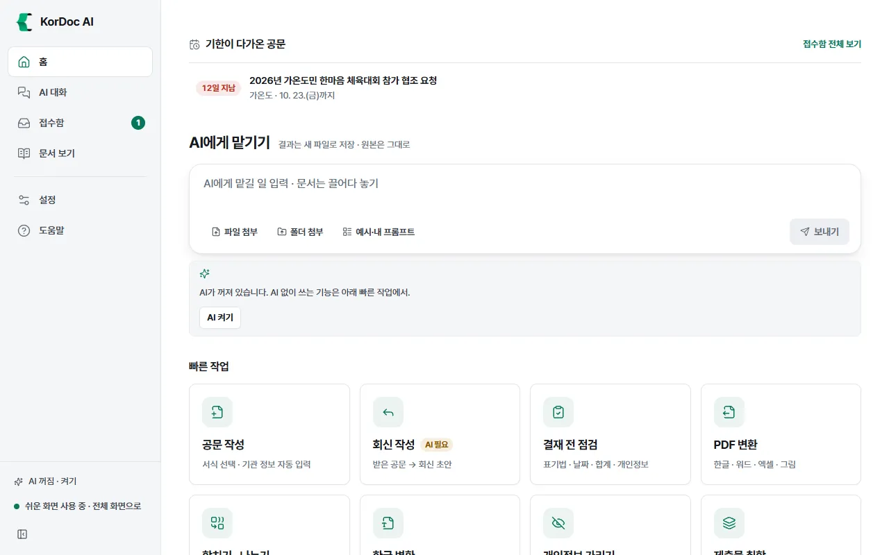
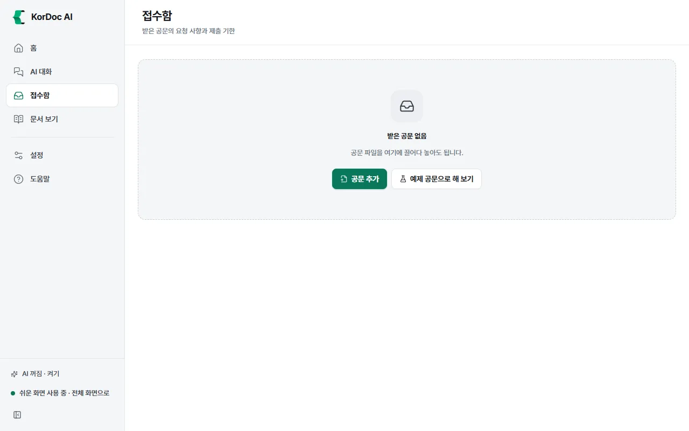

# 접수함

받은 공문을 넣으면 보낸 곳, 문서번호, 요청 사항, 제출 기한을 뽑아 기한 순으로 정리하는 화면입니다. 기한이 다가오면 알려 주고 바로 회신을 쓸 수 있습니다.

## 이럴 때 씁니다

- 받은 공문이 많아 기한을 놓칠까 걱정될 때
- 공문마다 무엇을 내야 하는지 한 줄로 보고 싶을 때
- 접수대장을 엑셀로 만들어야 할 때

뽑는 일은 정해진 규칙으로 하므로 AI가 필요 없습니다.

## 공문 넣기

1. 왼쪽 메뉴에서 **접수함**을 누릅니다.
2. **공문 추가**를 누르고 공문 파일을 고릅니다. 화면에 끌어다 놓아도 됩니다. 폴더를 놓으면 안쪽 문서까지 모두 넣습니다.
3. "공문을 읽는 중"이 끝나면 "공문 N건을 정리했습니다"가 뜨고 **할 일** 목록에 들어갑니다.

처음이라 목록이 비어 있으면 **예제 공문으로 해 보기**를 눌러 연습해 보세요.

넣을 수 있는 파일: HWP, HWPX, HML, PDF(스캔본 포함), DOCX, 그림(PNG·JPG·WEBP), TXT, MD. 스캔한 공문은 글자 읽기(OCR)를 씁니다.

다른 길

- 문서 보기에서 받은 공문을 열면 정보 칸에 **접수함에 넣기**가 보입니다.
- 탐색기에서 공문 파일을 마우스 오른쪽 단추로 누르고 KorDoc AI › **받은 공문 접수하기**를 고릅니다. 창을 열지 않고 접수함에 넣은 뒤 알림만 띄웁니다.

## 목록 보기

- 위쪽 **할 일**, **끝냄**, **전체**로 목록을 거릅니다. 고른 것은 기억합니다.
- 오른쪽에 "기한 지남 N건 · 오늘 N건 · 3일 안 N건"이 보입니다.
- 열: 기한, 제목, 보낸 곳, 요청 사항, 상태. 창이 좁으면 보낸 곳은 제목 아래로 들어갑니다.
- 기한 표시: 지났으면 "N일 지남"(빨강), 오늘이면 "오늘"(빨강), 7일 안이면 주황 "D-N", 그 밖은 "D-N". 기한이 없으면 "기한 없음".
- 할 일이 먼저, 기한이 빠른 순으로 놓입니다.

## 한 건 자세히 보기

줄을 누르면 펼쳐집니다.

- **요청 사항**: 공문에서 찾은 요청 문장과 기한. 못 찾았으면 "요청 문장을 찾지 못했습니다. 기한은 오른쪽에서 직접 넣으세요."
- **문서**: 보낸 곳, 문서번호, 시행일, 파일
- **기한**: 날짜를 고쳐 넣으면 저절로 저장합니다. **기한 지우기**를 누르면 지워집니다. 고친 뒤에는 뽑은 기한으로 되돌리는 링크가 생깁니다.
- **메모**: 담당자나 진행 상황을 적습니다. 칸을 벗어나면 저장합니다.

아래 단추

| 단추 | 하는 일 |
| --- | --- |
| **열기** | 문서 보기에서 본문을 읽고 검토·내보내기를 합니다 |
| **회신 쓰기** (AI 꺼짐: **서식으로 회신 쓰기**) | AI가 이 공문을 읽고 회신 기안문 초안을 씁니다. AI가 꺼져 있으면 서식함의 표준 기안문으로 직접 씁니다 |
| **끝냄으로 표시** / **할 일로 되돌리기** | 상태를 바꿉니다. 줄의 **끝냄** 칸을 눌러도 됩니다 |
| **인용 법령 확인** | 공문이 인용한 법령을 법제처 원문과 맞춰 봅니다. 시행일이 있으면 그날 조문과 지금 조문도 견줍니다 |
| **목록에서 빼기** | 접수함 목록에서만 뺍니다. 파일은 그대로 둡니다 |

## 접수대장 엑셀

1. 위쪽 **접수대장 엑셀**을 누릅니다.
2. 모든 공문의 접수일, 보낸 곳, 문서번호, 시행일, 제목, 요청 사항, 기한, 상태, 메모, 파일을 엑셀 한 장(`접수대장_날짜.xlsx`)으로 저장합니다.
3. "접수대장을 엑셀로 저장했습니다 (N건)"이 뜨면 아래 **열기**·**폴더에서 보기**를 누릅니다.

## 기한 알림

- 왼쪽 메뉴 접수함 옆 숫자는 할 일 가운데 기한이 지났거나 오늘·내일까지인 공문 수입니다. 앱을 켤 때와 30분마다 셉니다.
- 앱 창을 보고 있지 않을 때 "기한이 가까운 공문 N건" 알림을 하루에 한 번 띄웁니다.
- 홈 맨 위 "기한이 다가온 공문"에도 최대 3건 보입니다.

## 알아 둘 것

- 접수함 목록은 이 PC에만 저장합니다. 같은 파일을 다시 넣으면 뽑은 값은 새로 읽되 상태·메모·직접 고친 기한은 남깁니다.
- 읽지 못한 파일은 "읽지 못한 파일 N개"로 따로 보입니다. 스캔본인데 글자를 못 읽었으면 설정 › 저장과 연결에서 스캔한 쪽 글자 읽기를 켜고 다시 넣으세요.
- 쉬운 화면과 전체 화면의 차이는 없습니다.
