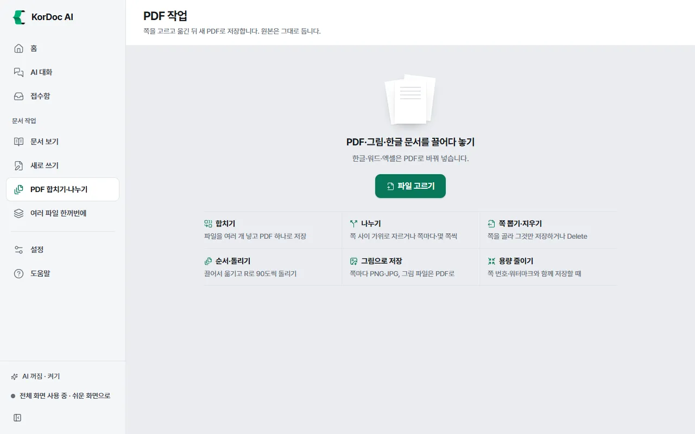
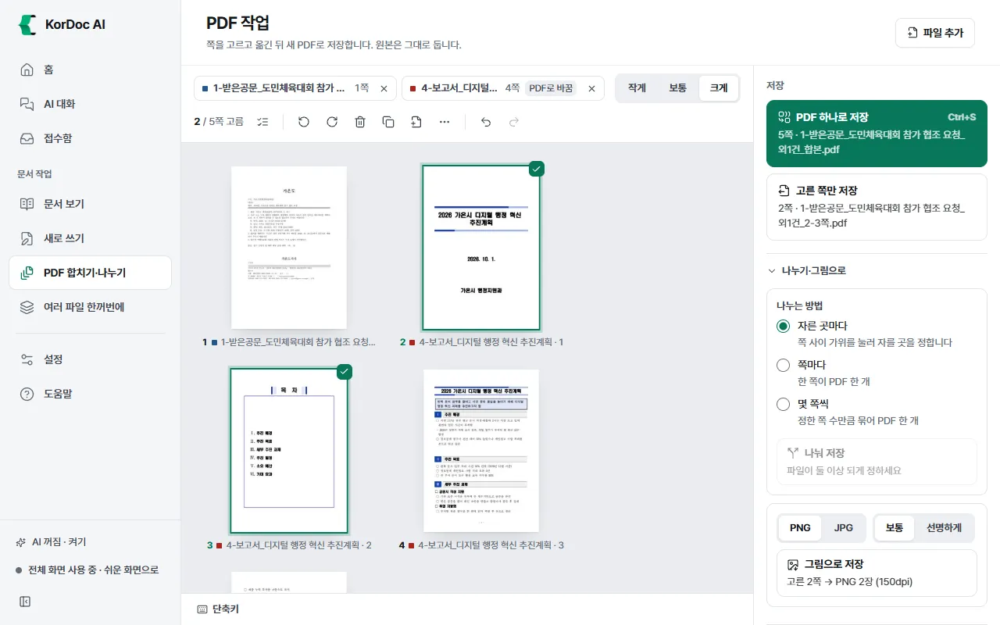
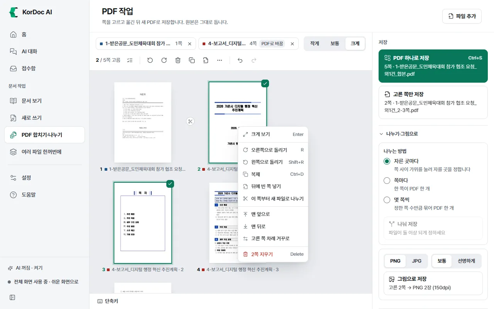
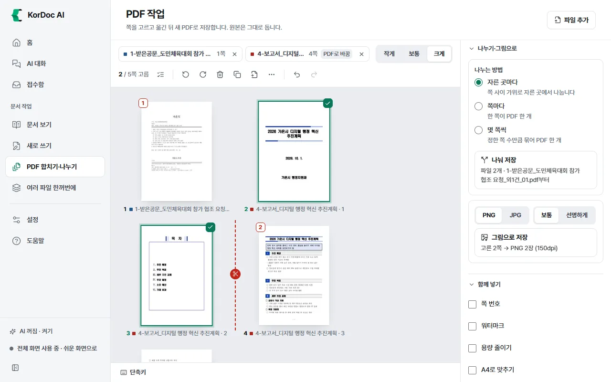

# PDF 합치기·나누기

PDF·그림·한글·워드·엑셀 파일을 쪽 단위로 책상에 펼쳐 놓고 고르고, 옮기고, 돌리고, 지우고, 나눈 뒤 새 PDF로 저장하는 화면입니다. 화면 제목은 **PDF 작업**입니다. 원본은 그대로 둡니다. 모든 손질은 되돌릴 수 있습니다. AI는 쓰지 않습니다.

## 이럴 때 씁니다

- 여러 파일을 PDF 하나로 합칠 때
- 긴 PDF를 몇 쪽씩 나눌 때
- 필요한 쪽만 뽑거나, 빈 쪽·필요 없는 쪽을 지울 때
- 거꾸로 스캔한 쪽을 돌리거나 순서를 바꿀 때
- 쪽마다 그림 파일(PNG·JPG)로 저장할 때
- 양면 스캔한 앞면·뒷면 파일을 번갈아 섞을 때

들어오는 길: 전체 화면의 왼쪽 메뉴 **PDF 합치기·나누기**, 문서 보기의 **쪽 정리·나누기**, 여러 파일 한꺼번에 › 나누기의 **쪽을 보며 나누기·뽑기 (PDF 작업)**, 전체 화면 홈의 모든 기능 보기 "4. PDF", 탐색기 우클릭 **PDF 쪽 편집하기**. 다른 화면에서 파일을 보내면 책상이 그 파일로 바뀝니다. 이전 책상은 Ctrl+Z로 되돌립니다.

## 파일 넣기

1. **파일 고르기**를 누르거나 파일을 끌어다 놓습니다. 여러 개를 고르면 이름 차례로 쪽이 이어집니다.
2. 이미 쪽이 있으면 위쪽 **파일 추가**로 더 넣습니다. 맨 뒤에 이어 붙습니다. Ctrl+O로도 넣습니다.
3. 한글·워드·엑셀은 PDF로 바꿔 넣습니다. 파일 이름표에 "PDF로 바꿈"이 붙습니다.
4. 보안 설정이 걸린 PDF는 쪽을 그림으로 넣습니다("보안 PDF"). 그 쪽은 글자 복사·검색이 되지 않습니다. 열기 암호가 걸린 PDF는 넣을 수 없습니다. 암호를 푼 사본을 저장해 넣으세요.

위쪽 파일 이름표를 누르면 그 파일의 쪽을 모두 고릅니다. 이름표의 ×는 그 파일과 쪽을 모두 뺍니다. **작게**·**보통**·**크게**로 쪽 그림 크기를 바꿉니다.

## 쪽 고르고 다루기

고르기

- 누르기: 그 쪽만 고릅니다
- Ctrl+누르기: 하나씩 더하거나 뺍니다
- Shift+누르기: 범위를 고릅니다
- 빈 곳에서 끌기: 상자로 여러 쪽을 고릅니다
- **고르기** 메뉴: 모두 고르기, 고르기 풀기, 홀수 쪽, 짝수 쪽, 빈 쪽 찾아 고르기, 고른 것과 반대로, 쪽 번호로 고르기("1-3, 5"처럼 적기)

위쪽 도구 줄

| 단추 | 하는 일 |
| --- | --- |
| 왼쪽으로 / 오른쪽으로 | 고른 쪽을 90도씩 돌립니다. 아무것도 안 골랐으면 "모두 왼쪽"·"모두 오른쪽"으로 모든 쪽을 돌립니다 |
| 지우기 | 고른 쪽을 지웁니다 |
| 복제 | 고른 쪽을 바로 뒤에 하나 더 넣습니다 |
| 빈 쪽 | 고른 쪽 뒤에 빈 쪽을 넣습니다 |
| … (더 보기) | 맨 앞으로, 맨 뒤로, 고른 쪽 차례 거꾸로, 두 파일 쪽 번갈아 섞기 (양면 스캔), 번갈아 섞기, 뒤 파일은 거꾸로, 자른 곳 모두 풀기, 책상 비우기 |
| 되돌리기 / 다시 하기 | 손질을 되돌리거나 다시 합니다 |

- 순서 바꾸기: 쪽을 끌어 원하는 자리에 놓습니다. 고른 쪽이 여럿이면 함께 옮겨 갑니다.
- 크게 보기: 쪽을 두 번 누르거나 Enter. 크게 보기 창에서도 앞 쪽·다음 쪽, 돌리기, 지우기가 됩니다.
- **빈 쪽 찾아 고르기**는 거의 하얀 쪽을 골라 줍니다. 지우려면 Delete를 누르세요.

쪽 우클릭 메뉴

크게 보기, 오른쪽으로 돌리기, 왼쪽으로 돌리기, 복제, 뒤에 빈 쪽 넣기, 이 쪽부터 새 파일로 나누기(또는 나누기 풀기), 맨 앞으로, 맨 뒤로, 고른 쪽 차례 거꾸로(두 쪽 이상 골랐을 때), 이 쪽만 PDF로 저장(여러 쪽이면 고른 N쪽만 PDF로 저장), N쪽 지우기. 여러 쪽을 골랐으면 메뉴 맨 위에 "N쪽 고름"이 보입니다. 크게 보기와 나누기는 누른 쪽 하나에만 듣습니다.

다른 곳의 우클릭 메뉴

- 넣은 파일 이름(위쪽 칩): 이 파일 쪽 모두 고르기, 이 파일 쪽 맨 앞으로·맨 뒤로, 폴더에서 보기, 경로 복사, 책상에서 빼기.
- 쪽이 없는 빈 바탕: 파일 추가, 맨 뒤에 빈 쪽 넣기, 모두 고르기, 고르기 풀기, 되돌리기, 다시 실행.

## 저장하기

오른쪽 **저장** 칸에서 저장 방법을 고릅니다.

| 단추 | 결과 |
| --- | --- |
| **PDF 하나로 저장** (Ctrl+S) | 책상의 쪽을 지금 차례대로 새 PDF 하나로. 여러 파일에서 쪽을 가져왔으면 `첫 파일 이름_외N건_합본.pdf`, 한 파일이면 `이름_정리.pdf` |
| **고른 쪽만 저장** | 고른 쪽만 새 PDF로. 예: `이름_2-3쪽.pdf`. 책상은 그대로 |
| **나눠 저장** | 나눈 조각마다 PDF를 따로. `이름_01.pdf`, `이름_02.pdf`… (여러 파일이면 `첫 파일 이름_외N건_01.pdf`…) |
| **그림으로 저장** | 쪽마다 그림 파일 하나를 새 폴더(`이름_그림`)에 모아 저장 |

단추 아래에 몇 쪽인지와 파일 이름이 미리 보입니다.

### 나누기

1. **나누기·그림으로**를 펼칩니다(쪽 사이를 자르면 저절로 펼쳐집니다).
2. **나누는 방법**을 고릅니다.
   - **자른 곳마다**: 쪽 사이의 가위 단추를 눌러 자를 곳을 정합니다. 자른 뒤 쪽에 조각 번호가 붙습니다. 가위를 다시 누르면 풀립니다.
   - **쪽마다**: 한 쪽이 PDF 한 개
   - **몇 쪽씩**: 정한 쪽 수만큼 묶어 PDF 한 개(기본 2쪽씩)
3. **나눠 저장**을 누릅니다. 조각이 둘 이상이어야 누를 수 있습니다.

### 그림으로 저장

- 고른 쪽이 있으면 고른 쪽만, 없으면 모든 쪽을 그림으로 저장합니다.
- 쉬운 화면은 PNG 150dpi로 저장합니다. 전체 화면에서는 **PNG**·**JPG**와 **보통**(150dpi)·**선명하게**(300dpi)를 고를 수 있습니다. PNG는 글자가 또렷하고 JPG는 파일이 작습니다.

### 함께 넣기

PDF로 저장하는 세 가지(하나로, 고른 쪽만, 나눠)에 함께 넣는 항목입니다.

- **쪽 번호**: 쪽 아래 가운데에 "- 1 -"
- **워터마크**: 쪽마다 대각선으로 흐린 글자. 기본 글자는 "대외비"이고 바꿀 수 있습니다
- **용량 줄이기**: 그림만 줄이고 글자는 그대로
- **A4로 맞추기**: 크기가 다른 스캔·영수증을 A4 크기로

### 저장 위치와 이름

- **저장 위치**: 고르지 않으면 설정의 저장 폴더, 그것도 없으면 첫 파일이 있는 폴더입니다. **폴더 바꾸기**로 바꾸고 **원래대로**로 되돌립니다.
- **이름**: 비우면 파일 이름에서 정합니다. 같은 이름이 있으면 (2)를 붙입니다.
- 저장이 끝나면 **열기**·**폴더에서 보기**(여러 파일이면 **폴더 열기**)가 보이고, 창 밖으로 "KorDoc AI: PDF 작업 끝" 알림이 뜹니다.

## 단축키

화면 아래 **단축키**를 누르면 목록이 보입니다. 한글 입력 상태에서도 됩니다.

| 키 | 하는 일 |
| --- | --- |
| 화살표 | 쪽 옮겨 다니기(Shift를 함께 누르면 범위 고르기) |
| Space | 쪽 고르기·풀기 |
| Enter / 두 번 누르기 | 크게 보기 |
| R / Shift+R | 오른쪽 / 왼쪽으로 돌리기 |
| Delete | 고른 쪽 지우기 |
| Alt+화살표 | 고른 쪽을 한 칸 옮기기 |
| Ctrl+A | 모두 고르기 |
| Ctrl+D | 복제 |
| Esc | 고르기 풀기 |
| Ctrl+S | PDF 하나로 저장 |
| Ctrl+Z / Ctrl+Shift+Z | 되돌리기 / 다시 하기 |

전체 목록은 [단축키](13-shortcuts.md) 장에 있습니다.

## 알아 둘 것

- 원본 파일은 바꾸지 않습니다. 저장은 늘 새 파일입니다.
- 되돌리기는 이 화면을 쓰는 동안 200번까지 됩니다.
- 쉬운 화면에서는 **나누기·그림으로**와 **함께 넣기**가 처음에 접혀 있고, 그림 형식·선명도 단추가 숨습니다.
