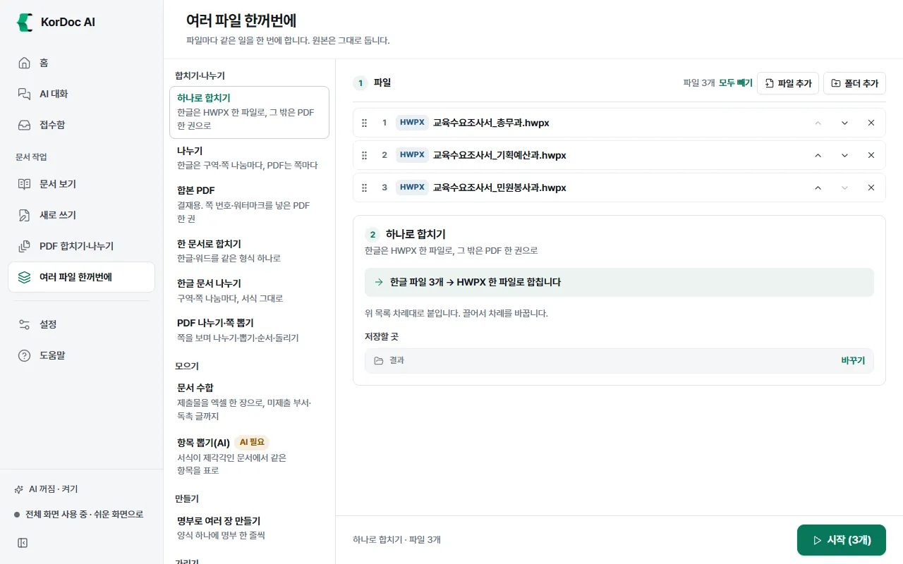
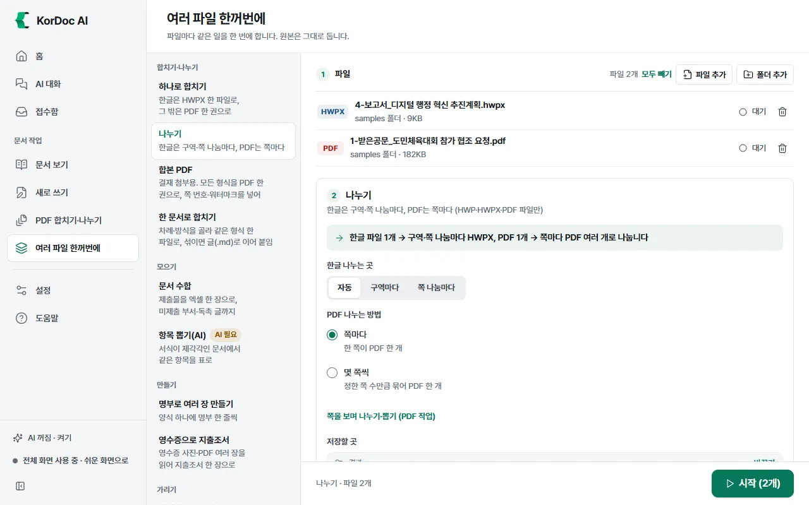
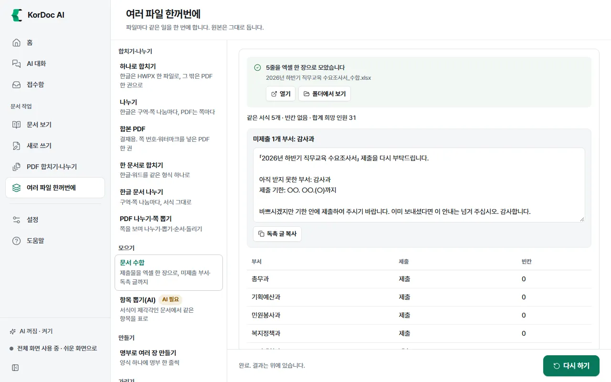

# 여러 파일 한꺼번에

파일 여러 개에 같은 일을 한 번에 하는 화면입니다. 왼쪽에서 할 일을 고르고 가운데에 파일을 넣은 뒤 **시작**을 누릅니다. 원본은 그대로 두고 결과는 새 파일로 저장합니다.

## 이럴 때 씁니다

- 부서 제출물 여러 개를 엑셀 한 장으로 모을 때
- 한글 파일 여러 개를 하나로 합치거나, 한 파일을 구역마다 나눌 때
- 파일 수십 개를 한꺼번에 PDF나 한글로 바꿀 때
- 명부 한 줄마다 같은 양식을 한 장씩 만들 때
- 두 문서를 비교해 신구대조표를 만들 때

들어오는 길: 전체 화면의 왼쪽 메뉴 **여러 파일 한꺼번에**, 홈의 **합치기 · 나누기**·**PDF 변환**·**제출물 취합**·**영수증 → 지출조서** 카드, 탐색기 폴더 우클릭 **여러 파일 한꺼번에 열기**·**문서 수합하기**. **합치기 · 나누기**와 **PDF 변환** 카드는 고른 파일만 넣어 두고 **시작**은 직접 누릅니다. **영수증 → 지출조서** 카드는 고른 영수증을 넣자마자 읽기 시작합니다.

## 따라 하기

1. 왼쪽 **할 일** 목록에서 일을 고릅니다.
2. **1 파일**에 파일을 넣습니다. 비어 있을 때는 **파일 고르기**·**폴더 고르기**, 넣은 뒤에는 **파일 추가**·**폴더 추가**(폴더 안 문서를 모두 넣음)를 누르거나 끌어다 놓습니다. 이 일에 쓸 수 없는 형식은 "이 일에는 쓰지 않는 형식"으로 표시하고 건너뜁니다.
3. **2 (할 일 이름)**에서 옵션을 고릅니다.
4. **저장할 곳**을 확인합니다. **바꾸기**로 바꾸고 **원래대로**로 되돌립니다.
5. 아래 **시작 (N개)**를 누릅니다. 진행 중에는 **멈추기**가 보입니다.
6. 끝나면 맨 위에 결과가 보입니다. 파일마다 "완료", "실패"가 붙고, **폴더에서 보기**로 결과를 엽니다. 같은 설정으로 다시 하려면 **다시 하기**를 누릅니다.

- **모두 빼기**는 목록에서만 뺍니다. 파일은 지우지 않습니다.
- 작업 중에는 파일을 넣을 수 없습니다.
- 끝나면 창 밖으로 "KorDoc AI: 여러 파일 작업 끝" 알림이 뜹니다.

## 할 일 목록

쉬운 화면에는 10가지만 보이고, 나머지는 **다른 일 N가지 더 보기 (전체 화면으로)**를 누르면 보입니다. 아래 표의 "쉬운 화면" 칸이 "전체 화면만"인 일은 전체 화면에서만 보입니다.

| 묶음 | 할 일 | 하는 일 | 쉬운 화면 | AI |
| --- | --- | --- | --- | --- |
| 합치기·나누기 | **하나로 합치기** | 한글은 HWPX 한 파일로, 그 밖은 PDF 한 권으로 | 보임 | 필요 없음 |
| | **나누기** | 한글은 구역·쪽 나눔마다, PDF는 쪽마다 | 보임 | 필요 없음 |
| | **합본 PDF** | 결재 첨부용. 모든 형식을 PDF 한 권으로, 쪽 번호·워터마크를 넣어 | 보임 | 필요 없음 |
| | **한 문서로 합치기** | 차례·방식을 골라 같은 형식 한 파일로, 섞이면 글(.md)로 이어 붙임 | 전체 화면만 | 필요 없음 |
| 모으기 | **문서 수합** | 제출물을 엑셀 한 장으로, 미제출 부서·독촉 글까지 | 보임 | 서식이 다른 문서만 |
| | **항목 뽑기(AI)** | 서식이 제각각인 문서에서 같은 항목을 표로 | 전체 화면만 | 필요 |
| 만들기 | **명부로 여러 장 만들기** | 양식 하나에 명부 한 줄씩 | 전체 화면만 | 필요 없음 |
| | **영수증으로 지출조서** | 영수증 사진·PDF 여러 장을 읽어 지출조서 한 장으로 | 보임 | 필요 없음(적요 제안만 선택) |
| 가리기 | **개인정보 가리기** | 주민번호·전화번호 등을 가린 사본 | 보임 | 필요 없음 |
| 줄이기·인쇄하기 | **PDF 용량 줄이기** | 첨부 한도에 맞게, 글자는 그대로 | 보임 | 필요 없음 |
| | **한꺼번에 인쇄** | 고른 프린터로 바로 | 전체 화면만 | 필요 없음 |
| 비교하기 | **신구대조표 만들기** | 고치기 전과 후 문서를 견줘 표로 | 보임 | 필요 없음 |
| 찾기·뽑기 | **여러 문서에서 찾기** | 낱말이 나오는 문서와 쪽 | 전체 화면만 | 필요 없음 |
| | **표 뽑기** | 문서 속 표를 엑셀로 | 전체 화면만 | 필요 없음 |
| | **그림만 뽑기** | 문서에 든 그림을 폴더로 | 전체 화면만 | 필요 없음 |
| 바꾸기 | **PDF로** | 인쇄 모양 그대로 PDF로 | 보임 | 필요 없음 |
| | **한글로** | PDF·워드·엑셀을 고칠 수 있는 한글 문서로 | 보임 | 필요 없음 |
| | **우리 서식으로 맞추기** | 내용은 두고 저장한 우리 기관 서식으로 | 전체 화면만 | 필요 없음 |
| | **글로** | 문서 속 글만 꺼내 글 파일로 | 전체 화면만 | 필요 없음 |
| | **스캔 읽기** | 그림·스캔 PDF 속 글자를 글로 | 전체 화면만 | 필요 없음 |
| 지켜보기 | **폴더 지켜보기** | 새 문서가 들어오면 글로 바꿈 | 전체 화면만 | 필요 없음 |

AI가 필요한 일에 AI가 꺼져 있으면 "AI 필요" 표시가 붙고, **시작** 대신 이유와 **AI 켜기** 단추가 보입니다.

합치는 일이 세 가지라 헷갈리기 쉽습니다. 이렇게 고르세요.

| 할 일 | 이럴 때 | 결과 |
| --- | --- | --- |
| **하나로 합치기** | 형식을 따로 정하지 않고 하나로 묶을 때 | 모두 한글이면 서식 그대로 HWPX 한 파일, 섞이면 PDF 한 권 |
| **합본 PDF** | 결재에 붙일 한 권이 필요할 때 | 어떤 형식이든 PDF 한 권. 쪽 번호와 워터마크(대외비·사본·공개용)를 넣을 수 있음 |
| **한 문서로 합치기** (전체 화면) | 순서를 직접 정하고 같은 형식끼리 그 형식 그대로 합치거나 글만 이어 붙일 때 | 모두 HWPX·DOCX·XLSX 가운데 한 형식이면 그 형식 한 파일, 형식이 섞이면 글(마크다운) 파일 하나 |

나누는 일은 **나누기** 하나입니다. 한글과 PDF를 함께 넣어도 됩니다. PDF 쪽을 보면서 골라 뽑거나 순서를 바꾸려면 나누기 옵션 아래의 **쪽을 보며 나누기·뽑기 (PDF 작업)**를 누릅니다([PDF 합치기·나누기](06-pdf.md)).

## 할 일마다 자세히

### 하나로 합치기

파일 목록 차례대로 붙입니다. 끌거나 위·아래 단추로 차례를 바꿉니다. 화면에 어떻게 합칠지 미리 보입니다(예: "한글 파일 3개 → HWPX 한 파일로 합칩니다").

판정 규칙

- 넣은 파일이 모두 한글(HWP·HWPX)이면 서식을 그대로 둔 **HWPX 한 파일**로 합칩니다. HWP는 HWPX로 바꿔 합칩니다. 읽을 수 있는 한글 문서가 두 개 이상이어야 합니다.
- 한글이 아닌 파일이 하나라도 섞이면 모두 PDF로 바꿔 **PDF 한 권**으로 합칩니다.
- 결과 이름: `첫 파일 이름_외N건_합본.hwpx` 또는 `.pdf`
- 읽지 못한 파일은 건너뛰고 "N개는 넣지 못함"으로 알려 줍니다.

### 나누기

한글·PDF 파일만 씁니다. 파일마다 따로 나눕니다. 화면에 어떻게 나눌지 미리 보입니다(예: "한글 파일 1개 → 구역·쪽 나눔마다 HWPX, PDF 1개 → 쪽마다 PDF 여러 개로 나눕니다"). 넣은 파일에 있는 형식의 옵션만 보입니다.

판정 규칙

- PDF: **PDF 나누는 방법**에서 **쪽마다**(한 쪽이 PDF 한 개) 또는 **몇 쪽씩**(기본 2쪽)을 고릅니다. 나눌 조각이 둘이 안 되면 "N쪽이라 나눌 것 없음"으로 건너뜁니다.
- 한글: **한글 나누는 곳**에서 고릅니다.
  - **자동**: 구역이 여럿이면 구역마다, 하나면 쪽 나눔(Ctrl+Enter)마다
  - **구역마다**: 구역 사이에서만 자릅니다
  - **쪽 나눔마다**: 구역 사이와 강제 쪽 나눔(Ctrl+Enter)마다 자릅니다
  - 글이 넘쳐 저절로 넘어간 쪽에서는 자르지 않습니다. 구역이 하나이고 강제 쪽 나눔도 없으면 "나눌 곳이 없습니다"로 알려 줍니다.
  - 결과는 서식을 그대로 둔 HWPX입니다(HWP도 HWPX로).
- 결과는 `이름_나누기` 폴더에 `이름_01.pdf`(한글은 `이름_1.hwpx`)처럼 번호를 붙여 저장합니다.
- 파일을 넣으면 옵션 아래에 **쪽을 보며 나누기·뽑기 (PDF 작업)**가 보입니다. 누르면 넣은 파일이 PDF 작업 화면에 열립니다(한글 파일은 PDF로 바꿔 엽니다). 쪽 그림을 보며 뽑기·지우기·순서 바꾸기·돌리기를 하고 새 PDF로 저장합니다. 원본은 그대로입니다.

### 합본 PDF

결재에 붙일 PDF 한 권을 만듭니다. 한글·워드·그림도 PDF로 바꿔 목록 차례대로 붙입니다. **워터마크**(없음, 대외비, 사본, 공개용)와 **쪽 번호 넣기**(기본 켬)를 고릅니다. 결과는 `첫 파일 이름_외N건_합본.pdf`입니다(파일이 하나면 `이름_합본.pdf`).

### 한 문서로 합치기 (전체 화면)

글을 차례대로 이어 붙여 문서 하나로 만듭니다. **시작**을 누르면 **합치기** 창이 열립니다. 끌어서 순서를 정하고 모두 같은 형식(HWPX·DOCX·XLSX·PDF)이면 **합칠 방식**에서 **서식 유지**(그 형식 그대로)나 **글(마크다운)**을 고릅니다. 형식이 섞이면 글로 합칩니다. 모두 PDF면 합본 PDF와 같은 방법으로 한 권을 만듭니다. **합치기**를 누르면 `첫 파일 이름_외N건_합본.확장자`로 저장합니다(글로 합치면 `.md`).

### 문서 수합

1. 부서들이 낸 파일이나 폴더를 넣습니다. 한글·엑셀·PDF가 섞여도 됩니다.
2. **부서 명단 (선택)**에 한 줄에 부서 하나씩 적습니다. **명단 파일에서 가져오기**로 엑셀·한글·글 파일의 부서 이름을 읽어 올 수도 있습니다. 명단을 넣으면 안 낸 부서를 찾아 독촉 글을 만듭니다.
3. **제출 기한 (선택)**을 적으면 독촉 글에 그대로 넣습니다. 예: 10. 20.(화)
4. AI가 켜져 있으면 **서식이 다른 문서는 AI로 항목 뽑기**가 기본으로 켜져 있습니다. 뽑은 값은 원문과 대조하세요. AI가 꺼져 있으면 서식이 다른 문서는 따로 볼 문서로 남깁니다.
5. **시작**을 누릅니다.

결과

- `문서 제목_수합.xlsx` 한 장. 같은 서식은 칸끼리, 엑셀은 열끼리 맞춰 한 줄씩 잇고 합계 행을 넣습니다. 빈칸은 노란색으로 표시합니다.
- "미제출 N개 부서: …"와 독촉 글. **독촉 글 복사**를 눌러 메신저나 메일에 붙여 넣습니다.
- **제출 현황** 표(부서, 제출, 빈칸)
- 늦게 온 파일은 **늦게 온 파일 더 넣기**로 넣습니다. **같은 파일 바꾸기**와 **새 파일로 만들기** 가운데 하나를 골라 앞서 만든 엑셀을 다시 만듭니다.

### 항목 뽑기(AI) (전체 화면)

**뽑을 항목**에 쉼표로 나눠 적습니다(예: 행사명, 일시, 장소, 담당자, 예산). 문서마다 한 줄, 항목마다 한 열인 엑셀을 만듭니다.

### 명부로 여러 장 만들기 (전체 화면)

1. **양식**을 고릅니다: 일반 기안문, 간이 기안문, 또는 **내 양식**(HWPX).
2. **명부 고르기**로 엑셀·CSV를 고릅니다. 첫 줄이 칸 이름, 그 아래 한 줄이 문서 한 장입니다.
3. "어느 열이 어느 칸에 들어가나" 표에서 맞춰진 것을 확인합니다. 양식에 같은 이름 칸이 없는 열은 쓰지 않는다고 알려 줍니다.
4. **파일 이름에 쓸 열**을 고릅니다(예: 성명). 고르지 않으면 1, 2, 3 순번입니다.
5. **시작**을 누르면 `양식 이름_명부 이름` 폴더에 한 장씩 만듭니다.
6. 만든 뒤 **만든 N장으로 이어서**에서 **한 파일로 합치기**, **합본 PDF**, **한꺼번에 인쇄**를 할 수 있습니다.

### 영수증으로 지출조서

1. 영수증 사진(PNG·JPG·WEBP)이나 PDF를 넣고 **시작**을 누릅니다. 홈의 **영수증 → 지출조서** 카드로 고르면 **시작**을 누르지 않아도 바로 읽습니다. 글자는 이 PC에서 읽습니다(인터넷 불필요). 글자가 든 PDF(전자영수증)는 글자 읽기를 거치지 않고 그 글을 그대로 씁니다. 여러 쪽 PDF는 쪽마다 영수증 한 장으로 봅니다.
2. 결과 표에서 영수증마다 지출일자·거래처·사업자등록번호·적요(품목)·금액·결제·비고를 확인합니다. 노란 칸은 읽은 값이 확실하지 않거나 비어 있는 칸입니다. 칸에 마우스를 올리면 읽은 줄과 확실도가 보입니다. 칸을 눌러 고치면 아래 미리보기에 바로 반영됩니다.
3. **표 복사**를 누르면 한글·워드에는 표로, 엑셀에는 칸마다 붙습니다. **HWPX 저장·열기**는 지출조서를 새 한글 파일(`지출조서_날짜.hwpx`)로 저장하고 엽니다.

- 기본 서식은 연번·지출일자·거래처·사업자등록번호·적요(품목)·금액·결제방법·비고이고, 합계 줄은 머리줄 바로 아래에 둡니다. 금액은 천 단위 쉼표입니다.
- 설정 › 내 기관 정보의 **지출조서 서식**에 기관 서식을 넣어 두면 그 서식 사본의 표에 채웁니다(줄이 모자라면 더하고 합계 줄이 있으면 금액 합을 넣습니다). 이때는 미리보기와 **표 복사**도 그 서식의 열 차례와 합계 줄 자리(맨 위, 맨 아래, 없음)를 따릅니다.
- 옵션에 "지출조서 서식: 기본 서식" 또는 "기관 서식(서식 이름)"이 보입니다. 기관 서식이 없으면 **기관 서식 넣기**, 있으면 **서식 바꾸기**를 눌러 설정의 지출조서 서식으로 바로 갑니다.
- 적요는 품목 첫 줄 요약(예: "우유 1L 외 3건")입니다. 이 PC·기관 AI 서버가 켜져 있으면 AI가 한 줄을 제안하고, 외부 AI면 결과의 **외부 AI로 적요 제안**을 눌렀을 때만 개인정보를 가린 뒤 보냅니다. 금액·날짜는 AI가 바꾸지 않습니다.
- 카드번호는 앞 네 자리만 두고 가립니다.

### 개인정보 가리기

**가릴 것**을 고릅니다. 법인등록번호와 IP 주소 말고는 기본으로 켜져 있습니다. 설정의 기관 전화·팩스와 내 이름은 가리지 않습니다. 한글은 서식 그대로 `이름_가림.hwpx`, PDF·그림은 검게 칠한 `이름_가림.pdf`, 그 밖은 `이름_가림.md`입니다. 가린 뒤 의심 가는 곳이 남으면 "남은 의심 N곳 확인 필요"로 알려 줍니다.

### PDF 용량 줄이기

문서 보기의 PDF 용량 줄이기와 같습니다. **첨부 한도**(정하지 않음, 5MB, 10MB, 20MB, 직접)와 **얼마나 줄일까요?**(가볍게, 보통, 강하게)를 고릅니다. 결과는 `이름_용량줄임.pdf`입니다.

### 한꺼번에 인쇄 (전체 화면)

**프린터**를 고르고 **시작**을 누르면 인쇄 창 없이 바로 보냅니다. 매수·양면은 프린터 기본값을 따릅니다.

### 신구대조표 만들기

이 일을 누르면 **비교** 화면이 열립니다(왼쪽 메뉴에서는 여러 파일 한꺼번에 자리에 불이 켜집니다).

1. **옛 문서 (현행)**과 **새 문서 (개정안)** 칸에 파일을 넣습니다. 형식이 달라도 됩니다(예: 옛 HWP와 새 PDF). 가운데 단추로 두 칸을 바꿉니다.
2. **비교하기**를 누릅니다.
3. "바뀜 N · 새로 넣음 N · 뺌 N · 같음 N"과 현행·개정안 표가 보입니다. **바뀐 곳만 보기**가 기본으로 켜져 있습니다.
4. **저장**에서 **한글(HWPX) 신구대조표**, **엑셀**, **HTML**, **글(마크다운)** 가운데 고릅니다. 결과는 `새 문서 이름 신구대조표.hwpx` 등입니다.

두 문서 내용이 같으면 "두 문서 내용이 같습니다. 바뀐 곳이 없어 대조표를 만들지 않았습니다."가 뜹니다.

### 여러 문서에서 찾기 (전체 화면)

**찾을 낱말**을 적고 Enter를 누르면 바로 찾습니다. 파일마다 나온 곳이 쪽과 함께 보이고, 누르면 그 쪽을 엽니다. 파일은 만들지 않습니다.

### 표 뽑기·그림만 뽑기 (전체 화면)

- 표 뽑기: **저장 형식**(엑셀, CSV, 글(마크다운))을 고릅니다. 결과는 `이름_표.xlsx`
- 그림만 뽑기: 문서에 든 그림을 `이름_그림` 폴더에 모읍니다

### 바꾸기: PDF로·한글로·우리 서식으로 맞추기·글로·스캔 읽기

| 할 일 | 결과 | 참고 |
| --- | --- | --- |
| PDF로 | `이름.pdf` | PDF는 건너뜁니다 |
| 한글로 | `이름.hwpx` | 공문은 기안문, □○ 항목은 보고서처럼 문서 모양을 보고 서식을 맞춥니다. 애매하면 글·표만 옮깁니다 |
| 우리 서식으로 맞추기 (전체 화면) | `이름_우리서식.hwpx` | 새로 쓰기 › 우리 서식으로 맞추기에서 저장한 서식을 고릅니다 |
| 글로 (전체 화면) | `이름.md`, `.html`, `.txt` | **형식**: 제목·표 살린 글, 웹 페이지, 글자만 |
| 스캔 읽기 (전체 화면) | `이름.md` | PDF와 그림만. 이 PC의 글자 읽기(OCR)를 씁니다 |

### 폴더 지켜보기 (전체 화면)

1. **지켜볼 폴더**의 **고르기**로 받은 문서가 쌓이는 폴더를 고릅니다.
2. **바꿀 형식**(제목·표 살린 글, 웹 페이지, 글자만)과 **담을 폴더**(기본: 지켜볼 폴더 안 "변환 결과")를 정합니다.
3. **지켜보기 시작**을 누릅니다. 새 문서가 들어올 때마다 글 파일로 바꿉니다. 앱 창을 닫아도 알림 영역에서 계속 지켜봅니다.
4. 그만두려면 **그만 보기**를 누릅니다.

앱을 완전히 끄면 멈춥니다. 다시 켜면 이 화면에서 다시 시작하세요. 같은 원본이 바뀌면 변환 결과를 다시 만들어 덮어씁니다.

## 알아 둘 것

- 결과는 늘 새 파일입니다. 같은 이름이 있으면 (2)를 붙입니다.
- AI가 필요한 일은 항목 뽑기(AI)뿐이고, 문서 수합은 서식이 다른 문서를 뽑을 때만 AI를 씁니다.
- 탐색기 우클릭의 **하나로 합치기**·**나누기**는 이 화면과 같은 규칙으로 창 없이 처리합니다. [탐색기 우클릭 메뉴](08-context-menu.md) 장을 보세요.
