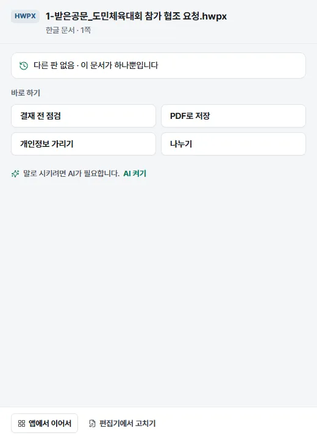
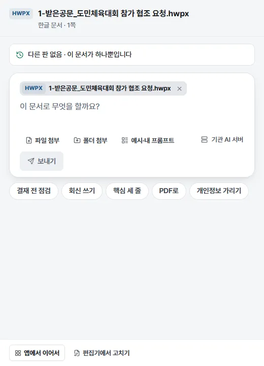
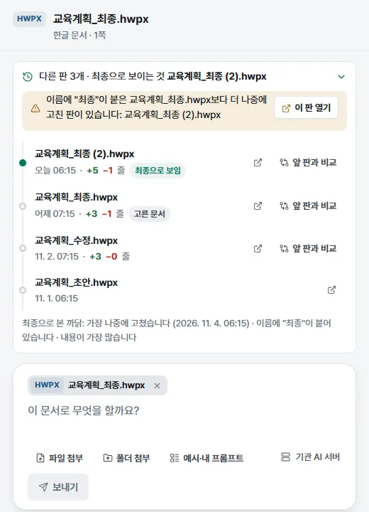

# 탐색기 우클릭 메뉴

Windows 탐색기(맥은 Finder)에서 파일이나 폴더를 우클릭해 앱을 열지 않고 바로 일을 시키는 메뉴입니다. PDF로 저장, 하나로 합치기, 나누기 같은 일은 창 없이 끝내고 알림만 띄웁니다.

## 이럴 때 씁니다

- 파일을 앱에서 다시 찾아 열기 번거로울 때
- 폴더 안 파일을 모두 PDF로 바꾸거나 하나로 합칠 때
- 받은 공문을 바로 접수함에 넣을 때
- 문서 하나에 무엇을 할지 작은 창(문서 카드)에서 고를 때

## 메뉴 넣고 빼기

- 처음 켤 때 시작 준비 창 3단계의 **탐색기 우클릭 메뉴 넣기** 스위치가 켜져 있으면 저절로 넣습니다.
- 나중에 넣거나 빼려면 설정 › 바. 저장과 연결 › **탐색기 우클릭 메뉴**(맥은 **Finder 빠른 동작**)에서 **메뉴 넣기** 또는 **메뉴 빼기**를 누릅니다. 이 구획은 전체 화면에서만 보입니다. 넣어 두었으면 "넣어 둠"이 보입니다.
- 메뉴를 넣을 때 알림 권한을 묻고 "우클릭 메뉴를 넣었습니다. 빠른 동작이 끝나면 이렇게 알립니다." 알림을 한 번 띄웁니다.
- 관리자 권한이 필요 없고 파일 형식마다 정해 둔 기본 프로그램(한글 등)은 바꾸지 않습니다.

## 메뉴 여는 법 (Windows)

1. 탐색기에서 파일이나 폴더를 우클릭합니다.
2. Windows 11은 먼저 **더 많은 옵션 표시**를 누릅니다(또는 Shift+F10).
3. **KorDoc AI** 위에 마우스를 올리면 항목이 펼쳐집니다.

항목은 다섯 묶음으로 나뉘고 묶음 사이에 줄이 그어져 있습니다. 파일 형식에 맞는 항목만 보입니다.

## 항목

표의 "창 없음"은 앱 창을 열지 않고 끝낸 뒤 알림만 띄우는 빠른 동작입니다.

| 묶음 | 항목 | 하는 일 | 창 |
| --- | --- | --- | --- |
| 맡기기 | **KorDoc AI 에게 맡기기…** | 작은 문서 카드 창이 뜹니다(아래 설명) | 카드 |
| | **AI로 요약하기** | 문서 보기에서 열어 요약합니다 | 앱 |
| 열기 | **앱에서 열기** | 문서 보기에서 엽니다 | 앱 |
| | **한글 편집기로 고치기** | 한글 편집기로 엽니다(HWP·HWPX) | 앱 |
| 바꾸기 | **PDF로 저장** | `이름.pdf` | 창 없음 |
| | **한글 문서로 바꾸기** | `이름.hwpx` | 창 없음 |
| | **PDF 용량 줄이기** | `이름_용량줄임.pdf` (PDF·HWP·HWPX·DOCX) | 창 없음 |
| | **쪽 번호 넣기** | `이름_쪽번호.pdf` (PDF) | 창 없음 |
| | **쪽마다 그림으로 저장** | `이름_그림` 폴더에 PNG (PDF·HWP·HWPX) | 창 없음 |
| | **표를 엑셀로 뽑기** | `이름_표.xlsx` | 창 없음 |
| | **글로 바꾸기** | `이름.md` | 창 없음 |
| 합치기·나누기 | **하나로 합치기** | 모두 한글이면 한글 문서 하나, 섞이면 PDF 한 권 | 창 없음 |
| | **엑셀 하나로 합치기** | 파일마다 시트 하나인 엑셀 한 파일 (XLSX) | 창 없음 |
| | **나누기** | 한글은 구역·쪽 나눔마다, PDF는 쪽마다 | 창 없음 |
| | **PDF 쪽 편집하기** | PDF 합치기·나누기 화면에서 엽니다 | 앱 |
| 점검·가리기 | **결재 전 점검하기** | 문서 보기에서 열고 결재 전 점검을 돌립니다 | 앱 |
| | **개인정보 가리기** | `이름_가림.hwpx` 등 | 창 없음 |
| | **신구대조표 만들기** | 두 파일을 골라 비교 화면에서 엽니다 | 앱 |
| | **최종본 찾기** | 문서 카드 창에서 다른 판을 찾아 보여 줍니다 | 카드 |
| | **받은 공문 접수하기** | 접수함에 넣습니다(HWP·HWPX·PDF) | 창 없음 |

파일 형식마다 빠지는 항목

| 형식 | 빠지는 항목 |
| --- | --- |
| HWP | 쪽 번호 넣기, 엑셀 하나로 합치기 |
| HWPX | HWP에서 빠지는 것과 한글 문서로 바꾸기 |
| PDF | 한글 편집기로 고치기, PDF로 저장, 엑셀 하나로 합치기 |
| DOCX | 한글 편집기로 고치기, 쪽 번호 넣기, 쪽마다 그림으로 저장, 엑셀 하나로 합치기, 나누기, 받은 공문 접수하기 |
| XLSX·XLS | 한글 편집기로 고치기, 용량 줄이기, 쪽 번호, 쪽마다 그림, 표를 엑셀로, 나누기, 결재 전 점검, 신구대조표, 받은 공문 접수 (엑셀 하나로 합치기는 XLSX에만) |
| PPTX | 위 엑셀과 같지만 표를 엑셀로 뽑기는 보입니다. 엑셀 하나로 합치기는 없습니다 |
| 그림(PNG·JPG) | 맡기기·요약, 앱에서 열기, PDF로 저장, 한글 문서로 바꾸기, 글로 바꾸기, 하나로 합치기, PDF 쪽 편집하기, 개인정보 가리기만 보입니다 |
| HML | 맡기기·요약, 앱에서 열기, PDF로 저장, 한글 문서로 바꾸기, 표를 엑셀로, 글로 바꾸기, 하나로 합치기, PDF 쪽 편집하기, 결재 전 점검, 개인정보 가리기, 최종본 찾기만 보입니다 |

TXT, MD, CSV, ZIP 같은 다른 형식에는 메뉴가 없습니다.

폴더를 우클릭하거나 폴더 안 빈 곳을 우클릭하면 아래 항목이 보입니다.

- **KorDoc AI 에게 맡기기…**
- **서무 도구에서 열기**: 여러 파일 한꺼번에 화면에서 폴더 안 파일을 엽니다
- **모두 PDF로 저장**, **모두 한글 문서로 바꾸기**
- **하나로 합치기 (이름 차례)**, **엑셀 하나로 합치기 (이름 차례)**
- **문서 수합하기**: 여러 파일 한꺼번에 화면의 문서 수합을 바로 시작합니다
- **개인정보 모두 가리기**

폴더 안 파일은 하위 폴더까지(12단계, 2,000개까지) 넣고 숨김·임시 파일은 뺍니다.

## 빠른 동작 (창 없음)

1. 파일을 우클릭해 빠른 동작을 누릅니다.
2. 1.5초 넘게 걸리면 "KorDoc AI: (항목 이름)" 알림에 "처리하는 중입니다. 끝나면 다시 알립니다."가 뜹니다.
3. 끝나면 "KorDoc AI: (항목 이름) 끝" 알림에 결과 파일 이름이 뜹니다. 결과는 결과 폴더(설정의 저장 위치, 비어 있으면 원본 옆)에 새 파일로 저장합니다.
4. 앱이 꺼져 있었으면 빠른 동작을 마친 뒤 다시 꺼집니다.

실패하면

- 일부 파일만 실패하면 앱 창이 열리고 그 일을 하는 화면에 파일이 들어가 있습니다. "N개는 했고 N개는 못 했습니다. (파일): (이유)" 안내를 보고 다시 하세요.
- 예: 한글 문서를 하나만 골라 **하나로 합치기**를 누르면 "합칠 한글 문서를 두 개 이상 고르세요."가 뜹니다.
- 알림이 꺼져 있으면 알림 대신 앱 창을 열어 결과를 보여 줍니다.

## 여러 파일을 골라 우클릭하기

- 탐색기는 고른 파일마다 프로그램을 따로 부릅니다. 앱은 이것을 모아 한 번에 처리합니다. 마지막 파일이 오고 0.4초가 지나면(늦어도 처음 파일 뒤 4초 안에) 시작합니다.
- 15개 넘게 골라도 메뉴가 보입니다.
- **하나로 합치기**는 파일 이름 차례로 합칩니다(이름 속 숫자는 1, 2, 10처럼 크기 차례로).
- **한글 편집기로 고치기**는 한 번에 한 문서만 엽니다. 여럿을 고르면 첫 문서만 열고 그렇게 알려 줍니다.

## 문서 카드

**KorDoc AI 에게 맡기기…**를 누르면 문서 옆에 작은 문서 카드 창이 뜹니다.

- 맨 위에 파일 이름과 "한글 문서 · 1쪽"처럼 형식과 쪽수가 보입니다. 여러 파일이면 "문서 N개 · 펼치기"를 눌러 목록을 보고 ×로 뺍니다.
- 같은 문서의 다른 판이 있는지 저절로 찾아 "다른 판 N개 · 최종으로 보이는 것 (파일 이름)"을 보여 줍니다.
- AI가 꺼져 있으면 **바로 하기** 단추가 보입니다. 단추는 파일 형식에 따라 다릅니다.

| 형식 | 바로 하기 단추 |
| --- | --- |
| PDF | 한글 문서로 바꾸기, 용량 줄이기, 개인정보 가리기, 나누기, 쪽 정리하기 |
| 한글 | 결재 전 점검, PDF로 저장, 개인정보 가리기, HWPX로 바꾸기(HWP만), 나누기 |
| 워드 | 결재 전 점검, PDF로 저장, 한글 문서로 바꾸기, 개인정보 가리기 |
| 그림 | 한글 문서로 바꾸기, PDF로 저장 |
| 두 파일 | 두 문서 비교, 하나로 합치기 |
| 세 파일 이상 | 하나로 합치기, 모두 PDF로 저장, 개인정보 모두 가리기 |

- "말로 시키려면 AI가 필요합니다." 옆 **AI 켜기**를 누르면 AI 켜는 칸이 펼쳐집니다.

- AI가 켜져 있으면 입력창이 보입니다. "이 문서로 무엇을 할까요?"에 할 일을 적고 **보내기**를 누르거나, 아래 추천 칩(결재 전 점검, 회신 쓰기, 핵심 세 줄, PDF로, 개인정보 가리기 등)을 누릅니다. 결과는 카드 안에 보이고 이 대화는 본창 AI 대화 목록에도 남습니다.
- 아래 단추: **앱에서 이어서**(본창을 열어 이 문서로 이어서 합니다), **편집기에서 고치기**(한글 문서), 두 파일이면 **두 문서 비교 화면**.

### 최종본 찾기

**최종본 찾기**를 누르면 문서 카드가 다른 판 목록을 펼쳐 보여 줍니다.

- 같은 폴더와 위·아래 폴더에서 같은 문서의 다른 판(초안, 수정, 최종, 날짜 붙은 것)을 찾습니다.
- 판마다 고친 시각, 앞 판보다 늘고 준 줄 수, "최종으로 보임"·"고른 문서" 표시가 붙습니다.
- 이름에 "최종"이 붙은 판보다 나중에 고친 판이 있으면 따로 짚어 주고 **이 판 열기**를 보여 줍니다.
- **앞 판과 비교**를 누르면 본창의 비교 화면에서 바뀐 곳을 봅니다.
- 맨 아래 "최종으로 본 까닭"에 이유가 적힙니다(가장 나중에 고침, 이름에 "최종", 내용이 가장 많음).

## macOS Finder

Finder에서 파일을 우클릭하면 빠른 동작에 "KorDoc AI: (항목)"이 보입니다. 항목은 KorDoc AI 에게 맡기기…, AI로 요약하기, 앱에서 열기, PDF로 저장, 한글 문서로 바꾸기, PDF 용량 줄이기, 하나로 합치기, PDF 쪽 편집하기, 개인정보 가리기, 최종본 찾기입니다.

## 알아 둘 것

- 빠른 동작은 모두 새 파일을 만듭니다. 원본은 그대로입니다.
- **AI로 요약하기**는 외부 AI를 쓰는 중이면 바로 보내지 않습니다. 문서만 열고 "외부 AI로 보내기 전에 확인하세요. 요약하기를 누르면 보냅니다."라고 알립니다.
- 기관에서 여러 PC에 한 번에 넣을 때는 `kordoc-ai.exe --shell-menu install` 명령을 씁니다(빼기는 `uninstall`, 확인은 `status`).
