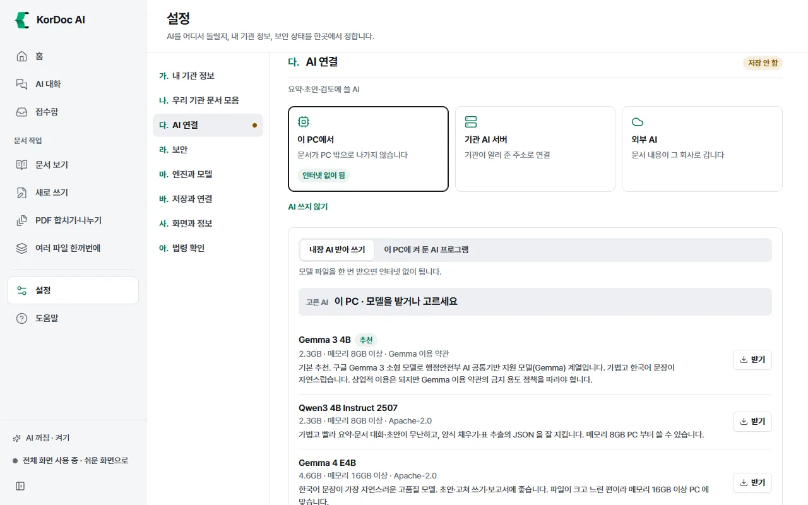
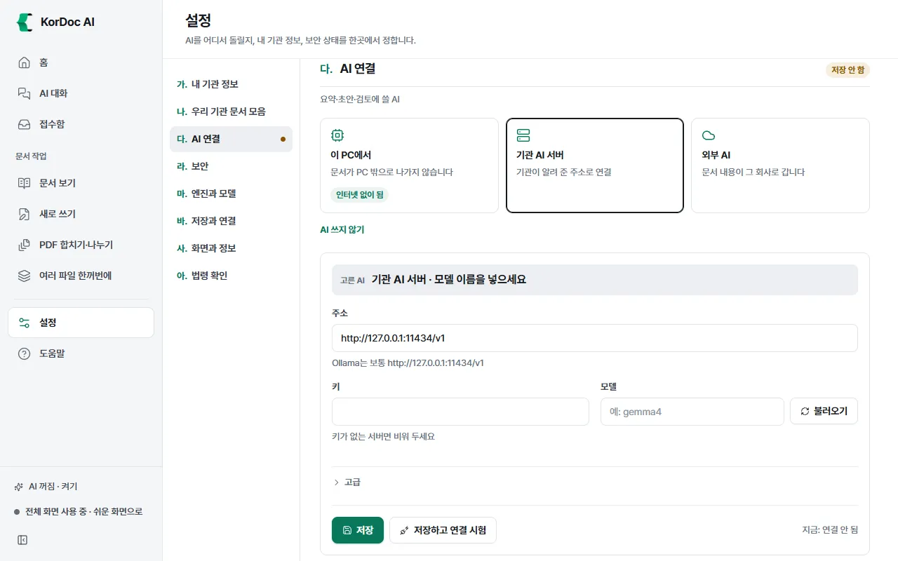
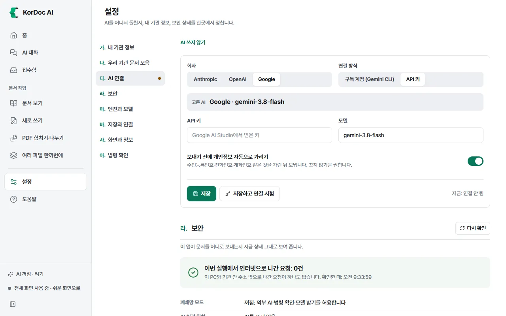
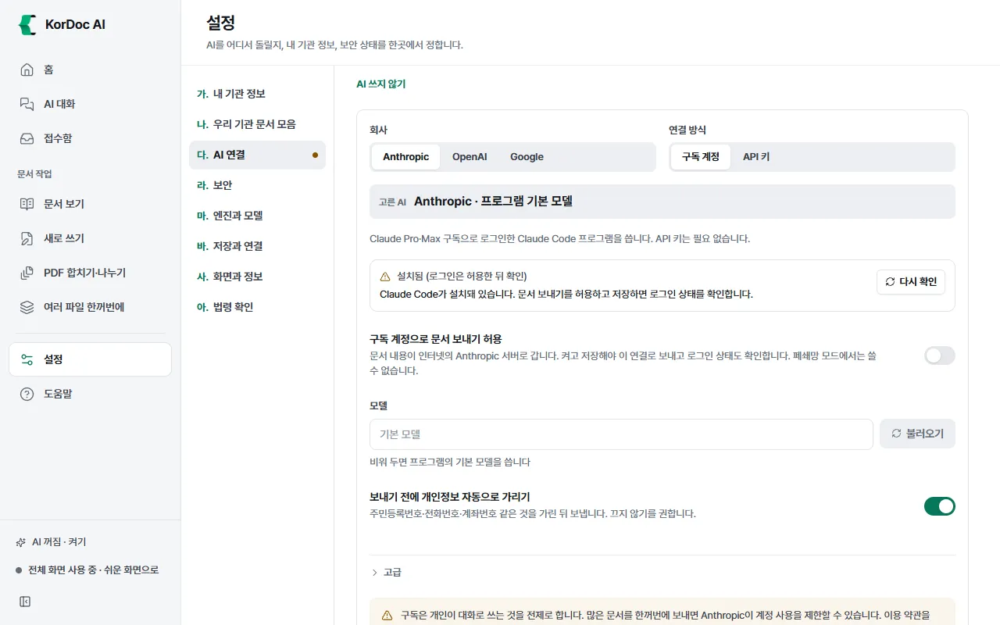

# AI 연결

요약, 초안, 검토, AI 대화에 쓸 AI를 고르는 곳입니다. 설정 › 다. AI 연결에 있습니다. AI를 어디서 돌리느냐에 따라 **이 PC에서**, **기관 AI 서버**, **외부 AI** 세 갈래로 나뉩니다.

## 이럴 때 씁니다

- 처음 AI를 켤 때
- 인터넷이 막힌 업무망에서 AI를 쓰고 싶을 때
- 기관에서 AI 서버 주소를 받았을 때
- 유료 구독 계정(Claude, ChatGPT)이나 Google 계정으로 AI를 쓰고 싶을 때

AI 없이도 문서 읽기·바꾸기·점검·개인정보 가리기·수합은 됩니다. AI가 꼭 필요한 기능은 AI 대화, 요약·묻기, AI 초안, 글 다듬기, K팀장 검토입니다.

## 들어가는 길

- 왼쪽 아래 AI 상태 줄("AI 꺼짐 · 켜기" 등)을 누릅니다.
- 홈 입력창 아래 **AI 켜기**를 누르면 간단히 고르는 칸이 펼쳐집니다([홈과 빠른 작업](01-home.md)).
- 설정 › **다. AI 연결**

## 고르는 기준

| 갈래 | 문서가 가는 곳 | 인터넷 | 이럴 때 |
| --- | --- | --- | --- |
| **이 PC에서** | 이 PC 안 | 필요 없음(내장 AI는 처음 받을 때만) | 인터넷이 막힌 PC, 문서를 밖으로 보내면 안 될 때 |
| **기관 AI 서버** | 기관 안 서버 | 기관 안 연결 | 기관 전산 담당자에게 서버 주소를 받았을 때 |
| **외부 AI** | 그 회사 서버 | 필요 | Gemini·Claude 키, Claude·ChatGPT 유료 구독, Gemini CLI에 로그인한 Google 계정이 있을 때 |

AI를 끄려면 **AI 쓰지 않기**를 누르고 저장합니다. 요약·초안·다듬기·K팀장 검토만 꺼지고 나머지 기능은 그대로 씁니다.

## 이 PC에서

**이 PC에서 쓰는 방법**에서 둘 가운데 하나를 고릅니다.

### 내장 AI 받아 쓰기

모델 파일을 한 번 받으면 인터넷 없이 씁니다.

1. 모델 목록에서 하나를 골라 **받기**를 누릅니다. 처음이면 "추천" 표시가 붙은 모델을 받으세요.

| 모델 | 크기 | 메모리 | 특징 |
| --- | --- | --- | --- |
| Gemma 3 4B (추천) | 약 2.3GB | 8GB 이상 | 가볍고 한국어 문장이 자연스럽습니다. 행정안전부 AI 공통기반 지원 모델(Gemma) 계열 |
| Qwen3 4B Instruct 2507 | 약 2.3GB | 8GB 이상 | 가볍고 빨라 요약·문서 대화·초안이 무난합니다 |
| Gemma 4 E4B | 약 4.6GB | 16GB 이상 | 한국어 문장이 가장 자연스럽지만 크고 느린 편입니다 |

2. 다 받으면 "모델을 받았습니다. 저장을 누르면 이 모델을 씁니다."가 뜹니다. **저장**을 누릅니다.
3. 이미 받은 모델은 **이 모델 쓰기**로 바꿉니다. 쓰는 모델에는 "쓰는 중"이 붙습니다.

인터넷이 막힌 PC

- 인터넷이 되는 PC에서 받은 모델 파일(.gguf)을 USB로 옮긴 뒤 **가진 모델 파일 가져오기**로 넣습니다.
- 폐쇄망 모드에서는 **받기**가 눌리지 않습니다.

고급(펼쳐서 보기)

- **한 번에 읽는 글 양**: 보통 (4,096), 길게 (8,192), 더 길게 (16,384), 아주 길게 (32,768). 길게 할수록 긴 문서를 한 번에 보지만 메모리를 더 씁니다.
- **그래픽 칩**: 있으면 쓰기, 쓰지 않기. 그래픽 칩이 없으면 저절로 CPU로 돌립니다.
- **미리 올려 두기**: 처음 쓸 때 기다리지 않도록 모델을 메모리에 올립니다.

### 이 PC에 켜 둔 AI 프로그램

Ollama, LM Studio 같은 프로그램을 이 PC에서 켜 두었으면 그 프로그램에 연결합니다.

1. 화면을 열면 저절로 한 번 찾습니다. 다시 찾으려면 **이 PC에서 찾기**를 누릅니다(Ollama, LM Studio, llama.cpp, vLLM, Jan, KoboldCpp, GPT4All 등이 쓰는 자리를 봅니다).
2. 찾은 프로그램을 누르면 **주소**가 채워집니다.
3. **모델**을 고릅니다. 목록이 없으면 **불러오기**를 누릅니다.
4. **저장**을 누릅니다.

못 찾으면 "켜진 로컬 모델 서버를 찾지 못했습니다."가 뜹니다. Ollama나 LM Studio를 켜고(LM Studio는 개발자 탭에서 서버 시작) 다시 찾거나 주소를 직접 넣습니다. 보통 `http://127.0.0.1:포트/v1` 꼴입니다. 이 PC 안(127.0.0.1)으로만 오가므로 폐쇄망 모드에서도 됩니다.

## 기관 AI 서버

1. **주소**에 기관에서 받은 주소를 넣습니다. 예: `http://10.0.0.5:8000/v1`. 주소 끝은 보통 /v1입니다.
2. **키**는 키를 요구하는 서버만 넣습니다. 없으면 비워 둡니다.
3. **모델** 옆 **불러오기**를 눌러 서버에 있는 모델을 고르거나, 모델 이름을 직접 적습니다(예: gemma4).
4. 고급의 **그림 읽기 모델(선택)**은 스캔 글자 읽기를 이 서버에 맡길 때만 넣습니다.
5. **저장하고 연결 시험**을 누릅니다.

폐쇄망 모드에서는 기관 안 주소(사설 IP)와 이 PC만 연결됩니다.

## 외부 AI

인터넷의 AI 회사 서버를 씁니다. 문서 내용이 그 회사로 갑니다. 폐쇄망 모드에서는 고를 수 없습니다.

1. **회사**(Anthropic, OpenAI, Google)를 고릅니다.
2. **연결 방식**을 고릅니다.

| 회사 | 연결 방식 |
| --- | --- |
| Anthropic | **구독 계정**(Claude Code 프로그램) 또는 **API 키** |
| OpenAI | **구독 계정 (ChatGPT·Codex)**만 |
| Google | **구독 계정 (Gemini CLI)** 또는 **API 키** |

### API 키

1. **API 키**에 키를 넣습니다. Google은 Google AI Studio에서, Anthropic은 Anthropic 콘솔에서 받습니다.
2. **모델**을 확인합니다. 기본값이 들어 있습니다.
3. **저장하고 연결 시험**을 누릅니다.

저장한 키는 "저장됨 (앞뒤 몇 글자)"로만 보입니다. 지우려면 **저장된 키 지우기**를 누르고 저장합니다. Windows에서는 키를 암호화해 저장합니다.

### 구독 계정

PC에 설치해 로그인해 둔 AI 프로그램을 앱이 대신 불러 씁니다. API 키는 필요 없습니다.

| 회사 | 쓰는 프로그램 | 필요한 계정 | 로그인 명령 |
| --- | --- | --- | --- |
| Anthropic | Claude Code | Claude Pro·Max 구독 | `claude` |
| OpenAI | Codex | ChatGPT Plus·Pro 구독 | `codex login` |
| Google | Gemini CLI | Google 계정(무료 또는 Google AI Pro·Ultra) | `gemini` |

1. 그 프로그램을 PC에 설치하고 명령 프롬프트나 PowerShell에서 로그인 명령을 실행해 로그인합니다.
2. 앱에서 회사와 **구독 계정**을 고릅니다. 상태 칸에 "설치됨 (로그인은 허용한 뒤 확인)"이 보이면 설치는 됐습니다.
3. **구독 계정으로 문서 보내기 허용**을 켭니다. 켜면 문서 내용이 인터넷의 그 회사 서버로 갑니다.
4. **저장**을 누릅니다. 그러면 앱이 프로그램에 로그인 상태를 묻습니다. "로그인됨"이 보이면 됩니다.
5. **모델**은 비워 두면 프로그램의 기본 모델을 씁니다. 바꾸려면 **불러오기**로 목록을 받습니다.
6. **저장하고 연결 시험**을 누릅니다.

상태 칸에 보이는 말

| 상태 | 뜻과 할 일 |
| --- | --- |
| 로그인됨 | 쓸 수 있습니다 |
| 로그인됨 (구독인지 확인 못 함) | 쓸 수는 있습니다. 쓴 만큼 요금이 나가는 방식이면 로그인 명령으로 구독 계정에 다시 로그인합니다 |
| 설치됨 (로그인은 허용한 뒤 확인) | 문서 보내기 허용을 켜고 저장하면 로그인 상태를 확인합니다 |
| 로그인 안 됨 | 안내된 로그인 명령을 실행한 뒤 **다시 확인**을 누릅니다 |
| 구독이 아닌 로그인 | API 키 같은 쓴 만큼 내는 방식으로 로그인돼 있습니다. 구독 계정으로 다시 로그인합니다 |
| 프로그램 없음 | 그 프로그램을 설치합니다 |
| 버전이 낮음 | **업데이트**를 누릅니다 |
| 폐쇄망 모드 | 폐쇄망 모드에서는 쓸 수 없습니다 |
| 기관에서 막음 | 기관이 막았습니다. 다른 AI 연결을 고릅니다 |

- **다시 확인**: 허용 전에는 프로그램을 띄우지 않고 설치 위치만 봅니다. 허용 뒤에는 프로그램을 잠깐 띄워 설치·로그인 상태를 묻습니다.
- **업데이트**: Claude Code와 Codex는 프로그램의 공식 업데이트 명령으로 최신 판을 받습니다. 몇 분 걸릴 수 있습니다. Gemini CLI는 업데이트 명령이 없어 터미널에서 칠 명령을 알려 줍니다. Codex 앱과 함께 깔린 Codex는 Codex 앱을 업데이트하면 같이 새 판이 됩니다.
- 고급의 **프로그램 위치**는 앱이 찾은 프로그램 경로입니다. 다른 위치는 정보통신 담당자가 기관 배포 설정으로만 정할 수 있습니다.
- 앱은 프로그램의 파일·명령 도구를 끈 채 답만 하도록 띄웁니다. 로그인 정보를 읽거나 옮기지 않습니다.
- 구독은 개인이 대화로 쓰는 것을 전제로 합니다. 많은 문서를 한꺼번에 보내면 그 회사가 계정 사용을 제한할 수 있습니다. 이용 약관을 확인하고 쓰세요.

## 외부 AI로 보낼 때 개인정보 자동 가림

외부 AI(API 키·구독 계정)에는 **보내기 전에 개인정보 자동으로 가리기** 스위치가 있습니다. 기본으로 켜져 있고 끄지 않기를 권합니다.

- 켜져 있으면 보내기 전에 주민·외국인등록번호, 전화번호, 이메일, 카드번호, 계좌번호, 여권번호, 운전면허번호, 사업자등록번호를 ●로 가립니다. 글자 수와 구분 기호는 그대로 둡니다.
- 사람 이름, 주소, 법인등록번호, IP 주소는 이 자동 가림에서 가리지 않습니다.
- 가린 건수는 답과 함께 알려 줍니다. 예: "외부 AI로 보내기 전에 개인정보 N건을 가렸습니다."
- 입력창 옆 AI 위치 표시에 "개인정보는 가려서 보냅니다" 또는 "문서 원문이 나갑니다"가 보입니다.
- 이 PC에서, 기관 AI 서버(기관 안 주소)로 보낼 때는 가리지 않습니다. 문서가 밖으로 나가지 않기 때문입니다.

## 폐쇄망 모드

인터넷이 막힌 업무망 PC라면 폐쇄망 모드를 켭니다. 시작 준비 창의 **인터넷이 막힌 PC입니다** 스위치나 설정 › 라. 보안의 **폐쇄망 모드** 스위치로 켭니다.

- 켜면 외부 AI, 구독 계정, 법령 확인, 모델 받기를 막고 기관 안 주소와 이 PC로만 연결합니다.
- 왼쪽 아래에 "폐쇄망 모드 켜짐"이 보입니다.
- 외부 AI를 고른 상태에서 켜면 외부 AI를 쓸 수 없다고 알려 줍니다. 내장 AI, 이 PC의 AI 프로그램, 기관 AI 서버 가운데 고르세요.

## 연결 시험

**저장하고 연결 시험**을 누르면 저장한 뒤 AI에 짧은 질문을 보내 답이 오는지 봅니다.

- 되면 "연결됐습니다. 답이 N초 만에 왔습니다."가 뜹니다.
- 안 되면 "연결하지 못했습니다." 뒤에 이유가 붙습니다. 이유 문장은 [막혔을 때](12-trouble.md) 장의 AI 연결 표에서 찾습니다.
- 맨 오른쪽 "지금:"에 지금 쓰는 AI와 모델이 보입니다.

## 알아 둘 것

- **저장**을 눌러야 바뀝니다. 저장하지 않으면 제목 옆에 "저장 안 함"이 붙습니다.
- AI를 바꾸면 앱을 다시 켜지 않아도 모든 기능이 새 AI로 돌아갑니다.
- 기관 배포 설정으로 정해진 칸은 "기관에서 정함"이 붙고 바꿀 수 없습니다.
- 쉬운 화면과 전체 화면에서 이 구획은 똑같이 보입니다.
