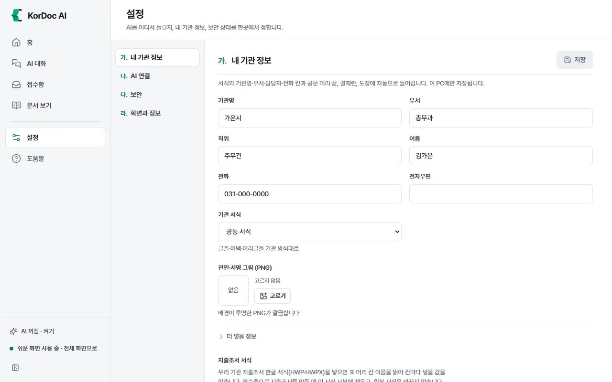
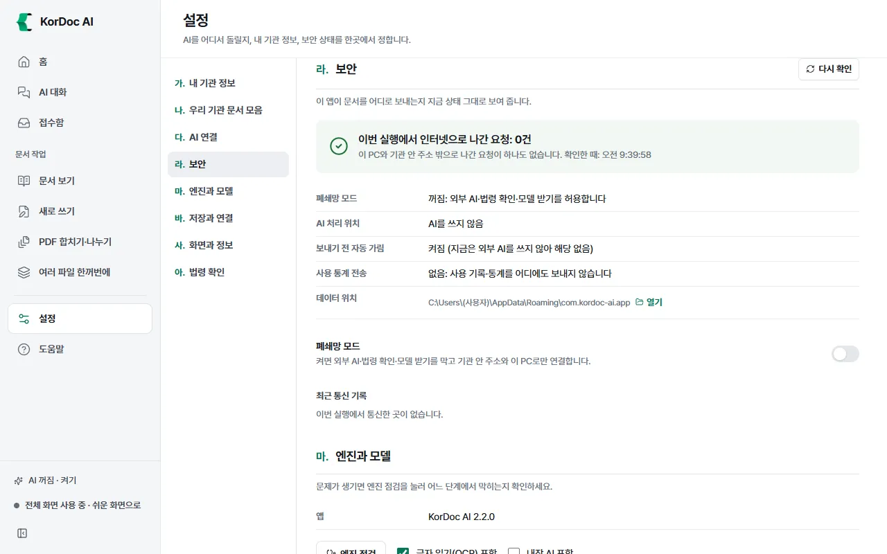
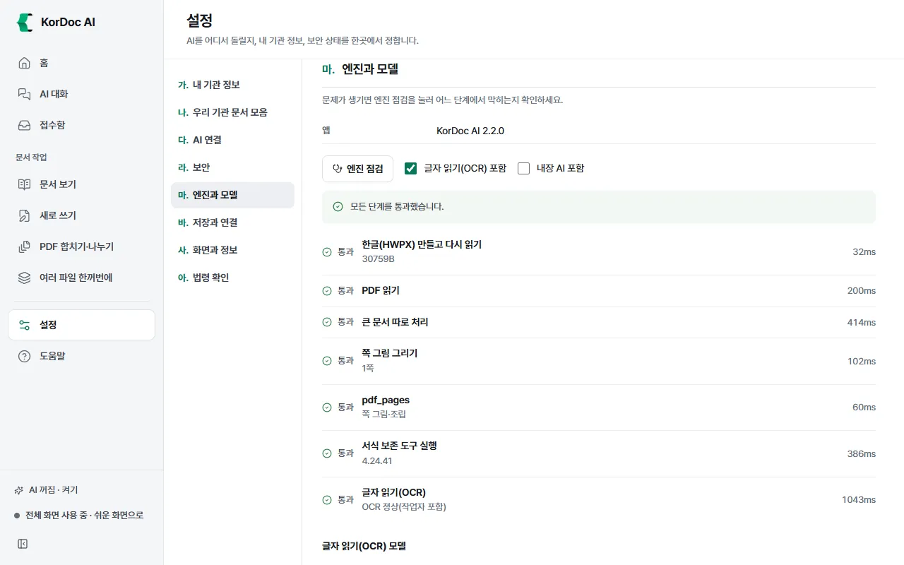

# 설정

내 기관 정보, AI 연결, 보안 상태, 저장 위치, 화면 방식을 정하는 화면입니다. 왼쪽 메뉴 아래쪽 **설정**을 누르면 열립니다. 왼쪽 목차를 누르면 그 구획으로 갑니다.

## 이럴 때 씁니다

- 기관명·부서·결재선·관인 그림을 넣거나 바꿀 때
- 만든 파일이 저장되는 폴더를 바꿀 때
- 탐색기 우클릭 메뉴를 넣거나 뺄 때
- 앱이 문서를 어디로 보내는지 확인할 때
- 화면 크기·밝기·화면 방식을 바꿀 때

## 구획 목록

| 구획 | 하는 일 | 쉬운 화면 |
| --- | --- | --- |
| 가. 내 기관 정보 | 서식·공문 머리·결재란·도장에 들어갈 기관 정보 | 보임 |
| 나. 우리 기관 문서 모음 | 우리 기관 문서를 모아 AI 초안과 새 문서가 그 서식을 따르게 함 | 숨음 |
| 다. AI 연결 | AI를 어디서 돌릴지 | 보임 |
| 라. 보안 | 문서가 어디로 나가는지, 폐쇄망 모드 | 보임 |
| 마. 엔진과 모델 | 엔진 점검, 글자 읽기(OCR) 모델 | 숨음 |
| 바. 저장과 연결 | 저장 위치, 글자 읽기 기본값, 우클릭 메뉴, 다른 AI 프로그램 연결 | 숨음 |
| 사. 화면과 정보 | 화면 방식·밝기·크기, 효과, 버전, 오픈소스 고지 | 보임 |
| 아. 법령 확인 | 법제처 아이디 | 숨음 |

- 쉬운 화면에서는 숨은 구획 대신 맨 아래에 "우리 기관 문서 모음, 엔진과 모델, 저장과 연결, 법령 확인 같은 세부 설정은 전체 화면에서 보입니다."와 **전체 화면으로** 단추가 있습니다.
- 다른 화면의 안내 링크로 숨은 구획을 열면 저절로 전체 화면으로 바뀝니다.
- 저장하지 않은 변경이 있는 구획은 목차에 점이 찍히고 제목 옆에 "저장 안 함"이 붙습니다. 그대로 다른 화면으로 가려 하면 "저장하지 않은 설정이 있습니다" 창이 뜹니다. **계속 고치기**, **저장하지 않고 나가기**, **저장하고 나가기** 가운데 고릅니다.
- 문서 엔진이 멈췄으면 맨 위에 안내와 **다시 켜기** 단추가 보입니다.

## 가. 내 기관 정보

여기 넣은 값은 서식의 기관명·부서·담당자·전화 칸, 공문 머리·끝, 결재란, 도장에 저절로 들어갑니다. 이 PC에만 저장합니다.

1. 칸을 채웁니다: 기관명, 부서, 직위, 이름, 전화, 팩스, 전자우편, 누리집, 주소, 문서번호 앞부분(예: 총무과-).
2. **기관 서식**을 고릅니다. 글꼴·여백·머리글을 기관 방식대로 맞춥니다. 모르면 "공통 서식"으로 둡니다.
3. **결재선**: 결재란에 왼쪽부터 들어갈 직위입니다. 아래 칸에 직위(예: 국장)를 적고 **더하기**를 누릅니다. 각 직위 옆 단추로 앞으로·뒤로 옮기거나 뺍니다.
4. **관인·서명 그림 (PNG)**: **고르기**로 도장 그림을 고릅니다. 배경이 투명한 PNG가 깔끔합니다. **빼기**로 지웁니다.
5. 오른쪽 위 **저장**을 누릅니다. "내 기관 정보를 저장했습니다"가 뜹니다.

**지출조서 서식** (쉬운 화면에서도 보입니다): 우리 기관 지출조서 한글 서식(HWP·HWPX)을 **서식 넣기**로 고르면, 표 머리 칸 이름(지출일자·사용일자, 거래처·상호·사용처, 금액·지출액, 적요·내역·품명 등)을 읽어 칸마다 넣을 값을 맞춘 대응표를 보여 줍니다.

- 못 맞춘 칸은 "비워 둠"입니다. AI가 켜져 있으면 칸 이름만 AI에 보내 제안을 받습니다. 칸마다 **넣을 값**을 고르면 바로 저장됩니다.
- 서식은 앱 데이터에 사본을 두고 씁니다. 원본 서식은 바꾸지 않습니다. 영수증으로 지출조서를 만들면 사본의 표 빈 줄에 차례로 채우고, 줄이 모자라면 더합니다. 제목·결재란·서명란은 그대로입니다.
- **다른 서식**으로 바꾸고, **지우기**로 지우면 기본 서식으로 돌아갑니다.

## 나. 우리 기관 문서 모음 (전체 화면)

결재가 끝난 우리 기관 한글 문서(HWP·HWPX)를 넣어 두면 AI 초안은 그 구성과 자주 쓰는 표현을 따르고 새 문서는 그 서식대로 만들어집니다. 한글 편집기의 AI 대화도 이 구성을 참고합니다.

1. **문서 넣기** 또는 **폴더째 넣기**를 누르거나, 문서를 끌어다 놓습니다. 보고서·기안문을 갈래마다 몇 건씩 넣으세요.
2. 앱이 문서 모양을 보고 갈래(기안문, 보고서 등)를 정합니다. 갈래마다 처음 넣은 문서가 **대표 견본**이 됩니다.
3. 갈래가 틀렸으면 문서 옆 갈래 칸에서 고칩니다. 다른 문서를 대표로 쓰려면 **대표로**를 누릅니다. 빼려면 휴지통 단추를 누릅니다.

넣은 문서는 앱 데이터에 사본으로 둡니다. 원본은 그대로이고 사본은 이 PC에만 둡니다. 사본이 지워졌으면 "사본 없음" 표시가 붙습니다. 빼고 다시 넣으세요.

## 다. AI 연결

AI를 어디서 돌릴지 고르는 곳입니다. [AI 연결](09-ai.md) 장에서 자세히 설명합니다.

## 라. 보안

이 앱이 문서를 어디로 보내는지 지금 상태 그대로 보여 줍니다. **다시 확인**을 누르면 새로 읽습니다.

- 맨 위에 "이번 실행에서 인터넷으로 나간 요청: N건"이 보입니다. 0건이면 "이 PC와 기관 안 주소 밖으로 나간 요청이 하나도 없습니다."가 보입니다.
- **폐쇄망 모드**: 켜짐이면 인터넷으로 나가는 연결을 모두 막습니다.
- **AI 처리 위치**: 이 PC 안(내장 모델), 이 PC의 로컬 모델 서버, 기관 AI 서버, 외부 AI(회사 이름), 구독 계정, AI를 쓰지 않음 가운데 하나. 외부로 나가면 "문서 내용이 인터넷으로 나갑니다"가 붙습니다.
- **보내기 전 자동 가림**: 외부 AI로 보낼 때 개인정보를 가리는지
- **사용 통계 전송**: "없음: 사용 기록·통계를 어디에도 보내지 않습니다"
- **데이터 위치**: 앱 데이터 폴더. **열기**로 엽니다.

**폐쇄망 모드** 스위치를 켜면 외부 AI, 법령 확인, 모델 받기를 막고 기관 안 주소와 이 PC로만 연결합니다. 바로 저장됩니다.

**최근 통신 기록** 표에는 이번 실행에서 연결한 곳이 시각, 주소, 이 PC 밖인지, 결과(허용·막음)와 함께 남습니다.

## 마. 엔진과 모델 (전체 화면)

문제가 생기면 여기서 **엔진 점검**을 눌러 어느 단계에서 막히는지 확인합니다.

1. **글자 읽기(OCR) 포함**(기본 켬), **내장 AI 포함**(기본 끔)을 고릅니다.
2. **엔진 점검**을 누릅니다. 단계마다 "통과" 또는 "실패"와 걸린 시간이 보입니다. 단계: 한글(HWPX) 만들고 다시 읽기, PDF 읽기, 큰 문서 따로 처리, 쪽 그림 그리기, 서식 보존 도구 실행, 글자 읽기(OCR), 내장 AI 엔진.
3. "통과하지 못한 단계가 있습니다"가 뜨면 화면 내용을 관리자에게 전하세요.

**글자 읽기(OCR) 모델**: "한글 글자 읽기"와 "수식 읽기"가 "준비됨"인지 "없음"인지 보여 줍니다. 인터넷이 없는 PC는 모델 파일이 든 폴더를 USB로 옮겨 **폴더에서 가져오기**로 넣습니다. 폴더에는 det.onnx, rec_korean.onnx, rec_korean.yml 세 파일이 있어야 합니다.

## 바. 저장과 연결 (전체 화면)

- **저장 위치**: 만든 문서를 담을 폴더입니다. 기본은 `문서\KorDoc AI 결과`. **바꾸기**로 다른 폴더를 고릅니다. **원본 옆으로**를 누르면 원본과 같은 폴더에 새 파일로 저장합니다(이때 "원본 파일 옆"으로 보입니다).
- **스캔한 쪽 글자 읽기 기본값**: 필요한 쪽만(기본), 모든 쪽, 안 함. 바로 저장됩니다.
- **탐색기 우클릭 메뉴**(맥은 **Finder 빠른 동작**): **메뉴 넣기**·**메뉴 빼기**. [탐색기 우클릭 메뉴](08-context-menu.md) 장을 보세요.
- **고급** › **다른 AI 프로그램과 연결 (MCP)**: **연결 설정**. [다른 AI 도구와 연결](11-mcp.md) 장을 보세요.

## 사. 화면과 정보

- **화면 방식**: 쉬운 화면, 전체 화면
- **화면 밝기**: 밝게, 어둡게, 컴퓨터 설정대로
- **화면 크기**: 글씨와 단추를 함께 키웁니다. Ctrl + 더하기·빼기로도 바꿉니다. Ctrl + 0을 누르면 100%로 돌아갑니다(맥은 ⌘). 창이 좁으면 더 키우지 못한다고 알려 줍니다.
- **효과**: **효과 보기**를 누르면 효과 화면이 열립니다(아래).
- **버전**: KorDoc AI 판 번호
- **오픈소스 고지**: **열기**를 누르면 앱에 든 오픈소스의 이름·버전·라이선스 전문을 엽니다.

## 아. 법령 확인 (전체 화면)

문서 속 「법령명」 제N조 인용을 법제처 현행 법령과 대조하려면 법제처 아이디가 필요합니다.

1. 법제처 국가법령정보 공동활용(open.law.go.kr)에 가입하고 Open API 활용을 신청합니다. 무료입니다.
2. 가입한 이메일의 @ 앞부분이 아이디입니다. 예를 들어 hong@korea.kr이면 hong입니다.
3. **법제처 아이디** 칸에 넣고 **저장**한 뒤 **연결 확인**을 누릅니다. "연결됐습니다. 법제처에서 현행 법령을 받아 왔습니다."가 뜨면 됩니다.

인터넷이 되는 PC에서만 대조합니다. 폐쇄망 모드에서는 법제처에 묻지 않고 문서 속 법령 인용을 찾는 것까지만 합니다.

## 효과 화면

앱으로 처리한 문서 수와 손으로 할 때보다 아낀 시간을 일 종류별로 보여 줍니다. 전체 화면 홈의 "이번 달 처리 문서 N건"이나 설정 › 사. 화면과 정보 › **효과 보기**로 엽니다.

1. **이번 달** 또는 **전체**를 고릅니다. 기록은 이 PC에만 두고 어디에도 보내지 않습니다.
2. 표에서 일 종류마다 건수, 한 건 기준 시간, 아낀 시간을 봅니다.
3. **한 건 기준 시간**은 손으로 할 때 걸리는 시간의 가정치입니다. 기관 실정에 맞게 고치고 **기준 시간 저장**을 누릅니다.
4. **기관 보고용 HWPX로 저장**을 누르면 집계를 한글 문서로 저장합니다.
5. **기록 지우기**는 쌓인 처리 기록을 모두 지웁니다. 되돌리지 못합니다.

## 기관 배포 설정

정보통신 담당자가 `policy.json` 파일로 기관 AI 서버 주소, 기관 정보, 폐쇄망 모드 등을 미리 넣고 잠글 수 있습니다.

- 적용되면 설정 맨 위에 "기관 배포 설정이 적용됐습니다: (안내)"가 보입니다.
- 잠긴 칸에는 자물쇠 그림과 "기관에서 정함"이 붙고 바꿀 수 없습니다.
- 파일을 읽지 못하면 "기관 배포 설정 파일을 읽지 못했습니다"가 보입니다. 담당자에게 알리세요.

## 알아 둘 것

- 설정은 이 PC의 앱 데이터 폴더에만 저장합니다. API 키는 Windows에서 암호화해 저장합니다.
- 내 기관 정보, AI 연결, 법령 확인은 **저장**을 눌러야 적용됩니다. 폐쇄망 모드, 글자 읽기 기본값, 화면 방식·밝기·크기는 바로 적용됩니다.
