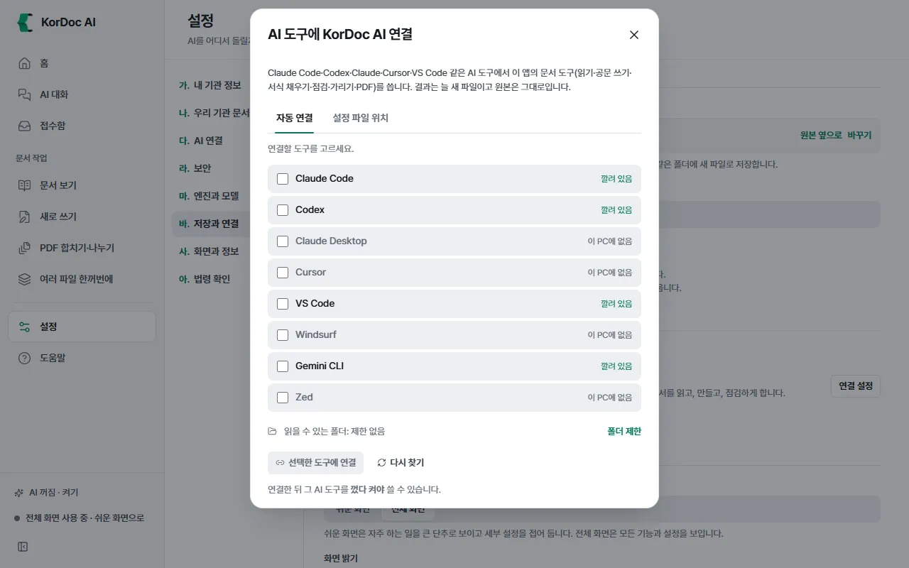

# 다른 AI 도구와 연결 (MCP)

PC에 깔린 다른 AI 프로그램(Claude Code, Codex, Claude Desktop, Cursor, VS Code 등)이 KorDoc AI의 문서 도구를 쓰게 연결하는 기능입니다. 연결하면 그 프로그램에서 "이 공문에 회신 기안문 만들어 줘"라고 해도 이 앱과 같은 도구로 한글 문서를 읽고 만들고 점검합니다. MCP는 AI 프로그램이 외부 도구를 부르는 공통 방식의 이름입니다.

## 이럴 때 씁니다

- 평소 쓰는 AI 프로그램에서 한글(HWP·HWPX) 문서를 다루고 싶을 때
- AI 프로그램이 한글 파일을 못 읽어 곤란할 때

처음 쓰는 분은 몰라도 됩니다. 앱 안의 [AI 대화](02-chat.md)가 같은 도구를 씁니다.

## 따라 하기

1. 전체 화면으로 바꿉니다.
2. 설정 › 바. 저장과 연결 › **고급**을 펼칩니다.
3. **다른 AI 프로그램과 연결 (MCP)** 줄의 **연결 설정**을 누릅니다. **AI 도구에 KorDoc AI 연결** 창이 뜹니다.
4. **자동 연결** 탭에서 앱이 이 PC의 AI 도구를 찾습니다. 도구마다 "연결됨", "깔려 있음", "이 PC에 없음"이 보입니다.
5. 연결할 도구를 고릅니다. 처음에는 고른 도구가 하나도 없습니다.
6. 특정 폴더의 문서만 읽고 쓰게 하려면 **폴더 제한**을 눌러 폴더를 고릅니다. "읽을 수 있는 폴더: 제한 없음"이 그 폴더 이름으로 바뀝니다. **제한 풀기**로 되돌립니다.
7. **선택한 도구에 연결 (N)**을 누릅니다. 도구마다 "연결함" 또는 오류가 보이고 "AI 도구 N개에 KorDoc AI를 연결했습니다"가 뜹니다.
8. 연결한 AI 도구를 **껐다 켭니다**. 그래야 새 도구를 읽습니다.

## 연결할 수 있는 도구

| 도구 | 설정 파일 |
| --- | --- |
| Claude Code | 사용자 폴더의 `.claude.json` |
| Codex | 사용자 폴더의 `.codex\config.toml` |
| Claude Desktop | `%APPDATA%\Claude\claude_desktop_config.json` |
| Cursor | 사용자 폴더의 `.cursor\mcp.json` |
| VS Code | `%APPDATA%\Code\User\mcp.json` |
| Windsurf | 사용자 폴더의 `.codeium\windsurf\mcp_config.json` |
| Gemini CLI | 사용자 폴더의 `.gemini\settings.json` |
| Zed | 사용자 폴더의 `.zed\settings.json` |

**설정 파일 위치** 탭에서 이 PC의 실제 경로를 볼 수 있습니다.

## 손으로 넣을 때

- 자동 연결은 위 설정 파일에 `kordoc-ai` 항목을 써 넣습니다. 앱에 든 문서 엔진을 부르므로 인터넷이나 따로 깐 Node가 필요 없습니다.
- 손으로 고칠 때도 `kordoc-ai` 항목(command·args·env)은 바꾸지 마세요.
- 목록에 없는 AI 도구는 목록의 도구 하나에 자동 연결한 뒤, 그 설정 파일의 `kordoc-ai` 항목과 같은 값을 넣으면 됩니다.
- 주석이 든 설정 파일이나 Codex 설정 파일은 고치기 전에 `.kordoc-backup` 사본을 한 번 남깁니다.

## 연결하면 쓸 수 있는 도구

앱의 AI 대화와 같은 문서 도구입니다(읽기·공문 쓰기·서식 채우기·점검·가리기·PDF). 결과는 늘 새 파일이고 원본은 그대로입니다. 도구 목록은 [AI 대화](02-chat.md)의 "AI가 할 수 있는 일"에 있습니다. 만든 파일을 PC에서 여는 도구는 빠집니다.

## 알아 둘 것

- 폴더 제한을 걸면 그 폴더 밖의 파일은 "허용한 폴더 밖의 파일입니다"라며 거절합니다.
- 폐쇄망 모드를 켠 상태로 연결하면 연결한 도구에서도 폐쇄망 모드로 동작합니다.
- 설정 파일을 읽을 수 없으면 건드리지 않고 "설정 파일을 읽을 수 없어 건드리지 않았습니다. 직접 확인하세요"라고 알립니다.
- 도구를 찾지 못하면 창을 닫았다가 다시 열거나 **다시 찾기**를 누르세요.
