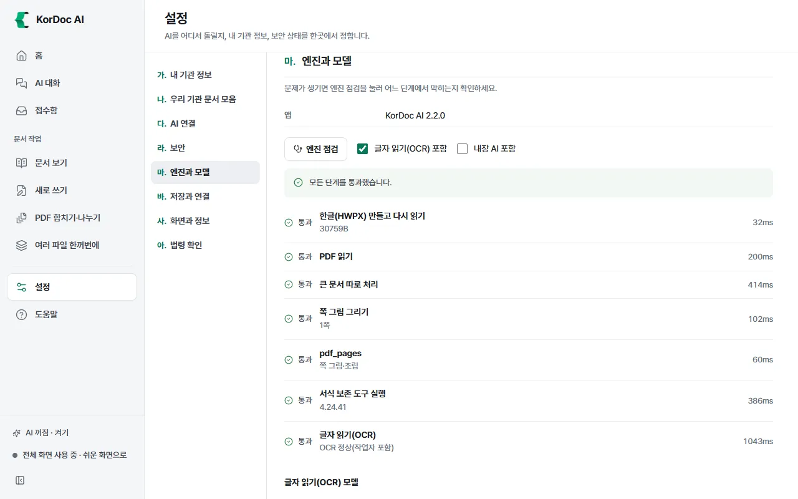

# 막혔을 때

화면에 뜬 안내 문장을 찾아 할 일을 따라 하세요. 왼쪽 위 **설명서에서 찾기** 칸에 안내 문장의 앞부분을 넣으면 이 장을 바로 찾습니다.

## 먼저 해 볼 것

1. 안내 문장을 끝까지 읽습니다. 대부분 무엇을 하면 되는지 함께 적혀 있습니다.
2. 같은 일을 한 번 더 해 봅니다.
3. 앱을 완전히 끄고(알림 영역의 앱 아이콘까지) 다시 켭니다.
4. 그래도 안 되면 설정 › 마. 엔진과 모델 › **엔진 점검**을 누르고 결과 화면을 관리자에게 전합니다. 이 구획은 전체 화면에서 보입니다.

## 문서 엔진

| 안내 | 할 일 |
| --- | --- |
| 왼쪽 아래 "문서 엔진 켜는 중" | 잠시 기다립니다 |
| 왼쪽 아래 "문서 엔진 멈춤: 눌러서 다시 켜기" | 그 줄을 누릅니다. 설정 화면 맨 위의 **다시 켜기**를 눌러도 됩니다 |
| "문서 엔진이 멈췄습니다(프로세스 종료). 잠시 뒤 다시 시도하세요. 계속되면 앱을 다시 켜세요." | 앱이 문서 엔진을 저절로 다시 켭니다. 잠시 뒤 다시 하고, 되풀이되면 앱을 다시 켭니다 |
| "문서 엔진을 켜지 못했습니다. 백신 프로그램이 막았는지 확인하고, 계속되면 앱을 다시 설치하세요." | 백신 프로그램의 차단 기록을 보고 KorDoc AI를 허용합니다. 안 되면 다시 설치합니다 |
| "문서 엔진 실행 파일(Node)이 없습니다. 앱을 다시 설치하세요." / "문서 엔진 파일이 없습니다. 앱을 다시 설치하세요." | 앱을 다시 설치합니다 |
| "문서를 읽는 데 필요한 부품이 없습니다. 설정 › 엔진 점검을 눌러 보고, 계속되면 앱을 다시 설치하세요." | 엔진 점검을 누르고 실패한 단계가 있으면 다시 설치합니다 |
| "작업이 너무 오래 걸려 멈췄습니다." | 파일 수나 쪽 범위를 줄여 다시 합니다 |
| "문서 처리 작업이 도중에 멈췄습니다. 메모리가 부족했을 수 있습니다." | 다른 프로그램을 닫거나 문서를 나눠 다시 합니다 |
| "처리 대기열이 가득 찼습니다" | 앞 작업이 끝난 뒤 다시 합니다 |
| "오류가 발생했습니다" 화면 | **다시 시도**를 누릅니다. 되풀이되면 **오류 내용 복사** 단추로 복사해 관리자에게 전합니다 |

## 파일을 못 열 때

| 안내 | 할 일 |
| --- | --- |
| "열 수 없는 형식이라 열지 않았습니다" | 한글·PDF·워드·엑셀·파워포인트·그림·글 파일만 엽니다. ZIP 같은 묶음 파일은 풀어서 넣습니다 |
| "파일이 손상됐거나 저장이 끝나지 않은 파일일 수 있습니다." | 원본을 다시 받거나 만든 프로그램에서 다시 저장한 뒤 엽니다 |
| "한글 문서로 읽을 수 없는 파일입니다." / "HWP 문서의 머리 정보가 없어 열 수 없습니다." | 한글에서 열리는지 확인하고, 열리면 다시 저장해 넣습니다 |
| "PDF로 읽을 수 없는 파일입니다." / "PDF가 손상되어 열 수 없습니다." | PDF 보기 프로그램에서 열리는지 확인하고, 열리면 다시 저장해 넣거나 원본을 다시 받습니다 |
| "내용이 없는 빈 파일입니다." | 저장이 끝나지 않은 파일일 수 있습니다. 원본을 다시 받습니다 |
| "파일을 찾을 수 없습니다. 경로가 맞는지 확인하세요." | 파일이 옮겨졌거나 지워졌습니다. 다시 고릅니다 |
| "암호가 걸린 문서" | 문서를 만든 사람에게 받은 암호를 넣습니다. "암호가 맞지 않습니다"가 뜨면 다시 확인합니다 |
| "열기 암호가 걸린 PDF는 PDF 작업에서 열 수 없습니다." | 암호를 푼 사본을 저장해 넣습니다 |
| "한컴 문서보안(DRM)이 걸린 문서라 열 수 없습니다." | 문서를 보낸 곳에 보안을 푼 사본을 달라고 합니다 |
| "글자 층이 없는 스캔 PDF입니다." / "문서에서 글자를 찾지 못했습니다." | 스캔본입니다. 글자 읽기(OCR)를 켜고 다시 합니다. 문서 보기에서는 미리보기 위 **글자 읽기**, 설정에서는 바. 저장과 연결 › 스캔한 쪽 글자 읽기 기본값 |
| "문서가 너무 커서(약 N쪽) PDF로 한 번에 만들 수 없습니다." | 한글에서 쪽을 나눠 저장한 뒤 다시 합니다 |
| "파일이 너무 큽니다 (200MB까지)." | 파일을 나누거나 용량을 줄입니다 |
| "PDF로 내보내려면 Microsoft Edge나 Chrome이 필요합니다." | Edge나 Chrome을 설치한 뒤 다시 합니다 |
| "HWPX 문서만 미리보기에서 고칠 수 있습니다." / "HWPX 양식만 채울 수 있습니다." | 한글 편집기로 열어 HWPX로 저장한 뒤 그 파일로 합니다 |
| "도장은 HWPX 문서에만 찍을 수 있습니다." | HWPX로 저장해 넣습니다 |

## 저장이 안 될 때

| 안내 | 할 일 |
| --- | --- |
| "이 위치에 접근할 권한이 없습니다." | 다른 폴더를 고르거나 설정 › 바. 저장과 연결 › 저장 위치를 바꿉니다 |
| "읽기 전용 위치라 저장할 수 없습니다." | 저장 위치를 바꿉니다 |
| "다른 프로그램이 파일을 쓰고 있습니다." | 한글·엑셀 등에서 그 파일을 닫고 다시 합니다 |
| "디스크 공간이 부족합니다." | 공간을 비우고 다시 합니다 |
| "공유 폴더의 네트워크 경로(UNC)는 쓸 수 없습니다." | 공유 폴더를 드라이브 문자(Z: 등)로 연결해 쓰거나 이 PC의 폴더를 고릅니다 |
| "시스템 폴더에는 접근할 수 없습니다" | Windows, Program Files 같은 폴더 말고 다른 폴더를 고릅니다 |
| 편집기 "저장하지 못했습니다. … 다른 폴더를 고르거나 파일을 연 프로그램을 닫고 다시 저장하세요." | 안내대로 합니다 |
| "설정 파일을 저장할 권한이 없습니다." | 앱 데이터 폴더에 쓸 수 있는지 확인하거나 IT 담당자에게 문의합니다 |

## 한글 편집기

| 안내 | 할 일 |
| --- | --- |
| "한글 편집기가 열리지 않습니다. 앱을 다시 켜 보세요." | 앱을 다시 켭니다. 그래도 안 되면 설정의 엔진 점검을 누릅니다 |
| "한글 편집기가 응답하지 않습니다. 편집기를 다시 열어 보세요." | 문서를 다시 엽니다 |
| "한글 편집기가 2분 안에 이 문서를 열지 못해 멈췄습니다." | 쪽이 아주 많은 문서입니다. 고치지 않고 그대로 저장·출력하거나 문서 보기에서 내용을 봅니다 |
| "변경 내용 추적이 든 문서입니다." | 저장하면 보이는 그대로 본문이 되고 추적 기록은 남지 않습니다. 처음 덮어쓸 때 원본은 .bak으로 남습니다 |
| "바탕쪽이나 메모 일부를 옮기지 못했습니다. 한글에서 열어 확인하세요." | 한글에서 열어 확인합니다 |

## AI 연결

| 안내 | 할 일 |
| --- | --- |
| "AI가 아직 연결되지 않았습니다." | 그 자리의 **AI 켜기**를 누르거나 설정 › AI 연결에서 AI를 고릅니다. [AI 연결](09-ai.md) 장 |
| "AI 서버에 연결하지 못했습니다." | 설정 › AI 연결의 주소를 확인하고 기관 AI 서버나 Ollama가 켜져 있는지 봅니다 |
| "AI 서버 주소 형식이 아닙니다" / "AI 서버 주소를 넣으세요." | 주소를 `http://127.0.0.1:11434/v1`처럼 넣습니다 |
| "AI 서버가 다른 주소(…)로 넘겨 보냅니다." | 설정의 주소를 안내된 주소로 바꿉니다 |
| "AI 모델 이름이 비어 있습니다." / "모델을 고르지 않았습니다" | 설정 › AI 연결에서 **불러오기**를 눌러 모델을 고릅니다 |
| "AI 서버가 N초 동안 응답하지 않습니다." / "AI 답이 너무 오래 걸려 멈췄습니다." | 서버가 켜져 있는지, 모델이 너무 크지 않은지 봅니다. 짧은 문서로 해 봅니다 |
| "인증에 실패했습니다 (401)" / "AI 키가 맞지 않거나 권한이 없습니다." | 설정 › AI 연결에서 API 키를 다시 넣습니다 |
| "요청 한도를 넘었습니다 (429)" | 잠시 뒤 다시 합니다 |
| "AI 서버가 오류를 냈습니다." | 잠시 뒤 다시 하고, 되풀이되면 기관 AI 서버 담당자에게 알립니다 |
| "AI 답을 읽지 못했습니다." / "AI 응답을 칸 값으로 읽지 못했습니다." | 다시 하고, 되풀이되면 더 큰 모델을 고릅니다 |
| "지금 연결된 AI는 그림을 읽지 못합니다." | 내장 글자 읽기(OCR)를 쓰거나 그림 읽기 모델을 고릅니다 |
| "내장 AI 모델 파일(.gguf)이 없습니다." | 설정 › AI 연결에서 모델을 받거나 가져옵니다 |
| "메모리가 부족해 내장 AI를 올리지 못했습니다." | 한 번에 읽는 글 양을 줄이거나 더 작은 모델을 고릅니다 |
| "이 모델 파일은 내장 AI가 읽을 수 없습니다" | 추천 모델을 받습니다 |
| "디스크 공간이 부족합니다 (필요 …, 남은 …)" | 공간을 비우고 모델을 다시 받습니다 |
| "모델을 받지 못했습니다" / "받은 파일이 손상되었습니다" | 인터넷 연결을 확인하고 다시 받습니다 |
| 연결 시험 "연결하지 못했습니다. (이유)" | 이유 문장을 위 표에서 찾습니다 |

## 구독 계정 (Claude Code·Codex 등)

명령은 Windows의 명령 프롬프트나 PowerShell에서 칩니다.

| 안내 | 할 일 |
| --- | --- |
| "로그인되어 있지 않습니다. 터미널에서 … 명령을 실행해 구독 계정으로 로그인한 뒤 다시 시도하세요." | 안내된 명령(예: Claude Code는 `claude`, Codex는 `codex login`)을 실행해 로그인한 뒤 설정의 **다시 확인**을 누릅니다 |
| "구독이 아닌 방식(쓴 만큼 요금을 내는 API 키 등)으로 로그인돼 있어 보내지 않았습니다." | 안내된 명령으로 구독 계정에 다시 로그인합니다. API 키를 쓰려면 설정 › AI 연결에서 API 키 방식을 고릅니다 |
| "이 PC에서 …를 찾지 못했습니다." | 그 프로그램을 설치하고 로그인한 뒤 다시 합니다 |
| "판이 낮습니다" | 설정 › AI 연결의 **업데이트** 단추를 누르거나 안내된 업데이트 명령을 실행합니다 |
| "구독 사용량 한도에 닿았습니다." | 안내된 시각 뒤에 다시 하거나 다른 AI 연결을 고릅니다 |
| "서버가 붐빕니다." / "서버에 오류가 났습니다." | 잠시 뒤 다시 합니다 |
| "인터넷에 연결하지 못했습니다. 네트워크와 프록시 설정을 확인하세요." | 인터넷 연결과 프록시를 확인합니다 |
| "문서가 너무 깁니다." | 문서를 나눠 보내거나 범위를 줄입니다 |
| "요청을 받지 않았습니다" | 설정 › AI 연결에서 모델 칸을 비워 기본 모델로 해 봅니다 |
| "켜진 도구가 보여서 멈췄습니다" | 업데이트 명령으로 최신 판을 깔고 다시 합니다. 되풀이되면 다른 AI 연결을 고릅니다 |
| "구독 계정으로 문서 보내기가 꺼져 있습니다." | 설정 › AI 연결 › 외부 AI › 구독 계정에서 **구독 계정으로 문서 보내기 허용**을 켜고 저장합니다 |
| "기관에서 구독 계정 연결을 막았습니다." | 다른 AI 연결을 고릅니다 |

## 폐쇄망 모드

| 안내 | 할 일 |
| --- | --- |
| "폐쇄망 모드라 외부 주소(…)로 보낼 수 없습니다." | 기관 안 주소를 쓰거나, 인터넷을 써도 되는 PC라면 설정 › 보안에서 폐쇄망 모드를 끕니다 |
| "폐쇄망 모드에서는 외부 AI를 쓸 수 없습니다." / "폐쇄망 모드에서는 구독 계정을 쓸 수 없습니다." | 설정 › AI 연결에서 **이 PC에서**(내장 AI나 켜 둔 AI 프로그램) 또는 **기관 AI 서버**를 고릅니다 |
| "폐쇄망 모드에서는 모델을 받을 수 없습니다." | 인터넷이 되는 PC에서 받은 .gguf 파일을 USB로 옮겨 **가진 모델 파일 가져오기**로 넣습니다 |
| 법령 확인 "폐쇄망 모드라 법제처에 묻지 않습니다." | 법령 인용 찾기까지만 됩니다. 인용은 직접 확인합니다 |

## 그 밖

| 안내 | 할 일 |
| --- | --- |
| "합칠 한글 문서를 두 개 이상 고르세요." / "합칠 문서를 두 개 이상 고르세요." | 파일을 두 개 이상 고릅니다 |
| "나눌 곳이 없습니다." | 구역이 하나이고 강제 쪽 나눔도 없는 문서입니다. 편집기에서 나눌 곳에 Ctrl+Enter로 쪽을 나눈 뒤 다시 합니다 |
| "명부 열 이름이 양식 칸과 하나도 맞지 않습니다." | 명부 첫 줄을 양식 칸 이름으로 고칩니다 |
| "엑셀 첫 시트에서 표를 찾지 못했습니다." | 첫 줄에 열 이름이 있는지 확인합니다 |
| "넘겨받은 파일 목록을 읽지 못했습니다" | 탐색기에서 다시 우클릭합니다 |
| "메뉴를 넣지 못했습니다. 앱을 다시 켠 뒤 해 보세요." | 앱을 다시 켜고 설정 › 바. 저장과 연결에서 **메뉴 넣기**를 다시 누릅니다 |
| "화면 크기를 바꾸지 못했습니다." | 앱을 다시 켠 뒤 한 번 더 합니다 |
| "같은 이름의 파일이 이미 있습니다." | 다른 이름으로 저장하거나 덮어쓰기를 고릅니다 |
| 개인정보 가리기 "아직 다 가려지지 않았을 수 있습니다" | 가린 사본을 열어 직접 확인한 뒤 내보냅니다 |
| 탐색기 우클릭 메뉴가 안 보임 | Windows 11에서는 **더 많은 옵션 표시**를 먼저 누릅니다. 그래도 없으면 설정에서 **메뉴 넣기**를 누릅니다 |
| AI가 엉뚱한 값을 넣음 | AI는 틀릴 수 있습니다. 결과 파일을 열어 확인하고 이름·날짜·금액은 원문과 맞춰 봅니다 |
